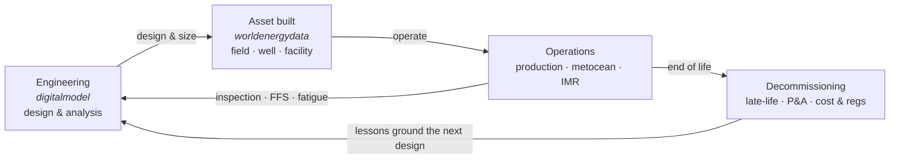
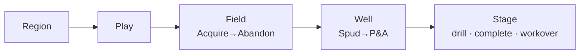
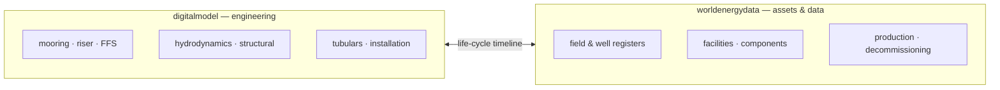

# digitalmodel

> *Everyday complex engineering — made deterministically simple.*

> digitalmodel is an engineering calculation library: physical-world analysis mapped clause by clause to
> industry codes and standards, with validation records, durable example workflows
> (`docs/registry/workflows.yaml` + `examples/workflows/`) and deterministic, standards-traceable reports
> (same input, same output, every time).

Engineering calculation library for offshore, subsea, and marine analysis. Single source of truth from standard clause to validated code.

**Dedicated to Mark Cerkovnik** -- Chief Engineer, mentor, and inspiration.

## Why this exists — the engineering ↔ asset circle

`digitalmodel` and `worldenergydata` are two halves of one loop.

- **digitalmodel** holds the engineering analysis code: mooring, riser, fitness-for-service, hydrodynamics, structural, tubulars and installation.
- **worldenergydata** holds public-source field, well and facility data across the life cycle.

Together they close a circle. Engineering designs an asset; it gets built and operated; operations feed back into engineering (inspection, fitness-for-service, fatigue re-assessment); at end of life it is decommissioned — itself an engineering problem — and the outcomes loop back as empirical priors for the next design. The **life-cycle timeline** is the shared spine: `worldenergydata` supplies each stage's real dates and assets, `digitalmodel` supplies each stage's engineering.



The same stage-gate timeline is **fractal** — one grammar that reads coherently from a whole region down to a single wellbore stage:



And the two repos meet at that timeline — each asset on a field page can show *what is possible via engineering*:



Live: [worldenergydata field life-cycle](https://vamseeachanta.github.io/worldenergydata/lifecycle/) · [digitalmodel engineering capabilities](https://vamseeachanta.github.io/digitalmodel/capabilities/)

This repo is the **engineering** half of that loop — the solvers that size, analyse and re-assess the assets.

## What This Is

A Python package of engineering calculations where every function traces to an international standard. Library-first: importable calculations with CLI convenience wrappers.

- 30 engineering disciplines (structural, subsea, hydrodynamics, cathodic protection, asset integrity, geotechnical, marine ops, and more)
- 7,355 public functions across 1,077 source files
- 42 standards fully implemented, 455 in capability map
- Dual traceability: code docstrings cite standard clauses + YAML manifests for CI validation

## Installation

### System prerequisites

A few transitive dependencies (notably `lxml`) need native compilation when a pre-built wheel is not available for your platform/Python combination. On Ubuntu/Debian, install the build toolchain and XML headers before `pip install`:

```bash
sudo apt-get install build-essential python3-dev libxml2-dev libxslt1-dev
```

Other Linux distros / macOS / Windows: install equivalents of those packages or use a pre-built `lxml` wheel. A follow-up issue tracks bumping `lxml` to a version with broader wheel coverage so this step is no longer required for most users.

```bash
pip install digitalmodel
```

Requires Python 3.10+. See [pyproject.toml](pyproject.toml) for full dependency list.

### Post-clone skill pointers

With a `workspace-hub` sibling containing the internal skills, inspect the
relative pointer recipe from the repository root:

```bash
bash scripts/setup-claude-skills.sh
```

For a different checkout layout, pass `--workspace-hub <checkout>`.
The command checks all three skill directories, then prints an idempotent JSON
recipe for the three symlinks and the dated propagation marker. A missing
sibling fails with a clone instruction before any file is written.

The default command plans files only. After inspecting the recipe, run
`bash scripts/setup-claude-skills.sh --apply` as the one-time installation step.
Existing matching symlinks are retained; conflicting entries fail before any
pointer is written. Worktree installation remains unverified under #2009;
the regression tests exercise creation in isolated fixtures.
The existing tracked `.codex/skills` and `.gemini/skills` symlinks address the
shared skill root, whereas the ignored Claude pointers address three internal
subdirectories. The asymmetry is retained deliberately because rebuilding ignored local
pointers does not require changing the existing tracked links. Regeneration
does not change their tracking policy or establish cross-platform link behaviour.

## Quick Start

```python
from digitalmodel.structural.fatigue import sn_curves
from digitalmodel.subsea.on_bottom_stability import dnv_rp_f109
from digitalmodel.cathodic_protection import dnv_rp_b401
```

## Key Modules

| Module | What It Does | Standards | Tests |
|--------|-------------|-----------|-------|
| structural/fatigue | S-N curves, rainflow counting, spectral fatigue | DNV-RP-C203, API RP 2A, BS 7608 (221 curves, 17 standards) | 808 |
| cathodic_protection | Anode sizing, coating breakdown, current demand | DNV-RP-B401, API RP 1632, ISO 15589-2 | 72 |
| subsea/on_bottom_stability | Pipeline stability on seabed | DNV-RP-F109 | 20 |
| structural/analysis | Wall thickness, member capacity | ASME B31.4, DNV-ST-F101, Eurocode 3 | -- |
| asset_integrity | Fitness-for-service assessment | API 579 Level 1/2/3, BS 7910 | -- |
| hydrodynamics | Wave spectra, RAO processing, diffraction | (825 functions, standards mapping in progress) | -- |
| solvers/orcaflex | OrcaFlex model generation and post-processing | -- | -- |
| power | Generator controls, microgrid EMS, protection relays | IEEE 1547, NFPA 110, IEEE C37.112 | 210+ |
| gis | CRS transforms, spatial queries, multi-format I/O | -- | -- |

For repo-wide current-state navigation, see [docs/maps/digitalmodel-operator-map.md](docs/maps/digitalmodel-operator-map.md). The canonical machine-readable routing registry is [docs/registry/module-routing.yaml](docs/registry/module-routing.yaml).

## Development Roadmap

See [ROADMAP.md](ROADMAP.md) for tiered development priorities driven by client project demand.

Current Tier 1 priorities:
- OrcaFlex subsea structural analysis -- advancing to production-grade workflow
- Cathodic protection maturity -- expanding test coverage and standard coverage

## Documentation

- [docs/README.md](docs/README.md) -- Canonical documentation entry point and common issue routing
- [ROADMAP.md](ROADMAP.md) -- Development priorities and tech debt
- [docs/vision/CALCULATIONS-VISION.md](docs/vision/CALCULATIONS-VISION.md) -- Ecosystem vision, current state, gap register
- [docs/maps/digitalmodel-operator-map.md](docs/maps/digitalmodel-operator-map.md) -- Canonical repo-wide operator map for source, tests, docs, and issue routing
- [docs/registry/module-routing.yaml](docs/registry/module-routing.yaml) -- Canonical machine-readable module routing registry
- [CHANGELOG.md](CHANGELOG.md) -- Release history
- [Demonstration pack retirement](docs/maintenance/demo-pack-retirement.md) -- Regression scope, report compatibility and a worked scan example

## CLI Tools

digitalmodel registers 27 CLI entry points. Run `digitalmodel --help` for the full list.

## Testing

```bash
cd digitalmodel
python -m pytest tests/ -x --tb=short -q
```

## Contributing

Lead developer: Vamsee Achanta ([email removed])

## License

MIT -- see [LICENSE](LICENSE)
