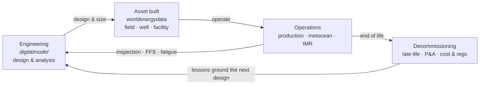
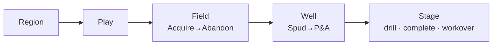
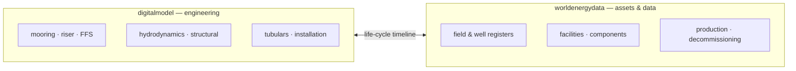

# digitalmodel

> *Everyday complex engineering — made deterministically simple.*

> digitalmodel is an engineering calculation library: physical-world analysis mapped clause by clause to
> industry codes and standards, with validation records, durable example workflows
> (`docs/registry/workflows.yaml` + `examples/workflows/`) and deterministic, standards-traceable reports
> (same input, same output, every time).

Engineering calculation library for offshore, subsea, and marine analysis. Single source of truth from standard clause to validated code.

**Dedicated to Mark Cerkovnik** -- Chief Engineer, mentor, and inspiration.

## Why this exists — the engineering ↔ asset circle

`digitalmodel` and `worldenergydata` are two halves of one loop.

- **digitalmodel** holds the engineering analysis code: mooring, riser, fitness-for-service, hydrodynamics, structural, tubulars and installation.
- **worldenergydata** holds public-source field, well and facility data across the life cycle.

Together they close a circle. Engineering designs an asset; it gets built and operated; operations feed back into engineering (inspection, fitness-for-service, fatigue re-assessment); at end of life it is decommissioned — itself an engineering problem — and the outcomes loop back as empirical priors for the next design. The **life-cycle timeline** is the shared spine: `worldenergydata` supplies each stage's real dates and assets, `digitalmodel` supplies each stage's engineering.



The same stage-gate timeline is **fractal** — one grammar that reads coherently from a whole region down to a single wellbore stage:



And the two repos meet at that timeline — each asset on a field page can show *what is possible via engineering*:



Live: [worldenergydata field life-cycle](https://vamseeachanta.github.io/worldenergydata/lifecycle/) · [digitalmodel engineering capabilities](https://vamseeachanta.github.io/digitalmodel/capabilities/)

This repo is the **engineering** half of that loop — the solvers that size, analyse and re-assess the assets.

## What This Is

A Python package of engineering calculations where every function traces to an international standard. Library-first: importable calculations with CLI convenience wrappers.

- 30 engineering disciplines (structural, subsea, hydrodynamics, cathodic protection, asset integrity, geotechnical, marine ops, and more)
- 7,355 public functions across 1,077 source files
- 42 standards fully implemented, 455 in capability map
- Dual traceability: code docstrings cite standard clauses + YAML manifests for CI validation

## Installation

### System prerequisites

A few transitive dependencies (notably `lxml`) need native compilation when a pre-built wheel is not available for your platform/Python combination. On Ubuntu/Debian, install the build toolchain and XML headers before `pip install`:

```bash
sudo apt-get install build-essential python3-dev libxml2-dev libxslt1-dev
```

Other Linux distros / macOS / Windows: install equivalents of those packages or use a pre-built `lxml` wheel. A follow-up issue tracks bumping `lxml` to a version with broader wheel coverage so this step is no longer required for most users.

```bash
pip install digitalmodel
```

Requires Python 3.10+. See [pyproject.toml](pyproject.toml) for full dependency list.

### Post-clone skill pointers

After cloning, run this one-time setup from the repository root. It requires
Bash, Python 3.10+ and a `workspace-hub` sibling with the
`.claude/skills/_internal/{guidelines,meta,workflows}` directories:

```bash
bash scripts/setup-claude-skills.sh
```

The command creates three relative symlinks under `.claude/skills/` and writes
`.ecosystem-propagated` with today's local date in `YYYYMMDD` format. All four
artifacts stay ignored by Git. Reruns retain matching links, repair stale links
and refresh the marker. Existing real files or directories at pointer paths
require manual review; setup checks for conflicts before writing any artifact.

For a different checkout layout, pass `--workspace-hub <checkout>`. Preview
without writing with `--dry-run`; the older `--apply` option remains supported.
If the shared skills are absent, setup exits with a clone instruction and leaves
existing artifacts unchanged. No shared checkout is cloned automatically.

The tracked `.codex/skills` and `.gemini/skills` symlinks deliberately address
the shared skill root. The ignored Claude links address its three internal
subdirectories and are regenerated locally; their different tracking policies
are retained. See the [setup guide and worked example](docs/skills/post-clone-setup.md)
for expected targets, conflict handling and platform limits.

## Quick Start

```python
from digitalmodel.structural.fatigue import sn_curves
from digitalmodel.subsea.on_bottom_stability import dnv_rp_f109
from digitalmodel.cathodic_protection import dnv_rp_b401
```

## Key Modules

| Module | What It Does | Standards | Tests |
|--------|-------------|-----------|-------|
| structural/fatigue | S-N curves, rainflow counting, spectral fatigue | DNV-RP-C203, API RP 2A, BS 7608 (221 curves, 17 standards) | 808 |
| cathodic_protection | Anode sizing, coating breakdown, current demand | DNV-RP-B401, API RP 1632, ISO 15589-2 | 72 |
| subsea/on_bottom_stability | Pipeline stability on seabed | DNV-RP-F109 | 20 |
| structural/analysis | Wall thickness, member capacity | ASME B31.4, DNV-ST-F101, Eurocode 3 | -- |
| asset_integrity | Fitness-for-service assessment | API 579 Level 1/2/3, BS 7910 | -- |
| hydrodynamics | Wave spectra, RAO processing, diffraction | (825 functions, standards mapping in progress) | -- |
| solvers/orcaflex | OrcaFlex model generation and post-processing | -- | -- |
| power | Generator controls, microgrid EMS, protection relays | IEEE 1547, NFPA 110, IEEE C37.112 | 210+ |
| gis | CRS transforms, spatial queries, multi-format I/O | -- | -- |

The [jacket and topside module analysis](docs/reports/modules/jacket_topside/README.md) documents independent geometry checks, zero-demand limits and unresolved capacity qualification.

For repo-wide current-state navigation, see [docs/maps/digitalmodel-operator-map.md](docs/maps/digitalmodel-operator-map.md). The canonical machine-readable routing registry is [docs/registry/module-routing.yaml](docs/registry/module-routing.yaml).

## Development Roadmap

See [ROADMAP.md](ROADMAP.md) for tiered development priorities driven by client project demand.

Current Tier 1 priorities:
- OrcaFlex subsea structural analysis -- advancing to production-grade workflow
- Cathodic protection maturity -- expanding test coverage and standard coverage

## Documentation

- [docs/README.md](docs/README.md) -- Canonical documentation entry point and common issue routing
- [ROADMAP.md](ROADMAP.md) -- Development priorities and tech debt
- [docs/vision/CALCULATIONS-VISION.md](docs/vision/CALCULATIONS-VISION.md) -- Ecosystem vision, current state, gap register
- [docs/maps/digitalmodel-operator-map.md](docs/maps/digitalmodel-operator-map.md) -- Canonical repo-wide operator map for source, tests, docs, and issue routing
- [docs/registry/module-routing.yaml](docs/registry/module-routing.yaml) -- Canonical machine-readable module routing registry
- [CHANGELOG.md](CHANGELOG.md) -- Release history
- [Demonstration pack retirement](docs/maintenance/demo-pack-retirement.md) -- Regression scope, report compatibility and a worked scan example

## CLI Tools

digitalmodel registers 27 CLI entry points. Run `digitalmodel --help` for the full list.

## Testing

```bash
cd digitalmodel
python -m pytest tests/ -x --tb=short -q
```

## Contributing

Lead developer: Vamsee Achanta ([email removed])

## License

MIT -- see [LICENSE](LICENSE)

<!-- repo-architecture:start -->
## Capability architecture and provenance

This drawing inventories 58 observed domain pages and 37 capability work declarations.
Evidence is reconciled with base revision `6581c271`; the branch does not merge that
revision. Acceptance checks run against that base with these documentation changes.
Three pages merged later are added at `38a71b86` without re-reconciling other entries.
Amber nodes have inline data or incomplete reproduction evidence. Solid arrows
show local production or routing; dotted arrows show licensed execution dependencies
or intended downstream integration, without asserting a live remote result.
Generators can emit embedded HTML and JSON as sibling outputs; an adjacent JSON file
is not assumed to be the page's input. The wall-thickness surface page explicitly
fetches its bounded JSON sidecar; the full study remains a generated prerequisite.
Page generation and upstream solver execution
are separate operations.

[Evidence inventory and worked example](docs/capability-map/repo-architecture.html) ·
[Machine-readable inventory](docs/capability-map/repo-architecture.json) ·
[Mermaid source](docs/capability-map/repo-architecture.mmd)

```mermaid
flowchart LR
  pages["GitHub Pages: configured docs/api root<br/>remote status NOT_EVALUATED"]
  hf["Hugging Face: ten table projections in seven dataset groups<br/>remote status NOT_EVALUATED"]
  web["aceengineer.com: canonical capabilities redirect configured<br/>downstream hydration NOT_EVALUATED"]
  tidy["scripts/hf/build_capability_datasets.py<br/>tidy JSON preparation; publication separate"]
  licenses["Licensed solve boundary<br/>OrcaFlex / OrcaWave: Windows solver execution<br/>AQWA: licensed execution<br/>Reading committed output does not require a solve"]
  retired["capabilities/api wrappers: absent in this snapshot<br/>work declarations retained in build_onepagers.py"]
  portal["docs/api/capabilities/index.html<br/>canonical redirect"]
  tidy --> hf
  pages --> portal
  portal --> web
  hf -.-> web
  subgraph g_artificial_lift["artificial-lift"]
    p0["docs/api/artificial-lift/dynacard-troubleshooting.html<br/>registered generator"]
    p0 --> pages
    sp0["scripts/capabilities/build_dynacard_troubleshooting.py<br/>src/digitalmodel/marine_ops/artificial_lift/dynacard/calculations.py<br/>src/digitalmodel/marine_ops/artificial_lift/dynacard/card_generators.py<br/>src/digitalmodel/marine_ops/artificial_lift/dynacard/diagnostics.py<br/>src/digitalmodel/marine_ops/artificial_lift/dynacard/example_cards.py<br/>src/digitalmodel/marine_ops/artificial_lift/dynacard/models.py<br/>src/digitalmodel/marine_ops/artificial_lift/dynacard/poc_settings.py<br/>src/digitalmodel/marine_ops/artificial_lift/dynacard/troubleshooting.py<br/>src/digitalmodel/marine_ops/artificial_lift/field_health.py"]
    sp0 --> p0
    ap0_0["docs/api/artificial-lift/dynacard-troubleshooting.json<br/>committed"]
    sp0 --> ap0_0
  end
  subgraph g_buckling["buckling"]
    p1["docs/api/buckling/ship-panel-buckling.html<br/>inline, no generator"]
    p1 --> pages
    p2["docs/api/buckling/ship-plate-buckling.html<br/>inline, no generator"]
    p2 --> pages
  end
  subgraph g_cfd["cfd"]
    p3["docs/api/cfd/cfd-runtime-estimator.html<br/>registered generator"]
    p3 --> pages
    sp3["scripts/capabilities/build_cfd_runtime_estimator.py<br/>direct calculation import not established"]
    sp3 --> p3
    p4["docs/api/cfd/cylinder-re100-verification.html<br/>external input or non-reproducible copy"]
    p4 --> pages
    p5["docs/api/cfd/dam-break-verification.html<br/>external input or non-reproducible copy"]
    p5 --> pages
    p53["docs/api/cfd/dual-tank-sloshing-cfd-study.html<br/>registered generator"]
    p53 --> pages
    sp53["scripts/capabilities/build_dual_tank_sloshing_study.py<br/>direct calculation import not established"]
    sp53 --> p53
    ip53_0["docs/api/cfd/data/dual_tank_cfd_evidence.json<br/>registered input"]
    ip53_0 --> sp53
    ip53_1["tests/hydrodynamics/test_utube_tank.py<br/>registered input"]
    ip53_1 --> sp53
    p6["docs/api/cfd/flat-plate-blasius-verification.html<br/>external input or non-reproducible copy"]
    p6 --> pages
    p7["docs/api/cfd/floating-body-decay-verification.html<br/>external input or non-reproducible copy"]
    p7 --> pages
    p55["docs/api/cfd/generic-hull-roll-screening.html<br/>registered generator"]
    p55 --> pages
    sp55["scripts/capabilities/build_generic_hull_screening.py<br/>direct calculation import not established"]
    sp55 --> p55
    ip55_0["src/digitalmodel/hydrodynamics/utube_tank.py<br/>registered input"]
    ip55_0 --> sp55
    ap55_0["docs/api/cfd/data/generic_hull_roll_screening.json<br/>committed"]
    sp55 --> ap55_0
    ap55_1["tests/hydrodynamics/test_generic_hull_screening.py<br/>committed"]
    sp55 --> ap55_1
    p8["docs/api/cfd/index.html<br/>inline, no generator"]
    p8 --> pages
    p9["docs/api/cfd/kcs-calm-water-resistance-verification.html<br/>external input or non-reproducible copy"]
    p9 --> pages
    p10["docs/api/cfd/kleefsman-impact-verification.html<br/>external input or non-reproducible copy"]
    p10 --> pages
    p11["docs/api/cfd/maccamy-fuchs-cylinder-verification.html<br/>registered generator"]
    p11 --> pages
    sp11["docs/api/cfd/report_build/build_maccamy_fuchs.py<br/>src/digitalmodel/solvers/openfoam/validation/maccamy_fuchs.py<br/>src/digitalmodel/solvers/openfoam/validation/wave_tank.py"]
    sp11 --> p11
    ip11_0["docs/api/cfd/cases/maccamy_fuchs/mf_results.json<br/>registered input"]
    ip11_0 --> sp11
    p12["docs/api/cfd/naca0012-airfoil-verification.html<br/>external input or non-reproducible copy"]
    p12 --> pages
    p13["docs/api/cfd/sloshing-cfd-study.html<br/>registered generator"]
    p13 --> pages
    sp13["scripts/capabilities/build_sloshing_cfd_showcase.py<br/>direct calculation import not established"]
    sp13 --> p13
    p14["docs/api/cfd/tank-sloshing-verification.html<br/>inline, no generator"]
    p14 --> pages
    p15["docs/api/cfd/turbulent-flat-plate-verification.html<br/>external input or non-reproducible copy"]
    p15 --> pages
    p16["docs/api/cfd/wave-excited-body-decay-verification.html<br/>external input or non-reproducible copy"]
    p16 --> pages
    p17["docs/api/cfd/wave-excited-body-rao-verification.html<br/>external input or non-reproducible copy"]
    p17 --> pages
    p18["docs/api/cfd/wave-excited-body-verification.html<br/>external input or non-reproducible copy"]
    p18 --> pages
    p19["docs/api/cfd/wave-tank-verification.html<br/>external input or non-reproducible copy"]
    p19 --> pages
  end
  subgraph g_corrosion["corrosion"]
    p20["docs/api/corrosion/galvanic-compatibility-explorer.html<br/>registered generator"]
    p20 --> pages
    sp20["scripts/corrosion/build_galvanic_explorer.py<br/>src/digitalmodel/corrosion/galvanic_screening.py"]
    sp20 --> p20
    ap20_0["docs/api/corrosion/galvanic-compatibility-explorer.json<br/>committed"]
    sp20 --> ap20_0
    ap20_0 --> tidy
  end
  subgraph g_drilling["drilling"]
    p21["docs/api/drilling/drilling-riser-operability-explorer.html<br/>registered generator"]
    p21 --> pages
    sp21["scripts/drilling_riser/build_operability_explorer.py<br/>src/digitalmodel/drilling_riser/__init__.py<br/>src/digitalmodel/drilling_riser/operability_screening.py<br/>src/digitalmodel/parametric/atlas.py"]
    sp21 --> p21
    ap21_0["docs/api/drilling/results.json<br/>committed"]
    sp21 --> ap21_0
    p22["docs/api/drilling/operability-monitor.html<br/>registered generator"]
    p22 --> pages
    sp22["scripts/drilling_riser/build_operability_monitor.py<br/>src/digitalmodel/decision_spine.py<br/>src/digitalmodel/drilling_riser/__init__.py<br/>src/digitalmodel/drilling_riser/drift_off.py<br/>src/digitalmodel/drilling_riser/envelope.py<br/>src/digitalmodel/drilling_riser/operability_screening.py<br/>src/digitalmodel/drilling_riser/response_correction.py<br/>src/digitalmodel/drilling_riser/telemetry_inputs.py<br/>src/digitalmodel/drilling_riser/twin_loop.py<br/>src/digitalmodel/parametric/atlas.py<br/>src/digitalmodel/subsea/mooring_analysis/models.py"]
    sp22 --> p22
    ap22_0["docs/api/drilling/operability-monitor.results.json<br/>committed"]
    sp22 --> ap22_0
  end
  subgraph g_ffs["ffs"]
    p23["docs/api/ffs/build-wave-2026-07.html<br/>inline, no generator"]
    p23 --> pages
    p24["docs/api/ffs/ffs-field-dashboard.html<br/>inline, no generator"]
    p24 --> pages
    p25["docs/api/ffs/ffs-showcase.html<br/>registered generator"]
    p25 --> pages
    sp25["examples/demos/asset_integrity/ffs_showcase.py<br/>src/digitalmodel/asset_integrity/assessment/__init__.py<br/>src/digitalmodel/asset_integrity/corroded_pipe.py<br/>src/digitalmodel/asset_integrity/dnv_rp_f101.py<br/>src/digitalmodel/structural/structural_analysis/models.py<br/>src/digitalmodel/structural/structural_analysis/plate_metal_loss_ffs.py"]
    sp25 --> p25
    ip25_0["examples/demos/asset_integrity/ffs_showcase.py<br/>registered input"]
    ip25_0 --> sp25
    p54["docs/api/ffs/pipeline-ffs-assessment.html<br/>registered generator"]
    p54 --> pages
    sp54["scripts/reporting/build_pipeline_ffs_report.py<br/>src/digitalmodel/asset_integrity/applicability.py<br/>src/digitalmodel/asset_integrity/assessment/__init__.py<br/>src/digitalmodel/asset_integrity/assessment/ffs_coordinator.py<br/>src/digitalmodel/asset_integrity/assessment/ffs_decision.py<br/>src/digitalmodel/asset_integrity/assessment/level2_engine.py<br/>src/digitalmodel/asset_integrity/assessment/measurement_sufficiency.py<br/>src/digitalmodel/asset_integrity/corroded_pipe.py<br/>src/digitalmodel/asset_integrity/pipeline_defect_screen.py<br/>src/digitalmodel/reporting/engine.py<br/>src/digitalmodel/reporting/provenance.py<br/>src/digitalmodel/reporting/spec.py<br/>src/digitalmodel/units.py"]
    sp54 --> p54
    ip54_0["examples/workflows/ffs-metal-loss/input.yml<br/>registered input"]
    ip54_0 --> sp54
    ip54_1["examples/workflows/pipeline-corroded-defect-screen/synthetic.yml<br/>registered input"]
    ip54_1 --> sp54
    ip54_2["examples/workflows/pipeline-ffs-assessment/assumptions.yml<br/>registered input"]
    ip54_2 --> sp54
    ip54_3["examples/workflows/pipeline-ffs-assessment/input.yml<br/>registered input"]
    ip54_3 --> sp54
    ip54_4["pyproject.toml<br/>registered input"]
    ip54_4 --> sp54
    ap54_0["docs/api/ffs/pipeline-ffs-assessment.manifest.json<br/>committed"]
    sp54 --> ap54_0
    ap54_1["docs/reports/pipeline-ffs-assessment.html<br/>committed"]
    sp54 --> ap54_1
    ap54_2["docs/reports/pipeline-ffs-assessment.manifest.json<br/>committed"]
    sp54 --> ap54_2
    p26["docs/api/ffs/riser-joint-acceptance-explorer.html<br/>registered generator"]
    p26 --> pages
    sp26["scripts/ffs/build_riser_joint_explorer.py<br/>src/digitalmodel/asset_integrity/riser_joint_ffs.py"]
    sp26 --> p26
  end
  subgraph g_hydro["hydro"]
    p27["docs/api/hydro/ocimf-coefficient-explorer.html<br/>external input or non-reproducible copy"]
    p27 --> pages
    p28["docs/api/hydro/passing-ship-benchmark.html<br/>external input or non-reproducible copy"]
    p28 --> pages
    p29["docs/api/hydro/rao-comparison/index.html<br/>external input or non-reproducible copy"]
    p29 --> pages
    licenses -.-> p29
    p30["docs/api/hydro/rudder-maneuvering-explorer.html<br/>inline, no generator"]
    p30 --> pages
    p56["docs/api/hydro/self-elevating-monitoring.html<br/>registered generator"]
    p56 --> pages
    sp56["scripts/capabilities/build_self_elevating_monitoring.py<br/>src/digitalmodel/marine_ops/self_elevating_monitoring.py"]
    sp56 --> p56
    ip56_0["pyproject.toml<br/>registered input"]
    ip56_0 --> sp56
    ip56_1["scripts/capabilities/build_self_elevating_monitoring.py<br/>registered input"]
    ip56_1 --> sp56
    ip56_2["scripts/capabilities/self_elevating_monitoring.html.template<br/>registered input"]
    ip56_2 --> sp56
    ip56_3["src/digitalmodel/marine_ops/self_elevating_monitoring.py<br/>registered input"]
    ip56_3 --> sp56
    p31["docs/api/hydro/short-horizon-motion-forecast.html<br/>inline, no generator"]
    p31 --> pages
    p32["docs/api/hydro/unit-box-benchmark/benchmark_amplitude.html<br/>external input or non-reproducible copy"]
    p32 --> pages
    licenses -.-> p32
    p33["docs/api/hydro/unit-box-benchmark/benchmark_combined.html<br/>external input or non-reproducible copy"]
    p33 --> pages
    licenses -.-> p33
    p34["docs/api/hydro/unit-box-benchmark/benchmark_heatmap.html<br/>external input or non-reproducible copy"]
    p34 --> pages
    licenses -.-> p34
    p35["docs/api/hydro/unit-box-benchmark/benchmark_phase.html<br/>external input or non-reproducible copy"]
    p35 --> pages
    licenses -.-> p35
    p36["docs/api/hydro/unit-box-benchmark/benchmark_report.html<br/>external input or non-reproducible copy"]
    p36 --> pages
    licenses -.-> p36
  end
  subgraph g_installation["installation"]
    p57["docs/api/installation/installation-forecast.html<br/>external input or non-reproducible copy"]
    p57 --> pages
    p37["docs/api/installation/installation-heading-explorer.html<br/>registered generator"]
    p37 --> pages
    sp37["scripts/capabilities/build_installation_heading_explorer.py<br/>direct calculation import not established"]
    sp37 --> p37
    ip37_0["scripts/capabilities/installation_heading/limits.json<br/>registered input"]
    ip37_0 --> sp37
    ip37_1["scripts/capabilities/installation_heading/page.html.template<br/>registered input"]
    ip37_1 --> sp37
    ip37_2["scripts/capabilities/installation_heading/revisions.json<br/>registered input"]
    ip37_2 --> sp37
    ap37_0["docs/api/installation/installation-heading-explorer.manifest.json<br/>committed"]
    sp37 --> ap37_0
  end
  subgraph g_orcaflex["orcaflex"]
    p38["docs/api/orcaflex/riser-mesh-sensitivity.html<br/>external input or non-reproducible copy"]
    p38 --> pages
    licenses -.-> p38
    p39["docs/api/orcaflex/riser-validation-report.html<br/>external input or non-reproducible copy"]
    p39 --> pages
    licenses -.-> p39
  end
  subgraph g_production["production"]
    p40["docs/api/production/scale-si-explorer.html<br/>registered generator"]
    p40 --> pages
    sp40["scripts/production_chemistry/build_scale_si_explorer.py<br/>src/digitalmodel/production_chemistry/scale_si.py"]
    sp40 --> p40
  end
  subgraph g_structural["structural"]
    p41["docs/api/structural/anchor-holding-explorer.html<br/>registered generator"]
    p41 --> pages
    sp41["scripts/capabilities/build_anchor_holding_explorer.py<br/>src/digitalmodel/geotechnical/anchors.py"]
    sp41 --> p41
    ap41_0["docs/api/structural/anchor-holding-explorer.json<br/>committed"]
    sp41 --> ap41_0
    ap41_0 --> tidy
    p42["docs/api/structural/cathodic-protection-explorer.html<br/>registered generator"]
    p42 --> pages
    sp42["scripts/capabilities/build_cathodic_protection_explorer.py<br/>src/digitalmodel/cathodic_protection/marine_structure_cp.py"]
    sp42 --> p42
    ap42_0["docs/api/structural/cathodic-protection-explorer.json<br/>committed"]
    sp42 --> ap42_0
    ap42_0 --> tidy
    p43["docs/api/structural/field-economics-explorer.html<br/>registered generator"]
    p43 --> pages
    sp43["scripts/capabilities/build_field_economics_explorer.py<br/>src/digitalmodel/field_development/economics.py"]
    sp43 --> p43
    ap43_0["docs/api/structural/field-economics-explorer.json<br/>committed"]
    sp43 --> ap43_0
    ap43_0 --> tidy
    p44["docs/api/structural/ipr-explorer.html<br/>registered generator"]
    p44 --> pages
    sp44["scripts/capabilities/build_ipr_explorer.py<br/>src/digitalmodel/production_engineering/ipr_models.py"]
    sp44 --> p44
    ap44_0["docs/api/structural/ipr-explorer.json<br/>committed"]
    sp44 --> ap44_0
    ap44_0 --> tidy
    p45["docs/api/structural/pore-pressure-explorer.html<br/>registered generator"]
    p45 --> pages
    sp45["scripts/capabilities/build_pore_pressure_explorer.py<br/>src/digitalmodel/well/drilling/pore_pressure.py"]
    sp45 --> p45
    ap45_0["docs/api/structural/pore-pressure-explorer.json<br/>committed"]
    sp45 --> ap45_0
    ap45_0 --> tidy
    p46["docs/api/structural/ship-resistance-explorer.html<br/>registered generator"]
    p46 --> pages
    sp46["scripts/capabilities/build_ship_resistance_explorer.py<br/>src/digitalmodel/naval_architecture/__init__.py"]
    sp46 --> p46
    ap46_0["docs/api/structural/ship-resistance-explorer.json<br/>committed"]
    sp46 --> ap46_0
    ap46_0 --> tidy
    p47["docs/api/structural/sloshing-explorer.html<br/>registered generator"]
    p47 --> pages
    sp47["scripts/capabilities/build_sloshing_explorer.py<br/>direct calculation import not established"]
    sp47 --> p47
    ap47_0["docs/api/structural/sloshing-explorer.json<br/>committed"]
    sp47 --> ap47_0
    p48["docs/api/structural/viv-explorer.html<br/>registered generator"]
    p48 --> pages
    sp48["scripts/capabilities/build_viv_explorer.py<br/>src/digitalmodel/subsea/viv_analysis/screening.py"]
    sp48 --> p48
    ap48_0["docs/api/structural/viv-explorer.json<br/>committed"]
    sp48 --> ap48_0
    ap48_0 --> tidy
    p49["docs/api/structural/wall-thickness-3d-explorer.html<br/>registered generator"]
    p49 --> pages
    sp49["scripts/capabilities/build_wall_thickness_3d_page.py<br/>direct calculation import not established"]
    sp49 --> p49
    ap49_0["docs/api/structural/wall-thickness-3d.json<br/>generated prerequisite"]
    rp49["scripts/capabilities/build_wall_thickness_3d.py"]
    rp49 --> ap49_0
    ap49_0 --> sp49
    ap49_0 --> tidy
    ap49_1["docs/api/structural/wall-thickness-3d-explorer.json<br/>committed"]
    sp49 --> ap49_1
    ap49_1 --> p49
    p50["docs/api/structural/wall-thickness-explorer.html<br/>registered generator"]
    p50 --> pages
    sp50["scripts/capabilities/build_wall_thickness_explorer.py<br/>src/digitalmodel/structural/analysis/wall_thickness.py"]
    sp50 --> p50
    ap50_0["docs/api/structural/wall-thickness-explorer.json<br/>committed"]
    sp50 --> ap50_0
    ap50_0 --> tidy
  end
  subgraph g_subsea["subsea"]
    p51["docs/api/subsea/offshore-cross-section-report.html<br/>inline, no generator"]
    p51 --> pages
  end
  subgraph g_well["well"]
    p52["docs/api/well/casing-design-explorer.html<br/>registered generator"]
    p52 --> pages
    sp52["scripts/capabilities/build_casing_design_explorer.py<br/>src/digitalmodel/well/tubulars/casing.py<br/>src/digitalmodel/well/tubulars/casing_design.py"]
    sp52 --> p52
    ap52_0["docs/api/well/casing-design-explorer.json<br/>committed"]
    sp52 --> ap52_0
  end
  subgraph declarations["Capability work declarations: inventory, not proof of execution"]
    c0["ffs-showcase"]
    c0 --> p25
    c1["ffs-field-dashboard"]
    c1 --> p24
    c2["riser-joint-acceptance"]
    c2 --> p26
    c3["buckling-plate"]
    c3 --> p2
    c4["buckling-panel"]
    c4 --> p1
    c5["rao-comparison"]
    c5 --> p29
    c6["unitbox-report"]
    c6 --> p36
    c7["unitbox-amplitude"]
    c7 --> p32
    c8["unitbox-phase"]
    c8 --> p35
    c9["unitbox-combined"]
    c9 --> p33
    c10["unitbox-heatmap"]
    c10 --> p34
    c11["ocimf"]
    c11 --> p27
    c12["passing-ship"]
    c12 --> p28
    c13["drilling-riser-operability"]
    c13 --> p21
    c14["drilling-riser-operability-monitor"]
    c14 --> p22
    c15["riser-validation"]
    c15 --> p39
    c16["riser-mesh"]
    c16 --> p38
    c17["subsea-xsection"]
    c17 --> p51
    c18["installation-hlv-a<br/>src/digitalmodel/installation/installation_pamphlet<br/>source target; lineage NOT_EVALUATED"]
    c19["rudder-explorer"]
    c19 --> p30
    c20["rudder-database<br/>src/digitalmodel/naval_architecture/data/rudder_database.yml<br/>source target; lineage NOT_EVALUATED"]
    c21["diffraction-deck-prep<br/>examples/workflows/aqwa-diffraction-deck-prep<br/>source target; lineage NOT_EVALUATED"]
    c22["vessel-suitability<br/>data/vessels<br/>source target; lineage NOT_EVALUATED"]
    c23["container-utilization<br/>examples/structural/offshore_container_utilization<br/>source target; lineage NOT_EVALUATED"]
    c24["wind-sizing<br/>examples/workflows/floating-wind-sizing<br/>source target; lineage NOT_EVALUATED"]
    c25["wind-economics<br/>examples/workflows/floating-wind-economics<br/>source target; lineage NOT_EVALUATED"]
    c26["mooring-resilience<br/>examples/marine_ops/mooring_resilience<br/>source target; lineage NOT_EVALUATED"]
    c27["short-horizon-motion-forecast"]
    c27 --> p31
    c28["dynacard-troubleshooting"]
    c28 --> p0
    c29["casing-design"]
    c29 --> p52
    c30["dynacard-field-health<br/>examples/workflows/artificial-lift-field-health<br/>source target; lineage NOT_EVALUATED"]
    c31["galvanic-explorer"]
    c31 --> p20
    c32["scale-si-explorer"]
    c32 --> p40
    c33["wall-thickness-explorer"]
    c33 --> p50
    c34["sloshing-explorer"]
    c34 --> p47
    c35["cathodic-protection-explorer"]
    c35 --> p42
    c36["wall-thickness-load-explorer"]
    c36 --> p49
  end
  classDef gap fill:#fff1d6,stroke:#875800,color:#191919
  classDef licensed fill:#fce4e4,stroke:#9c2020,color:#191919
  class licenses licensed
  class p1,p2,p4,p5,p6,p7,p8,p9,p10,p12,p14,p15,p16,p17,p18,p19,p23,p24,p27,p28,p29,p30,p31,p32,p33,p34,p35,p36,p38,p39,p51,p57 gap
```
<!-- repo-architecture:end -->
