<!-- Generated by examples/domains/artificial_lift/build_dynacard_worked_examples.py; do not edit. -->
# Ten worked dynacard examples

Ten worked examples relate a surface card to its pump card, analysis and diagnosis. Every surface card is synthesised from a public diagnostic plate shape, not measured. The pump-card interpretation, physical scale and illustrative well are ASSUMED. All classifier calls are HYPOTHESIS.

The [results document](results.json) is the reporting source for this README and all CSVs. Sample numbers are zero-based. Each card retains its own sample index; where counts differ, the shorter card's columns are blank rather than interpolated. Browser inputs contain exactly position_in and load_lbf. Positions have four decimals and loads two.

## How to read each example

The surface card is what a dynamometer records at the polished rod; the pump card is the load and travel at the plunger after the wave equation removes rod weight, rod stretch and rod dynamics. Fillage is effective plunger travel divided by gross travel. Fluid load is the upstroke mean load minus the downstroke mean load. The matrix shows the shape-only model probability for each condition on the pump card computed from the synthesised surface card.

| Example preview | Example preview |
| --- | --- |
| [Example 1: Normal operation](#example-1-normal-operation)<br><a href="#example-1-normal-operation">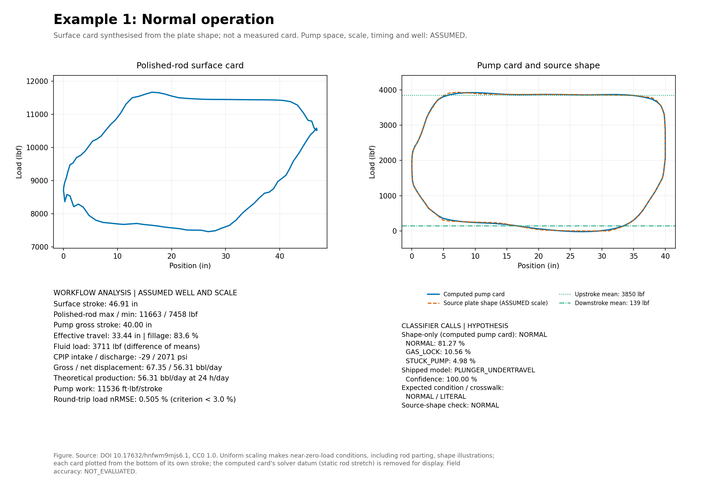</a> | [Example 2: Insufficient supply](#example-2-insufficient-supply)<br><a href="#example-2-insufficient-supply">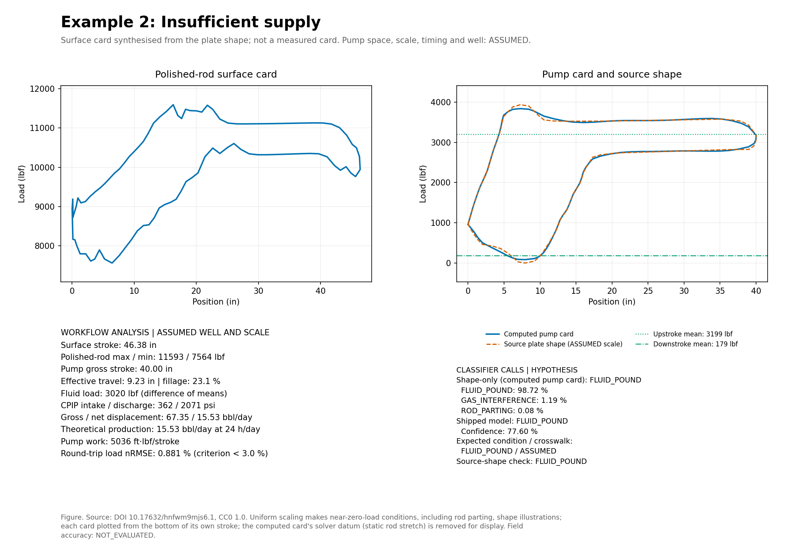</a> |
| [Example 3: Gas interference](#example-3-gas-interference)<br><a href="#example-3-gas-interference">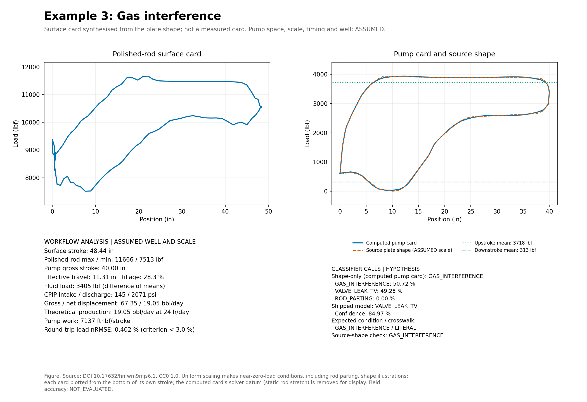</a> | [Example 4: Rod parting](#example-4-rod-parting)<br><a href="#example-4-rod-parting">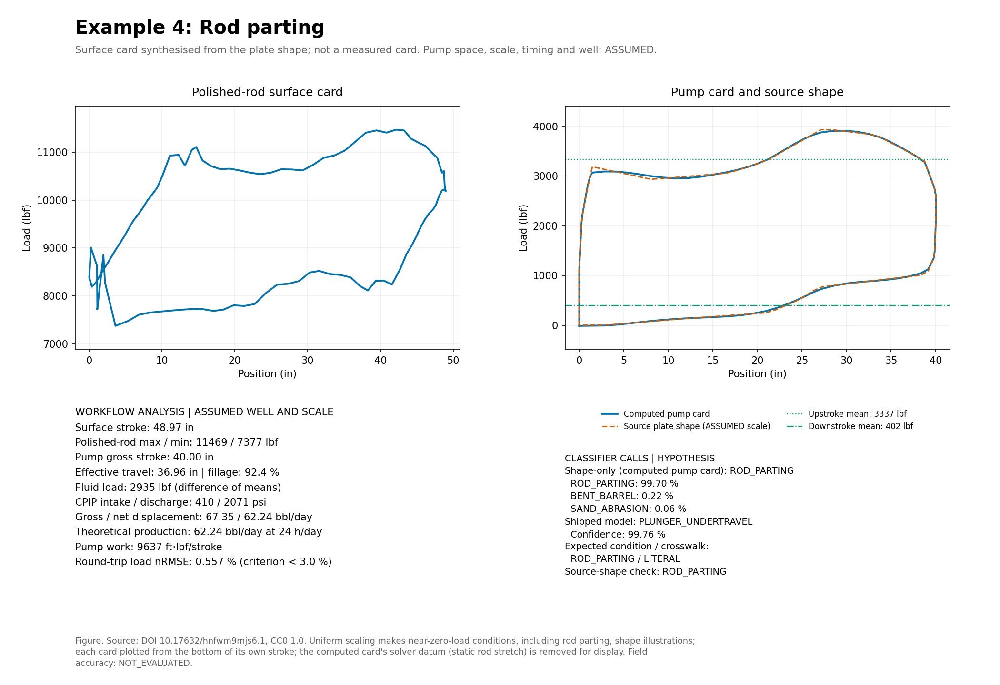</a> |
| [Example 5: Tagging up](#example-5-tagging-up)<br><a href="#example-5-tagging-up">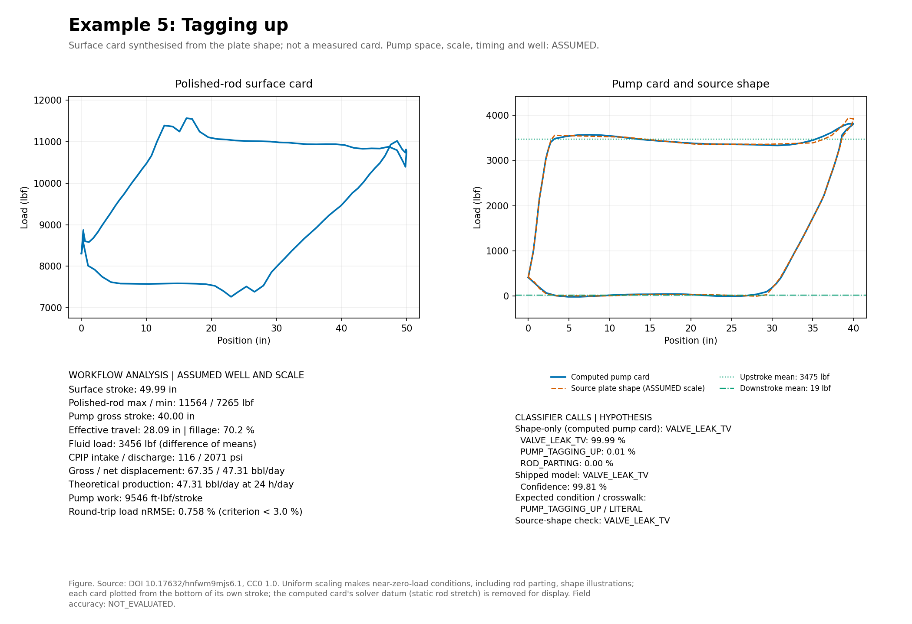</a> | [Example 6: Tagging down](#example-6-tagging-down)<br><a href="#example-6-tagging-down">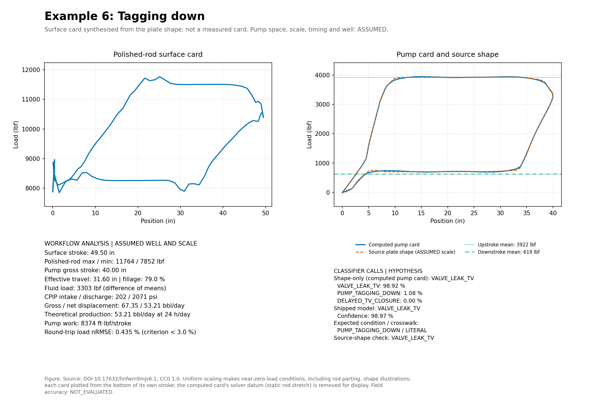</a> |
| [Example 7: Traveling valve leakage](#example-7-traveling-valve-leakage)<br><a href="#example-7-traveling-valve-leakage">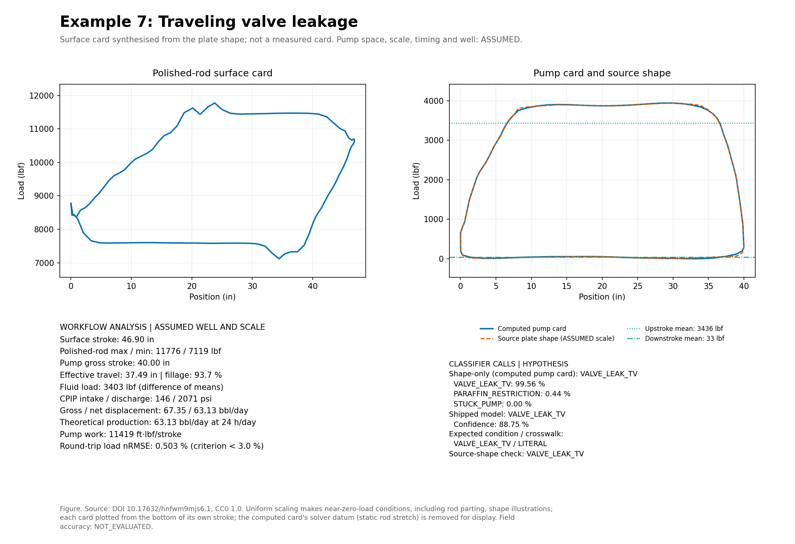</a> | [Example 8: Standing valve leakage](#example-8-standing-valve-leakage)<br><a href="#example-8-standing-valve-leakage">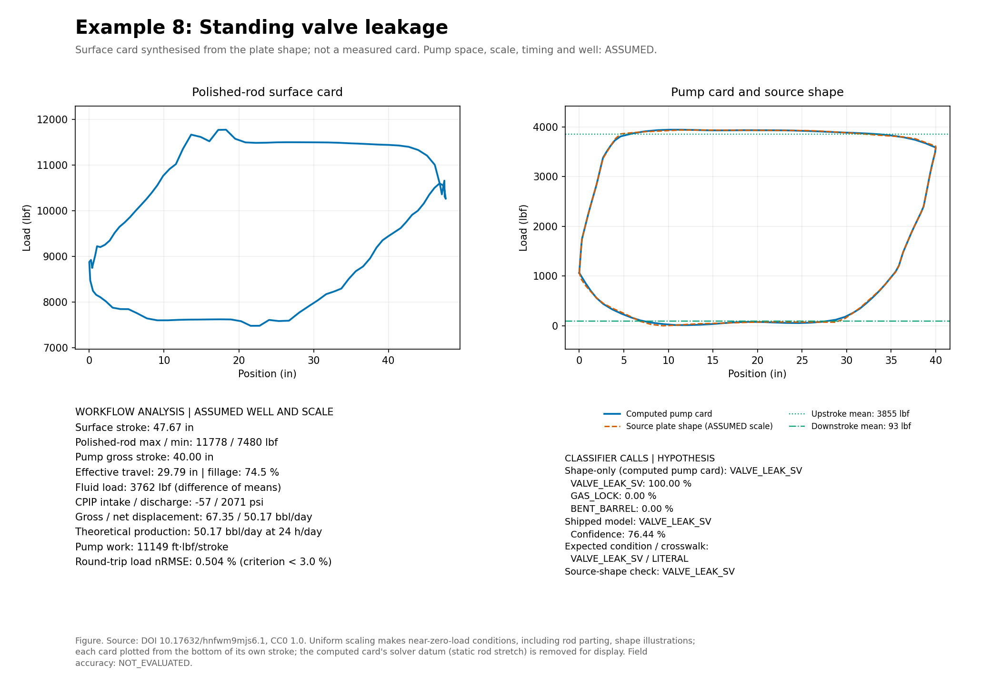</a> |
| [Example 9: Plunger out of barrel](#example-9-plunger-out-of-barrel)<br><a href="#example-9-plunger-out-of-barrel">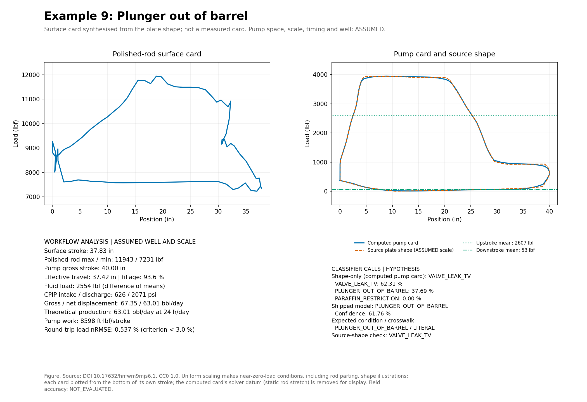</a> | [Example 10: Sand production](#example-10-sand-production)<br><a href="#example-10-sand-production">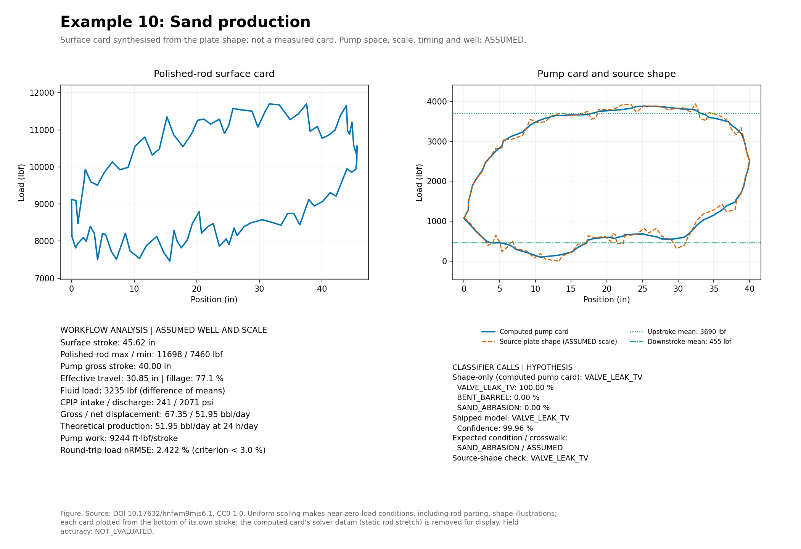</a> |

Gallery. Ten surface-card and computed-pump-card examples.

Computed-card shape-only matches 6/10 expected modes; the shipped model matches 4/10; source-shape consistency is 5/8 literal and 6/10 including ASSUMED crosswalks, against the [recorded plate score](../plate-classifier-score.md) of 5/8 and 6/10. No rows differ from the source-shape call. The observed round-trip load nRMSE range is 0.402–2.422 %, below the 3.0 % inverse-consistency test limit.

Every analysis runs on the surface card at its published CSV precision (0.0001 in, 0.01 lbf), so rerunning a published CSV reproduces the stored values. Fluid load and fillage step with the detected corner samples: the unrounded synthesised cards give fluid loads differing by up to 34 lbf and the same fillage to one decimal, with corners moved in examples 3, 4, 9. Differences of this size between two tools reading the same card are expected unless both use identical input digits.

Computed CPIP below zero: example 1: -28.764 psi; example 8: -57.485 psi. These values are retained as reported by the module; physical intake pressure is not established without a consistent dimensioned fluid-pressure basis and measured cards.

| Example | Condition | Crosswalk | Pump stroke (in) | Fillage (%) | Fluid load (lbf) | Shipped HYPOTHESIS | Shape-only HYPOTHESIS (computed pump card) | Round-trip nRMSE (%) |
| --- | --- | --- | --- | --- | --- | --- | --- | --- |
| 1 | Normal operation | LITERAL | 40.00 | 83.6 | 3711 | PLUNGER_UNDERTRAVEL | NORMAL | 0.505 |
| 2 | Insufficient supply | ASSUMED | 40.00 | 23.1 | 3020 | FLUID_POUND | FLUID_POUND | 0.881 |
| 3 | Gas interference | LITERAL | 40.00 | 28.3 | 3405 | VALVE_LEAK_TV | GAS_INTERFERENCE | 0.402 |
| 4 | Rod parting | LITERAL | 40.00 | 92.4 | 2935 | PLUNGER_UNDERTRAVEL | ROD_PARTING | 0.557 |
| 5 | Tagging up | LITERAL | 40.00 | 70.2 | 3456 | VALVE_LEAK_TV | VALVE_LEAK_TV | 0.758 |
| 6 | Tagging down | LITERAL | 40.00 | 79.0 | 3303 | VALVE_LEAK_TV | VALVE_LEAK_TV | 0.435 |
| 7 | Traveling valve leakage | LITERAL | 40.00 | 93.7 | 3403 | VALVE_LEAK_TV | VALVE_LEAK_TV | 0.503 |
| 8 | Standing valve leakage | LITERAL | 40.00 | 74.5 | 3762 | VALVE_LEAK_SV | VALVE_LEAK_SV | 0.504 |
| 9 | Plunger out of barrel | LITERAL | 40.00 | 93.6 | 2554 | PLUNGER_OUT_OF_BARREL | VALVE_LEAK_TV | 0.537 |
| 10 | Sand production | ASSUMED | 40.00 | 77.1 | 3235 | VALVE_LEAK_TV | VALVE_LEAK_TV | 2.422 |

Table 1. Computed values under the ASSUMED basis; calls are hypotheses.

## Diagnostics matrix

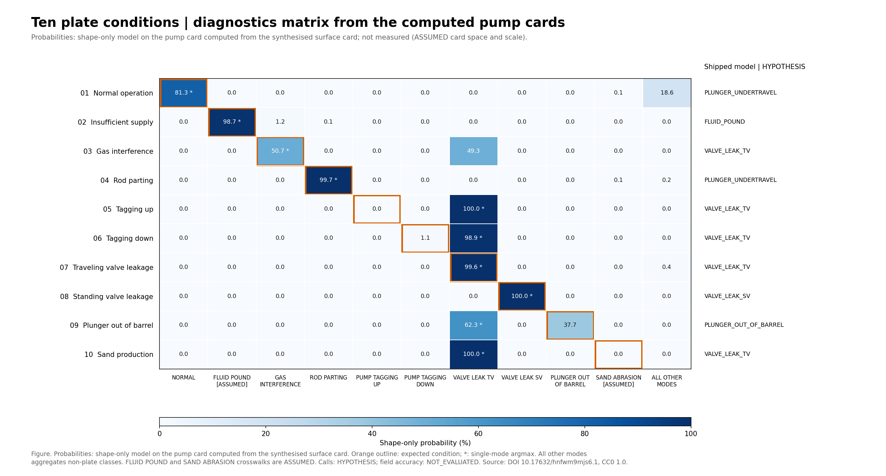

Figure 1. Probabilities are from the shape-only model on the pump card computed from the synthesised surface card. An outline marks the expected cell; a star marks the single-mode argmax (located in the aggregate column when outside the plate modes). The right-hand column reports the shipped-model HYPOTHESIS.

| Example | NORMAL (%) | FLUID_POUND [ASSUMED] (%) | GAS_INTERFERENCE (%) | ROD_PARTING (%) | PUMP_TAGGING_UP (%) | PUMP_TAGGING_DOWN (%) | VALVE_LEAK_TV (%) | VALVE_LEAK_SV (%) | PLUNGER_OUT_OF_BARREL (%) | SAND_ABRASION [ASSUMED] (%) | All other modes (%) | Shipped HYPOTHESIS |
| --- | --- | --- | --- | --- | --- | --- | --- | --- | --- | --- | --- | --- |
| 1 | 81.27 | 0.00 | 0.00 | 0.02 | 0.00 | 0.00 | 0.00 | 0.00 | 0.00 | 0.07 | 18.64 | PLUNGER_UNDERTRAVEL |
| 2 | 0.00 | 98.72 | 1.19 | 0.08 | 0.00 | 0.00 | 0.00 | 0.00 | 0.00 | 0.00 | 0.00 | FLUID_POUND |
| 3 | 0.00 | 0.00 | 50.72 | 0.00 | 0.00 | 0.00 | 49.28 | 0.00 | 0.00 | 0.00 | 0.00 | VALVE_LEAK_TV |
| 4 | 0.00 | 0.00 | 0.00 | 99.70 | 0.00 | 0.00 | 0.00 | 0.00 | 0.00 | 0.06 | 0.24 | PLUNGER_UNDERTRAVEL |
| 5 | 0.00 | 0.00 | 0.00 | 0.00 | 0.01 | 0.00 | 99.99 | 0.00 | 0.00 | 0.00 | 0.00 | VALVE_LEAK_TV |
| 6 | 0.00 | 0.00 | 0.00 | 0.00 | 0.00 | 1.08 | 98.92 | 0.00 | 0.00 | 0.00 | 0.00 | VALVE_LEAK_TV |
| 7 | 0.00 | 0.00 | 0.00 | 0.00 | 0.00 | 0.00 | 99.56 | 0.00 | 0.00 | 0.00 | 0.44 | VALVE_LEAK_TV |
| 8 | 0.00 | 0.00 | 0.00 | 0.00 | 0.00 | 0.00 | 0.00 | 100.00 | 0.00 | 0.00 | 0.00 | VALVE_LEAK_SV |
| 9 | 0.00 | 0.00 | 0.00 | 0.00 | 0.00 | 0.00 | 62.31 | 0.00 | 37.69 | 0.00 | 0.00 | PLUNGER_OUT_OF_BARREL |
| 10 | 0.00 | 0.00 | 0.00 | 0.00 | 0.00 | 0.00 | 100.00 | 0.00 | 0.00 | 0.00 | 0.00 | VALVE_LEAK_TV |

Table 2. Shape-only model probabilities (%) on the pump card computed from the synthesised surface card; the final probability column sums all modes without a plate-condition column. Display rounding may affect sums.

The [matrix CSV](diagnostics-matrix.csv) also records expected modes, argmax calls and both equality flags. [Vector figure](diagnostics-matrix.svg).

## Example 1: Normal operation


Figure 2. Synthesised surface card, not a measured card; computed pump card overlaid with the ASSUMED scaled source shape; each card plotted from the bottom of its own stroke; the computed card's solver datum (static rod stretch) is removed for display.

| Quantity | Unit | Value |
| --- | --- | --- |
| Surface stroke | in | 46.91 |
| Peak polished-rod load | lbf | 11663 |
| Minimum polished-rod load | lbf | 7458 |
| Pump gross stroke | in | 40.00 |
| Effective pump travel | in | 33.44 |
| Pump fillage | % | 83.6 |
| Fluid load (upstroke minus downstroke mean) | lbf | 3711 |
| Upstroke mean load | lbf | 3850 |
| Downstroke mean load | lbf | 139 |
| CPIP intake pressure | psi | -28.8 |
| CPIP discharge pressure | psi | 2071.4 |
| CPIP module fluid density | lb/ft³ | 58.651 |
| CPIP tubing gradient | psi/ft | 0.4070 |
| Gross displacement | bbl/day | 67.4 |
| Net displacement | bbl/day | 56.3 |
| Theoretical production | bbl/day | 56.3 |
| Reported ASSUMED pump efficiency | % | 100.0 |
| ASSUMED runtime | h/day | 24.0 |
| Pump maximum load | lbf | 3924 |
| Pump minimum load | lbf | -19 |
| Pump-card work per stroke | ft·lbf | 11536 |
| Polished-rod work per stroke | ft·lbf | 11587 |
| Production runtime source | category | card |
| Buckling compression flag | boolean | False |
| Round-trip load nRMSE | % | 0.505 |
| Round-trip stroke difference | in | 0.00 |

Table 3. Example 1 workflow results; numeric zero is a calculated value, not missing evidence.

- **HYPOTHESIS — shape-only model, computed pump card:** `NORMAL`. Top three: NORMAL 81.27 %; GAS_LOCK 10.56 %; STUCK_PUMP 4.98 %.
- **HYPOTHESIS — shipped model:** `PLUNGER_UNDERTRAVEL`; confidence 100.00 %. Differential: PLUNGER_UNDERTRAVEL 100.00 %; NORMAL 0.00 %; PARAFFIN_RESTRICTION 0.00 %.
- Expected condition / crosswalk: `NORMAL` / **LITERAL**.
- Source-shape check: `NORMAL`.

Buckling criterion: Computed minimum pump load < -500 lbf; compression flag only. Full sinusoidal/helical buckling analysis is not exposed by this workflow; rod_buckling is null. Detailed stability is NOT_EVALUATED.

Source: [DOI 10.17632/hnfwm9mjs6.1](https://data.mendeley.com/datasets/hnfwm9mjs6/1); [original workbook](https://data.mendeley.com/public-files/datasets/hnfwm9mjs6/files/53140ff5-85c3-40d1-b900-364a892e692e/file_downloaded); sheet `工况正常`; CC0 1.0; retrieved 2026-10-11.

[Paired card CSV](example-01-normal-operation.csv) · [Browser surface-card CSV](example-01-normal-operation-surface-card.csv) · [Vector figure](example-01-normal-operation.svg).

## Example 2: Insufficient supply


Figure 3. Synthesised surface card, not a measured card; computed pump card overlaid with the ASSUMED scaled source shape; each card plotted from the bottom of its own stroke; the computed card's solver datum (static rod stretch) is removed for display.

| Quantity | Unit | Value |
| --- | --- | --- |
| Surface stroke | in | 46.38 |
| Peak polished-rod load | lbf | 11593 |
| Minimum polished-rod load | lbf | 7564 |
| Pump gross stroke | in | 40.00 |
| Effective pump travel | in | 9.23 |
| Pump fillage | % | 23.1 |
| Fluid load (upstroke minus downstroke mean) | lbf | 3020 |
| Upstroke mean load | lbf | 3199 |
| Downstroke mean load | lbf | 179 |
| CPIP intake pressure | psi | 362.5 |
| CPIP discharge pressure | psi | 2071.4 |
| CPIP module fluid density | lb/ft³ | 58.651 |
| CPIP tubing gradient | psi/ft | 0.4070 |
| Gross displacement | bbl/day | 67.4 |
| Net displacement | bbl/day | 15.5 |
| Theoretical production | bbl/day | 15.5 |
| Reported ASSUMED pump efficiency | % | 100.0 |
| ASSUMED runtime | h/day | 24.0 |
| Pump maximum load | lbf | 3839 |
| Pump minimum load | lbf | 85 |
| Pump-card work per stroke | ft·lbf | 5036 |
| Polished-rod work per stroke | ft·lbf | 5095 |
| Production runtime source | category | card |
| Buckling compression flag | boolean | False |
| Round-trip load nRMSE | % | 0.881 |
| Round-trip stroke difference | in | 0.00 |

Table 4. Example 2 workflow results; numeric zero is a calculated value, not missing evidence.

- **HYPOTHESIS — shape-only model, computed pump card:** `FLUID_POUND`. Top three: FLUID_POUND 98.72 %; GAS_INTERFERENCE 1.19 %; ROD_PARTING 0.08 %.
- **HYPOTHESIS — shipped model:** `FLUID_POUND`; confidence 77.60 %. Differential: FLUID_POUND 77.60 %; PLUNGER_UNDERTRAVEL 22.18 %; GAS_INTERFERENCE 0.23 %.
- Expected condition / crosswalk: `FLUID_POUND` / **ASSUMED**.
- Source-shape check: `FLUID_POUND`.

Buckling criterion: Computed minimum pump load < -500 lbf; compression flag only. Full sinusoidal/helical buckling analysis is not exposed by this workflow; rod_buckling is null. Detailed stability is NOT_EVALUATED.

Source: [DOI 10.17632/hnfwm9mjs6.1](https://data.mendeley.com/datasets/hnfwm9mjs6/1); [original workbook](https://data.mendeley.com/public-files/datasets/hnfwm9mjs6/files/53140ff5-85c3-40d1-b900-364a892e692e/file_downloaded); sheet `供液不足`; CC0 1.0; retrieved 2026-10-11.

[Paired card CSV](example-02-insufficient-supply.csv) · [Browser surface-card CSV](example-02-insufficient-supply-surface-card.csv) · [Vector figure](example-02-insufficient-supply.svg).

## Example 3: Gas interference


Figure 4. Synthesised surface card, not a measured card; computed pump card overlaid with the ASSUMED scaled source shape; each card plotted from the bottom of its own stroke; the computed card's solver datum (static rod stretch) is removed for display.

| Quantity | Unit | Value |
| --- | --- | --- |
| Surface stroke | in | 48.44 |
| Peak polished-rod load | lbf | 11666 |
| Minimum polished-rod load | lbf | 7513 |
| Pump gross stroke | in | 40.00 |
| Effective pump travel | in | 11.31 |
| Pump fillage | % | 28.3 |
| Fluid load (upstroke minus downstroke mean) | lbf | 3405 |
| Upstroke mean load | lbf | 3718 |
| Downstroke mean load | lbf | 313 |
| CPIP intake pressure | psi | 144.9 |
| CPIP discharge pressure | psi | 2071.4 |
| CPIP module fluid density | lb/ft³ | 58.651 |
| CPIP tubing gradient | psi/ft | 0.4070 |
| Gross displacement | bbl/day | 67.4 |
| Net displacement | bbl/day | 19.0 |
| Theoretical production | bbl/day | 19.0 |
| Reported ASSUMED pump efficiency | % | 100.0 |
| ASSUMED runtime | h/day | 24.0 |
| Pump maximum load | lbf | 3939 |
| Pump minimum load | lbf | 30 |
| Pump-card work per stroke | ft·lbf | 7137 |
| Polished-rod work per stroke | ft·lbf | 7186 |
| Production runtime source | category | card |
| Buckling compression flag | boolean | False |
| Round-trip load nRMSE | % | 0.402 |
| Round-trip stroke difference | in | 0.00 |

Table 5. Example 3 workflow results; numeric zero is a calculated value, not missing evidence.

- **HYPOTHESIS — shape-only model, computed pump card:** `GAS_INTERFERENCE`. Top three: GAS_INTERFERENCE 50.72 %; VALVE_LEAK_TV 49.28 %; ROD_PARTING 0.00 %.
- **HYPOTHESIS — shipped model:** `VALVE_LEAK_TV`; confidence 84.97 %. Differential: VALVE_LEAK_TV 84.97 %; GAS_INTERFERENCE 14.18 %; PLUNGER_UNDERTRAVEL 0.85 %.
- Expected condition / crosswalk: `GAS_INTERFERENCE` / **LITERAL**.
- Source-shape check: `GAS_INTERFERENCE`.

Buckling criterion: Computed minimum pump load < -500 lbf; compression flag only. Full sinusoidal/helical buckling analysis is not exposed by this workflow; rod_buckling is null. Detailed stability is NOT_EVALUATED.

Source: [DOI 10.17632/hnfwm9mjs6.1](https://data.mendeley.com/datasets/hnfwm9mjs6/1); [original workbook](https://data.mendeley.com/public-files/datasets/hnfwm9mjs6/files/53140ff5-85c3-40d1-b900-364a892e692e/file_downloaded); sheet `气体影响`; CC0 1.0; retrieved 2026-10-11.

[Paired card CSV](example-03-gas-interference.csv) · [Browser surface-card CSV](example-03-gas-interference-surface-card.csv) · [Vector figure](example-03-gas-interference.svg).

## Example 4: Rod parting


Figure 5. Synthesised surface card, not a measured card; computed pump card overlaid with the ASSUMED scaled source shape; each card plotted from the bottom of its own stroke; the computed card's solver datum (static rod stretch) is removed for display.

| Quantity | Unit | Value |
| --- | --- | --- |
| Surface stroke | in | 48.97 |
| Peak polished-rod load | lbf | 11469 |
| Minimum polished-rod load | lbf | 7377 |
| Pump gross stroke | in | 40.00 |
| Effective pump travel | in | 36.96 |
| Pump fillage | % | 92.4 |
| Fluid load (upstroke minus downstroke mean) | lbf | 2935 |
| Upstroke mean load | lbf | 3337 |
| Downstroke mean load | lbf | 402 |
| CPIP intake pressure | psi | 410.4 |
| CPIP discharge pressure | psi | 2071.4 |
| CPIP module fluid density | lb/ft³ | 58.651 |
| CPIP tubing gradient | psi/ft | 0.4070 |
| Gross displacement | bbl/day | 67.4 |
| Net displacement | bbl/day | 62.2 |
| Theoretical production | bbl/day | 62.2 |
| Reported ASSUMED pump efficiency | % | 100.0 |
| ASSUMED runtime | h/day | 24.0 |
| Pump maximum load | lbf | 3916 |
| Pump minimum load | lbf | -13 |
| Pump-card work per stroke | ft·lbf | 9637 |
| Polished-rod work per stroke | ft·lbf | 9688 |
| Production runtime source | category | card |
| Buckling compression flag | boolean | False |
| Round-trip load nRMSE | % | 0.557 |
| Round-trip stroke difference | in | 0.00 |

Table 6. Example 4 workflow results; numeric zero is a calculated value, not missing evidence.

- **HYPOTHESIS — shape-only model, computed pump card:** `ROD_PARTING`. Top three: ROD_PARTING 99.70 %; BENT_BARREL 0.22 %; SAND_ABRASION 0.06 %.
- **HYPOTHESIS — shipped model:** `PLUNGER_UNDERTRAVEL`; confidence 99.76 %. Differential: PLUNGER_UNDERTRAVEL 99.76 %; VALVE_LEAK_SV 0.21 %; BENT_BARREL 0.03 %.
- Expected condition / crosswalk: `ROD_PARTING` / **LITERAL**.
- Source-shape check: `ROD_PARTING`.

Buckling criterion: Computed minimum pump load < -500 lbf; compression flag only. Full sinusoidal/helical buckling analysis is not exposed by this workflow; rod_buckling is null. Detailed stability is NOT_EVALUATED.

Source: [DOI 10.17632/hnfwm9mjs6.1](https://data.mendeley.com/datasets/hnfwm9mjs6/1); [original workbook](https://data.mendeley.com/public-files/datasets/hnfwm9mjs6/files/53140ff5-85c3-40d1-b900-364a892e692e/file_downloaded); sheet `抽油杆断脱`; CC0 1.0; retrieved 2026-10-11.

[Paired card CSV](example-04-rod-parting.csv) · [Browser surface-card CSV](example-04-rod-parting-surface-card.csv) · [Vector figure](example-04-rod-parting.svg).

## Example 5: Tagging up


Figure 6. Synthesised surface card, not a measured card; computed pump card overlaid with the ASSUMED scaled source shape; each card plotted from the bottom of its own stroke; the computed card's solver datum (static rod stretch) is removed for display.

| Quantity | Unit | Value |
| --- | --- | --- |
| Surface stroke | in | 49.99 |
| Peak polished-rod load | lbf | 11564 |
| Minimum polished-rod load | lbf | 7265 |
| Pump gross stroke | in | 40.00 |
| Effective pump travel | in | 28.09 |
| Pump fillage | % | 70.2 |
| Fluid load (upstroke minus downstroke mean) | lbf | 3456 |
| Upstroke mean load | lbf | 3475 |
| Downstroke mean load | lbf | 19 |
| CPIP intake pressure | psi | 115.7 |
| CPIP discharge pressure | psi | 2071.4 |
| CPIP module fluid density | lb/ft³ | 58.651 |
| CPIP tubing gradient | psi/ft | 0.4070 |
| Gross displacement | bbl/day | 67.4 |
| Net displacement | bbl/day | 47.3 |
| Theoretical production | bbl/day | 47.3 |
| Reported ASSUMED pump efficiency | % | 100.0 |
| ASSUMED runtime | h/day | 24.0 |
| Pump maximum load | lbf | 3811 |
| Pump minimum load | lbf | -15 |
| Pump-card work per stroke | ft·lbf | 9546 |
| Polished-rod work per stroke | ft·lbf | 9599 |
| Production runtime source | category | card |
| Buckling compression flag | boolean | False |
| Round-trip load nRMSE | % | 0.758 |
| Round-trip stroke difference | in | -0.00 |

Table 7. Example 5 workflow results; numeric zero is a calculated value, not missing evidence.

- **HYPOTHESIS — shape-only model, computed pump card:** `VALVE_LEAK_TV`. Top three: VALVE_LEAK_TV 99.99 %; PUMP_TAGGING_UP 0.01 %; ROD_PARTING 0.00 %.
- **HYPOTHESIS — shipped model:** `VALVE_LEAK_TV`; confidence 99.81 %. Differential: VALVE_LEAK_TV 99.81 %; PUMP_TAGGING_UP 0.18 %; PLUNGER_UNDERTRAVEL 0.00 %.
- Expected condition / crosswalk: `PUMP_TAGGING_UP` / **LITERAL**.
- Source-shape check: `VALVE_LEAK_TV`.

Buckling criterion: Computed minimum pump load < -500 lbf; compression flag only. Full sinusoidal/helical buckling analysis is not exposed by this workflow; rod_buckling is null. Detailed stability is NOT_EVALUATED.

Source: [DOI 10.17632/hnfwm9mjs6.1](https://data.mendeley.com/datasets/hnfwm9mjs6/1); [original workbook](https://data.mendeley.com/public-files/datasets/hnfwm9mjs6/files/53140ff5-85c3-40d1-b900-364a892e692e/file_downloaded); sheet `上碰泵`; CC0 1.0; retrieved 2026-10-11.

[Paired card CSV](example-05-tagging-up.csv) · [Browser surface-card CSV](example-05-tagging-up-surface-card.csv) · [Vector figure](example-05-tagging-up.svg).

## Example 6: Tagging down


Figure 7. Synthesised surface card, not a measured card; computed pump card overlaid with the ASSUMED scaled source shape; each card plotted from the bottom of its own stroke; the computed card's solver datum (static rod stretch) is removed for display.

| Quantity | Unit | Value |
| --- | --- | --- |
| Surface stroke | in | 49.50 |
| Peak polished-rod load | lbf | 11764 |
| Minimum polished-rod load | lbf | 7852 |
| Pump gross stroke | in | 40.00 |
| Effective pump travel | in | 31.60 |
| Pump fillage | % | 79.0 |
| Fluid load (upstroke minus downstroke mean) | lbf | 3303 |
| Upstroke mean load | lbf | 3922 |
| Downstroke mean load | lbf | 619 |
| CPIP intake pressure | psi | 202.4 |
| CPIP discharge pressure | psi | 2071.4 |
| CPIP module fluid density | lb/ft³ | 58.651 |
| CPIP tubing gradient | psi/ft | 0.4070 |
| Gross displacement | bbl/day | 67.4 |
| Net displacement | bbl/day | 53.2 |
| Theoretical production | bbl/day | 53.2 |
| Reported ASSUMED pump efficiency | % | 100.0 |
| ASSUMED runtime | h/day | 24.0 |
| Pump maximum load | lbf | 3949 |
| Pump minimum load | lbf | -13 |
| Pump-card work per stroke | ft·lbf | 8374 |
| Polished-rod work per stroke | ft·lbf | 8425 |
| Production runtime source | category | card |
| Buckling compression flag | boolean | False |
| Round-trip load nRMSE | % | 0.435 |
| Round-trip stroke difference | in | 0.00 |

Table 8. Example 6 workflow results; numeric zero is a calculated value, not missing evidence.

- **HYPOTHESIS — shape-only model, computed pump card:** `VALVE_LEAK_TV`. Top three: VALVE_LEAK_TV 98.92 %; PUMP_TAGGING_DOWN 1.08 %; DELAYED_TV_CLOSURE 0.00 %.
- **HYPOTHESIS — shipped model:** `VALVE_LEAK_TV`; confidence 98.97 %. Differential: VALVE_LEAK_TV 98.97 %; DELAYED_TV_CLOSURE 0.95 %; PLUNGER_UNDERTRAVEL 0.04 %.
- Expected condition / crosswalk: `PUMP_TAGGING_DOWN` / **LITERAL**.
- Source-shape check: `VALVE_LEAK_TV`.

Buckling criterion: Computed minimum pump load < -500 lbf; compression flag only. Full sinusoidal/helical buckling analysis is not exposed by this workflow; rod_buckling is null. Detailed stability is NOT_EVALUATED.

Source: [DOI 10.17632/hnfwm9mjs6.1](https://data.mendeley.com/datasets/hnfwm9mjs6/1); [original workbook](https://data.mendeley.com/public-files/datasets/hnfwm9mjs6/files/53140ff5-85c3-40d1-b900-364a892e692e/file_downloaded); sheet `下碰泵`; CC0 1.0; retrieved 2026-10-11.

[Paired card CSV](example-06-tagging-down.csv) · [Browser surface-card CSV](example-06-tagging-down-surface-card.csv) · [Vector figure](example-06-tagging-down.svg).

## Example 7: Traveling valve leakage


Figure 8. Synthesised surface card, not a measured card; computed pump card overlaid with the ASSUMED scaled source shape; each card plotted from the bottom of its own stroke; the computed card's solver datum (static rod stretch) is removed for display.

| Quantity | Unit | Value |
| --- | --- | --- |
| Surface stroke | in | 46.90 |
| Peak polished-rod load | lbf | 11776 |
| Minimum polished-rod load | lbf | 7119 |
| Pump gross stroke | in | 40.00 |
| Effective pump travel | in | 37.49 |
| Pump fillage | % | 93.7 |
| Fluid load (upstroke minus downstroke mean) | lbf | 3403 |
| Upstroke mean load | lbf | 3436 |
| Downstroke mean load | lbf | 33 |
| CPIP intake pressure | psi | 145.9 |
| CPIP discharge pressure | psi | 2071.4 |
| CPIP module fluid density | lb/ft³ | 58.651 |
| CPIP tubing gradient | psi/ft | 0.4070 |
| Gross displacement | bbl/day | 67.4 |
| Net displacement | bbl/day | 63.1 |
| Theoretical production | bbl/day | 63.1 |
| Reported ASSUMED pump efficiency | % | 100.0 |
| ASSUMED runtime | h/day | 24.0 |
| Pump maximum load | lbf | 3942 |
| Pump minimum load | lbf | 1 |
| Pump-card work per stroke | ft·lbf | 11419 |
| Polished-rod work per stroke | ft·lbf | 11474 |
| Production runtime source | category | card |
| Buckling compression flag | boolean | False |
| Round-trip load nRMSE | % | 0.503 |
| Round-trip stroke difference | in | 0.00 |

Table 9. Example 7 workflow results; numeric zero is a calculated value, not missing evidence.

- **HYPOTHESIS — shape-only model, computed pump card:** `VALVE_LEAK_TV`. Top three: VALVE_LEAK_TV 99.56 %; PARAFFIN_RESTRICTION 0.44 %; STUCK_PUMP 0.00 %.
- **HYPOTHESIS — shipped model:** `VALVE_LEAK_TV`; confidence 88.75 %. Differential: VALVE_LEAK_TV 88.75 %; PLUNGER_UNDERTRAVEL 11.05 %; PARAFFIN_RESTRICTION 0.20 %.
- Expected condition / crosswalk: `VALVE_LEAK_TV` / **LITERAL**.
- Source-shape check: `VALVE_LEAK_TV`.

Buckling criterion: Computed minimum pump load < -500 lbf; compression flag only. Full sinusoidal/helical buckling analysis is not exposed by this workflow; rod_buckling is null. Detailed stability is NOT_EVALUATED.

Source: [DOI 10.17632/hnfwm9mjs6.1](https://data.mendeley.com/datasets/hnfwm9mjs6/1); [original workbook](https://data.mendeley.com/public-files/datasets/hnfwm9mjs6/files/53140ff5-85c3-40d1-b900-364a892e692e/file_downloaded); sheet `游动阀漏失`; CC0 1.0; retrieved 2026-10-11.

[Paired card CSV](example-07-traveling-valve-leakage.csv) · [Browser surface-card CSV](example-07-traveling-valve-leakage-surface-card.csv) · [Vector figure](example-07-traveling-valve-leakage.svg).

## Example 8: Standing valve leakage


Figure 9. Synthesised surface card, not a measured card; computed pump card overlaid with the ASSUMED scaled source shape; each card plotted from the bottom of its own stroke; the computed card's solver datum (static rod stretch) is removed for display.

| Quantity | Unit | Value |
| --- | --- | --- |
| Surface stroke | in | 47.67 |
| Peak polished-rod load | lbf | 11778 |
| Minimum polished-rod load | lbf | 7480 |
| Pump gross stroke | in | 40.00 |
| Effective pump travel | in | 29.79 |
| Pump fillage | % | 74.5 |
| Fluid load (upstroke minus downstroke mean) | lbf | 3762 |
| Upstroke mean load | lbf | 3855 |
| Downstroke mean load | lbf | 93 |
| CPIP intake pressure | psi | -57.5 |
| CPIP discharge pressure | psi | 2071.4 |
| CPIP module fluid density | lb/ft³ | 58.651 |
| CPIP tubing gradient | psi/ft | 0.4070 |
| Gross displacement | bbl/day | 67.4 |
| Net displacement | bbl/day | 50.2 |
| Theoretical production | bbl/day | 50.2 |
| Reported ASSUMED pump efficiency | % | 100.0 |
| ASSUMED runtime | h/day | 24.0 |
| Pump maximum load | lbf | 3942 |
| Pump minimum load | lbf | 14 |
| Pump-card work per stroke | ft·lbf | 11149 |
| Polished-rod work per stroke | ft·lbf | 11198 |
| Production runtime source | category | card |
| Buckling compression flag | boolean | False |
| Round-trip load nRMSE | % | 0.504 |
| Round-trip stroke difference | in | 0.00 |

Table 10. Example 8 workflow results; numeric zero is a calculated value, not missing evidence.

- **HYPOTHESIS — shape-only model, computed pump card:** `VALVE_LEAK_SV`. Top three: VALVE_LEAK_SV 100.00 %; GAS_LOCK 0.00 %; BENT_BARREL 0.00 %.
- **HYPOTHESIS — shipped model:** `VALVE_LEAK_SV`; confidence 76.44 %. Differential: VALVE_LEAK_SV 76.44 %; PLUNGER_UNDERTRAVEL 23.56 %; PUMP_TAGGING_DOWN 0.00 %.
- Expected condition / crosswalk: `VALVE_LEAK_SV` / **LITERAL**.
- Source-shape check: `VALVE_LEAK_SV`.

Buckling criterion: Computed minimum pump load < -500 lbf; compression flag only. Full sinusoidal/helical buckling analysis is not exposed by this workflow; rod_buckling is null. Detailed stability is NOT_EVALUATED.

Source: [DOI 10.17632/hnfwm9mjs6.1](https://data.mendeley.com/datasets/hnfwm9mjs6/1); [original workbook](https://data.mendeley.com/public-files/datasets/hnfwm9mjs6/files/53140ff5-85c3-40d1-b900-364a892e692e/file_downloaded); sheet `固定阀漏失`; CC0 1.0; retrieved 2026-10-11.

[Paired card CSV](example-08-standing-valve-leakage.csv) · [Browser surface-card CSV](example-08-standing-valve-leakage-surface-card.csv) · [Vector figure](example-08-standing-valve-leakage.svg).

## Example 9: Plunger out of barrel


Figure 10. Synthesised surface card, not a measured card; computed pump card overlaid with the ASSUMED scaled source shape; each card plotted from the bottom of its own stroke; the computed card's solver datum (static rod stretch) is removed for display.

| Quantity | Unit | Value |
| --- | --- | --- |
| Surface stroke | in | 37.83 |
| Peak polished-rod load | lbf | 11943 |
| Minimum polished-rod load | lbf | 7231 |
| Pump gross stroke | in | 40.00 |
| Effective pump travel | in | 37.42 |
| Pump fillage | % | 93.6 |
| Fluid load (upstroke minus downstroke mean) | lbf | 2554 |
| Upstroke mean load | lbf | 2607 |
| Downstroke mean load | lbf | 53 |
| CPIP intake pressure | psi | 626.1 |
| CPIP discharge pressure | psi | 2071.4 |
| CPIP module fluid density | lb/ft³ | 58.651 |
| CPIP tubing gradient | psi/ft | 0.4070 |
| Gross displacement | bbl/day | 67.4 |
| Net displacement | bbl/day | 63.0 |
| Theoretical production | bbl/day | 63.0 |
| Reported ASSUMED pump efficiency | % | 100.0 |
| ASSUMED runtime | h/day | 24.0 |
| Pump maximum load | lbf | 3950 |
| Pump minimum load | lbf | 8 |
| Pump-card work per stroke | ft·lbf | 8598 |
| Polished-rod work per stroke | ft·lbf | 8645 |
| Production runtime source | category | card |
| Buckling compression flag | boolean | False |
| Round-trip load nRMSE | % | 0.537 |
| Round-trip stroke difference | in | 0.00 |

Table 11. Example 9 workflow results; numeric zero is a calculated value, not missing evidence.

- **HYPOTHESIS — shape-only model, computed pump card:** `VALVE_LEAK_TV`. Top three: VALVE_LEAK_TV 62.31 %; PLUNGER_OUT_OF_BARREL 37.69 %; PARAFFIN_RESTRICTION 0.00 %.
- **HYPOTHESIS — shipped model:** `PLUNGER_OUT_OF_BARREL`; confidence 61.76 %. Differential: PLUNGER_OUT_OF_BARREL 61.76 %; VALVE_LEAK_TV 38.11 %; PLUNGER_UNDERTRAVEL 0.12 %.
- Expected condition / crosswalk: `PLUNGER_OUT_OF_BARREL` / **LITERAL**.
- Source-shape check: `VALVE_LEAK_TV`.

Buckling criterion: Computed minimum pump load < -500 lbf; compression flag only. Full sinusoidal/helical buckling analysis is not exposed by this workflow; rod_buckling is null. Detailed stability is NOT_EVALUATED.

Source: [DOI 10.17632/hnfwm9mjs6.1](https://data.mendeley.com/datasets/hnfwm9mjs6/1); [original workbook](https://data.mendeley.com/public-files/datasets/hnfwm9mjs6/files/53140ff5-85c3-40d1-b900-364a892e692e/file_downloaded); sheet `活塞脱出工作筒`; CC0 1.0; retrieved 2026-10-11.

[Paired card CSV](example-09-plunger-out-of-barrel.csv) · [Browser surface-card CSV](example-09-plunger-out-of-barrel-surface-card.csv) · [Vector figure](example-09-plunger-out-of-barrel.svg).

## Example 10: Sand production


Figure 11. Synthesised surface card, not a measured card; computed pump card overlaid with the ASSUMED scaled source shape; each card plotted from the bottom of its own stroke; the computed card's solver datum (static rod stretch) is removed for display.

| Quantity | Unit | Value |
| --- | --- | --- |
| Surface stroke | in | 45.62 |
| Peak polished-rod load | lbf | 11698 |
| Minimum polished-rod load | lbf | 7460 |
| Pump gross stroke | in | 40.00 |
| Effective pump travel | in | 30.85 |
| Pump fillage | % | 77.1 |
| Fluid load (upstroke minus downstroke mean) | lbf | 3235 |
| Upstroke mean load | lbf | 3690 |
| Downstroke mean load | lbf | 455 |
| CPIP intake pressure | psi | 241.0 |
| CPIP discharge pressure | psi | 2071.4 |
| CPIP module fluid density | lb/ft³ | 58.651 |
| CPIP tubing gradient | psi/ft | 0.4070 |
| Gross displacement | bbl/day | 67.4 |
| Net displacement | bbl/day | 52.0 |
| Theoretical production | bbl/day | 52.0 |
| Reported ASSUMED pump efficiency | % | 100.0 |
| ASSUMED runtime | h/day | 24.0 |
| Pump maximum load | lbf | 3881 |
| Pump minimum load | lbf | 101 |
| Pump-card work per stroke | ft·lbf | 9244 |
| Polished-rod work per stroke | ft·lbf | 9289 |
| Production runtime source | category | card |
| Buckling compression flag | boolean | False |
| Round-trip load nRMSE | % | 2.422 |
| Round-trip stroke difference | in | 0.00 |

Table 12. Example 10 workflow results; numeric zero is a calculated value, not missing evidence.

- **HYPOTHESIS — shape-only model, computed pump card:** `VALVE_LEAK_TV`. Top three: VALVE_LEAK_TV 100.00 %; BENT_BARREL 0.00 %; SAND_ABRASION 0.00 %.
- **HYPOTHESIS — shipped model:** `VALVE_LEAK_TV`; confidence 99.96 %. Differential: VALVE_LEAK_TV 99.96 %; PLUNGER_UNDERTRAVEL 0.04 %; BENT_BARREL 0.00 %.
- Expected condition / crosswalk: `SAND_ABRASION` / **ASSUMED**.
- Source-shape check: `VALVE_LEAK_TV`.

Buckling criterion: Computed minimum pump load < -500 lbf; compression flag only. Full sinusoidal/helical buckling analysis is not exposed by this workflow; rod_buckling is null. Detailed stability is NOT_EVALUATED.

Source: [DOI 10.17632/hnfwm9mjs6.1](https://data.mendeley.com/datasets/hnfwm9mjs6/1); [original workbook](https://data.mendeley.com/public-files/datasets/hnfwm9mjs6/files/53140ff5-85c3-40d1-b900-364a892e692e/file_downloaded); sheet `出砂`; CC0 1.0; retrieved 2026-10-11.

[Paired card CSV](example-10-sand-production.csv) · [Browser surface-card CSV](example-10-sand-production-surface-card.csv) · [Vector figure](example-10-sand-production.svg).

## Basis and assumptions

| Item | Status | Value | Reason |
| --- | --- | --- | --- |
| `well.api14` | ASSUMED | `"PLATE-EXAMPLE"` | Illustrative design values; no measured well is represented. Rod order is surface first; lengths ft, diameters in, weights lb/ft, moduli psi. |
| `well.spm` | ASSUMED | `6.42` | Same ASSUMED well basis. |
| `well.fluid_density` | ASSUMED | `63.237` | Same ASSUMED well basis. |
| `well.pump.diameter` | ASSUMED | `1.5` | Same ASSUMED well basis. |
| `well.pump.depth` | ASSUMED | `4844.0` | Same ASSUMED well basis. |
| `well.input_params.strokes_per_minute` | ASSUMED | `6.42` | Same ASSUMED well basis. |
| `well.input_params.tubing_pressure` | ASSUMED | `100.0` | Same ASSUMED well basis. |
| `well.rod_string[0].diameter` | ASSUMED | `0.875` | Same ASSUMED well basis. |
| `well.rod_string[0].length` | ASSUMED | `1400.0` | Same ASSUMED well basis. |
| `well.rod_string[0].weight_per_foot` | ASSUMED | `2.224` | Same ASSUMED well basis. |
| `well.rod_string[0].modulus_of_elasticity` | ASSUMED | `30500000.0` | Same ASSUMED well basis. |
| `well.rod_string[1].diameter` | ASSUMED | `0.75` | Same ASSUMED well basis. |
| `well.rod_string[1].length` | ASSUMED | `3350.0` | Same ASSUMED well basis. |
| `well.rod_string[1].weight_per_foot` | ASSUMED | `1.634` | Same ASSUMED well basis. |
| `well.rod_string[1].modulus_of_elasticity` | ASSUMED | `30500000.0` | Same ASSUMED well basis. |
| `resolved_context_defaults.api14` | ASSUMED | `"PLATE-EXAMPLE"` | All unspecified context, rod, pump and surface-unit fields retain model defaults; no survey or well test was supplied. |
| `resolved_context_defaults.rod_string[0].diameter` | ASSUMED | `0.875` | Same ASSUMED resolved_context_defaults basis. |
| `resolved_context_defaults.rod_string[0].length` | ASSUMED | `1400.0` | Same ASSUMED resolved_context_defaults basis. |
| `resolved_context_defaults.rod_string[0].count` | ASSUMED | `1` | Same ASSUMED resolved_context_defaults basis. |
| `resolved_context_defaults.rod_string[0].modulus_of_elasticity` | ASSUMED | `30500000.0` | Same ASSUMED resolved_context_defaults basis. |
| `resolved_context_defaults.rod_string[0].density` | ASSUMED | `490.0` | Same ASSUMED resolved_context_defaults basis. |
| `resolved_context_defaults.rod_string[0].speed_of_sound` | ASSUMED | `16300.0` | Same ASSUMED resolved_context_defaults basis. |
| `resolved_context_defaults.rod_string[0].damping_factor` | ASSUMED | `0.0` | Same ASSUMED resolved_context_defaults basis. |
| `resolved_context_defaults.rod_string[0].weight_per_foot` | ASSUMED | `2.224` | Same ASSUMED resolved_context_defaults basis. |
| `resolved_context_defaults.rod_string[0].minimum_tensile` | ASSUMED | `115000` | Same ASSUMED resolved_context_defaults basis. |
| `resolved_context_defaults.rod_string[0].grade` | ASSUMED | `"KD"` | Same ASSUMED resolved_context_defaults basis. |
| `resolved_context_defaults.rod_string[0].manufacturer` | ASSUMED | `"Generic"` | Same ASSUMED resolved_context_defaults basis. |
| `resolved_context_defaults.rod_string[1].diameter` | ASSUMED | `0.75` | Same ASSUMED resolved_context_defaults basis. |
| `resolved_context_defaults.rod_string[1].length` | ASSUMED | `3350.0` | Same ASSUMED resolved_context_defaults basis. |
| `resolved_context_defaults.rod_string[1].count` | ASSUMED | `1` | Same ASSUMED resolved_context_defaults basis. |
| `resolved_context_defaults.rod_string[1].modulus_of_elasticity` | ASSUMED | `30500000.0` | Same ASSUMED resolved_context_defaults basis. |
| `resolved_context_defaults.rod_string[1].density` | ASSUMED | `490.0` | Same ASSUMED resolved_context_defaults basis. |
| `resolved_context_defaults.rod_string[1].speed_of_sound` | ASSUMED | `16300.0` | Same ASSUMED resolved_context_defaults basis. |
| `resolved_context_defaults.rod_string[1].damping_factor` | ASSUMED | `0.0` | Same ASSUMED resolved_context_defaults basis. |
| `resolved_context_defaults.rod_string[1].weight_per_foot` | ASSUMED | `1.634` | Same ASSUMED resolved_context_defaults basis. |
| `resolved_context_defaults.rod_string[1].minimum_tensile` | ASSUMED | `115000` | Same ASSUMED resolved_context_defaults basis. |
| `resolved_context_defaults.rod_string[1].grade` | ASSUMED | `"KD"` | Same ASSUMED resolved_context_defaults basis. |
| `resolved_context_defaults.rod_string[1].manufacturer` | ASSUMED | `"Generic"` | Same ASSUMED resolved_context_defaults basis. |
| `resolved_context_defaults.pump.diameter` | ASSUMED | `1.5` | Same ASSUMED resolved_context_defaults basis. |
| `resolved_context_defaults.pump.depth` | ASSUMED | `4844.0` | Same ASSUMED resolved_context_defaults basis. |
| `resolved_context_defaults.pump.efficiency` | ASSUMED | `1.0` | Same ASSUMED resolved_context_defaults basis. |
| `resolved_context_defaults.surface_unit.manufacturer` | ASSUMED | `"Generic"` | Same ASSUMED resolved_context_defaults basis. |
| `resolved_context_defaults.surface_unit.unit_type` | ASSUMED | `"Conventional"` | Same ASSUMED resolved_context_defaults basis. |
| `resolved_context_defaults.surface_unit.stroke_length` | ASSUMED | `0.0` | Same ASSUMED resolved_context_defaults basis. |
| `resolved_context_defaults.surface_unit.gear_box_rating` | ASSUMED | `0.0` | Same ASSUMED resolved_context_defaults basis. |
| `resolved_context_defaults.surface_unit.structural_imbalance` | ASSUMED | `0.0` | Same ASSUMED resolved_context_defaults basis. |
| `resolved_context_defaults.surface_unit.counterbalance_moment` | ASSUMED | `0.0` | Same ASSUMED resolved_context_defaults basis. |
| `resolved_context_defaults.surface_unit.geometry` | ASSUMED | `"C. Clockwise"` | Same ASSUMED resolved_context_defaults basis. |
| `resolved_context_defaults.surface_unit.dimensional_a` | ASSUMED | `0.0` | Same ASSUMED resolved_context_defaults basis. |
| `resolved_context_defaults.surface_unit.dimensional_c` | ASSUMED | `0.0` | Same ASSUMED resolved_context_defaults basis. |
| `resolved_context_defaults.surface_unit.dimensional_i` | ASSUMED | `0.0` | Same ASSUMED resolved_context_defaults basis. |
| `resolved_context_defaults.surface_unit.dimensional_k` | ASSUMED | `0.0` | Same ASSUMED resolved_context_defaults basis. |
| `resolved_context_defaults.surface_unit.dimensional_p` | ASSUMED | `0.0` | Same ASSUMED resolved_context_defaults basis. |
| `resolved_context_defaults.surface_unit.radius` | ASSUMED | `0.0` | Same ASSUMED resolved_context_defaults basis. |
| `resolved_context_defaults.surface_unit.phase_angle` | ASSUMED | `0.0` | Same ASSUMED resolved_context_defaults basis. |
| `resolved_context_defaults.surface_unit.beam_rating` | ASSUMED | `0.0` | Same ASSUMED resolved_context_defaults basis. |
| `resolved_context_defaults.surface_unit.max_stroke_length` | ASSUMED | `0.0` | Same ASSUMED resolved_context_defaults basis. |
| `resolved_context_defaults.motor.model` | ASSUMED | `""` | Same ASSUMED resolved_context_defaults basis. |
| `resolved_context_defaults.motor.prime_mover_type` | ASSUMED | `""` | Same ASSUMED resolved_context_defaults basis. |
| `resolved_context_defaults.motor.horsepower` | ASSUMED | `0.0` | Same ASSUMED resolved_context_defaults basis. |
| `resolved_context_defaults.motor.voltage` | ASSUMED | `0.0` | Same ASSUMED resolved_context_defaults basis. |
| `resolved_context_defaults.motor.manufacturer` | ASSUMED | `""` | Same ASSUMED resolved_context_defaults basis. |
| `resolved_context_defaults.spm` | ASSUMED | `6.42` | Same ASSUMED resolved_context_defaults basis. |
| `resolved_context_defaults.fluid_density` | ASSUMED | `63.237` | Same ASSUMED resolved_context_defaults basis. |
| `resolved_context_defaults.runtime` | ASSUMED | `24.0` | Same ASSUMED resolved_context_defaults basis. |
| `resolved_context_defaults.well_test` | ASSUMED | `null` | Same ASSUMED resolved_context_defaults basis. |
| `resolved_context_defaults.survey` | ASSUMED | `null` | Same ASSUMED resolved_context_defaults basis. |
| `resolved_context_defaults.input_params.strokes_per_minute` | ASSUMED | `6.42` | Same ASSUMED resolved_context_defaults basis. |
| `resolved_context_defaults.input_params.tubing_pressure` | ASSUMED | `100.0` | Same ASSUMED resolved_context_defaults basis. |
| `resolved_context_defaults.input_params.runtime` | ASSUMED | `24.0` | Same ASSUMED resolved_context_defaults basis. |
| `resolved_context_defaults.input_params.load_max_sp` | ASSUMED | `null` | Same ASSUMED resolved_context_defaults basis. |
| `resolved_context_defaults.input_params.load_min_sp` | ASSUMED | `null` | Same ASSUMED resolved_context_defaults basis. |
| `resolved_context_defaults.input_params.fluid_density` | ASSUMED | `null` | Same ASSUMED resolved_context_defaults basis. |
| `resolved_context_defaults.input_params.casing_pressure` | ASSUMED | `null` | Same ASSUMED resolved_context_defaults basis. |
| `resolved_context_defaults.input_params.stroke_load_peak` | ASSUMED | `null` | Same ASSUMED resolved_context_defaults basis. |
| `resolved_context_defaults.input_params.normal_peak_load` | ASSUMED | `null` | Same ASSUMED resolved_context_defaults basis. |
| `resolved_context_defaults.input_params.stroke_load_min` | ASSUMED | `null` | Same ASSUMED resolved_context_defaults basis. |
| `resolved_context_defaults.input_params.normal_min_load` | ASSUMED | `null` | Same ASSUMED resolved_context_defaults basis. |
| `resolved_context_defaults.input_params.spm_24hr_avg` | ASSUMED | `null` | Same ASSUMED resolved_context_defaults basis. |
| `resolved_context_defaults.input_params.assumed_pump_efficiency` | ASSUMED | `1.0` | Same ASSUMED resolved_context_defaults basis. |
| `resolved_context_defaults.calc_params.acceleration_due_to_gravity` | ASSUMED | `9.81` | Same ASSUMED resolved_context_defaults basis. |
| `resolved_context_defaults.calc_params.density_of_water` | ASSUMED | `1000.0` | Same ASSUMED resolved_context_defaults basis. |
| `resolved_context_defaults.calc_params.density_of_steel` | ASSUMED | `7850.0` | Same ASSUMED resolved_context_defaults basis. |
| `resolved_context_defaults.calc_params.coulomb_friction_coefficient` | ASSUMED | `0.0` | Same ASSUMED resolved_context_defaults basis. |
| `resolved_context_defaults.calc_params.num_finite_difference_nodes` | ASSUMED | `100` | Same ASSUMED resolved_context_defaults basis. |
| `resolved_context_defaults.calc_params.remove_jump_value` | ASSUMED | `true` | Same ASSUMED resolved_context_defaults basis. |
| `resolved_context_defaults.calc_params.use_si_units` | ASSUMED | `false` | Same ASSUMED resolved_context_defaults basis. |
| `resolved_context_defaults.calc_params.efficiency_prime_mover` | ASSUMED | `0.85` | Same ASSUMED resolved_context_defaults basis. |
| `resolved_context_defaults.calc_params.efficiency_pumping_unit` | ASSUMED | `0.9` | Same ASSUMED resolved_context_defaults basis. |
| `stroke_in` | ASSUMED | `40.0` | Dimensionless source has no measured stroke. |
| `minimum_load_lbf` | ASSUMED | `0.0` | Dimensionless source has no measured load datum. |
| `load_range_lbf` | ASSUMED | `3935.82689` | Fo = (pi/4 * 1.5^2) * (63.237 * 4844 / 144 + 100); common static fluid-load scale at zero intake pressure. |
| `scale_intake_pressure_psi` | ASSUMED | `0.0` | Defines only the static load scale; computed CPIP need not be zero. |
| `card_space` | ASSUMED | `"pump (downhole)"` | Source does not identify surface or pump space. |
| `sampling.samples` | ASSUMED | `100` | Arc-length samples are treated as uniformly timed; measured kinematics are unavailable. |
| `sampling.timing` | ASSUMED | `"uniform"` | Same ASSUMED sampling basis. |
| `sampling.preparation` | ASSUMED | `"closed, uniform normalised Euclidean arc length, clockwise, renormalised"` | Same ASSUMED sampling basis. |
| `surface_card.origin` | ASSUMED | `"synthesised from the plate shape"` | Forward rod-string model, not a measured polished-rod card. Rounded to the published CSV precision before analysis, so the published card reproduces the stored results. |
| `surface_card.position_decimals` | ASSUMED | `4` | Same ASSUMED surface_card basis. |
| `surface_card.load_decimals` | ASSUMED | `2` | Same ASSUMED surface_card basis. |
| `crosswalks.供液不足` | ASSUMED | `"FLUID_POUND"` | Supply insufficiency does not establish fluid pound; sand production does not establish abrasion. |
| `crosswalks.出砂` | ASSUMED | `"SAND_ABRASION"` | Same ASSUMED crosswalks basis. |
| `uniform_scale` | ASSUMED | `"All ten shapes use the same stroke and load range"` | Rod parting and other near-zero physical-load conditions are shape illustrations, not physical pump cards. |
| `cpip_defaults.oil_api` | ASSUMED | `35.0` | CPIP derives density from this default mixture, not context fluid_density; retained as the module reports it. |
| `cpip_defaults.water_sg` | ASSUMED | `1.03` | Same ASSUMED cpip_defaults basis. |
| `cpip_defaults.water_cut_pct` | ASSUMED | `50.0` | Same ASSUMED cpip_defaults basis. |
| `production.runtime_hours` | ASSUMED | `24.0` | InputParameters defaults runtime to 24 h (reported source: card); no measured runtime or efficiency. Production = net displacement * runtime / 24; reported efficiency is not a multiplier. |
| `production.pump_efficiency_pct` | ASSUMED | `100.0` | Same ASSUMED production basis. |
| `solver_defaults.method` | ASSUMED | `"everitt_jennings"` | Forward and default inverse use matching grids, damping defaults and vertical survey; inverse output smoothing remains enabled. |
| `solver_defaults.nodes` | ASSUMED | `200` | Same ASSUMED solver_defaults basis. |
| `solver_defaults.viscosity_cp` | ASSUMED | `10.0` | Same ASSUMED solver_defaults basis. |
| `solver_defaults.tubing_id_in` | ASSUMED | `2.441` | Same ASSUMED solver_defaults basis. |
| `solver_defaults.zero_surface_position_datum` | ASSUMED | `true` | Same ASSUMED solver_defaults basis. |

Table 13. Every assigned input and interpretation is ASSUMED; the source does not provide a dimensioned well or measured surface card.

The production module reports gross displacement from pump area, gross stroke and speed; net displacement multiplies gross by fillage; theoretical production multiplies net by runtime/24. The reported pump-efficiency value is not a multiplier in that calculation. Runtime source `card` denotes the InputParameters default, not measured runtime. Both CPIP density and gradient are retained above; negative computed intake pressures are retained without clamping. The module's CPIP uses its own default mixture density (35° API oil, 1.03 water specific gravity, 50 % water cut, 58.651 lb/ft³), not the context fluid density of 63.237 lb/ft³ used to scale the load, so the computed fluid load can exceed the CPIP discharge-pressure basis; CPIP for these examples is therefore not established.

Model SHA-256 digests: shipped `c3612e1f31aad740b4ebc5f81e34bf09ae7d21e42f1f18915c2a76c94337a40c`; shape_only `4190590bd965267518f9e936ac3a315d3be9a68eac72e92b60f5b1e6bb38c94f`.

## What these examples do not establish

The surface cards are synthesised, not measured. The plate is normalised and dimensionless; engineering scale and pump-card space are ASSUMED. There is one exemplar per condition. The shape-only model was trained on generators held to these plate shapes, so agreement measures consistency with dependent shapes, not field accuracy. Field accuracy is **NOT_EVALUATED** pending independently labelled, dimensioned field cards.

All ten shapes receive the same fluid-load range. For rod parting and any condition whose physical pump load would be near zero, that uniform scale makes the result a shape illustration, not a physical pump card. Classifier probabilities describe model class separation; they are not calibrated field probabilities. Every classifier call remains **HYPOTHESIS**.

The forward model is the discrete inverse of the default solver on the same grid. Round-trip load nRMSE tests inverse consistency under that basis, not physical accuracy. The test limit is 3.0 %, above the prior 0.4–2.4 % probe envelope by 0.6 percentage points. Direction and cyclic phase follow compare_cards alignment; no load offset is introduced. Computed pump position retains the solver datum (static rod stretch offset) in JSON and CSV; stroke is compared by range. Each card is plotted from the bottom of its own stroke; the computed card's solver datum (static rod stretch) is removed for display only.

## Rebuild

From the repository root, with the existing environment:

```sh
PYTHONPATH=src PYTHONIOENCODING=utf-8 python examples/domains/artificial_lift/build_dynacard_worked_examples.py
PYTHONPATH=src PYTHONIOENCODING=utf-8 python examples/domains/artificial_lift/build_dynacard_worked_examples.py --check
```

The offline builder uses the retained digest-pinned workbook and models. The check compares results.json, all CSVs and README byte for byte; figures are excluded. SVG and PNG use fixed sizes and 150 dpi.
