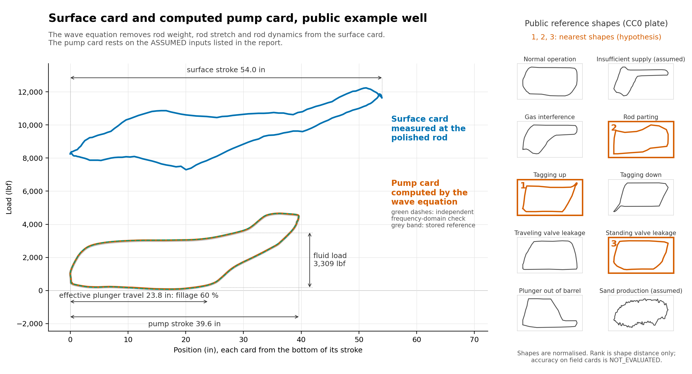

<!-- Generated by examples/report-evals/dynacard-pump-card/build_report.py. -->
# Sucker-rod pump dynamometer card analysis: surface card to pump card by the wave equation, with fillage, fluid load and input sensitivity

## Summary

The public example well gives a pump stroke of 39.58 in from a measured surface stroke of 53.99 in, a fluid load of 3309 lbf and a card-derived fillage of 60.08 %. Effective plunger travel is 23.78 in. At 24 h/day and 100 % volumetric efficiency, fillage-adjusted displacement is 40.03 bbl/day.

## 1 Introduction

### 1.1 Background

A measured surface dynamometer card contains rod-string weight, elastic stretch and dynamic effects. The wave-equation conversion separates those effects to calculate displacement and load at the pump.

### 1.2 Scope of work

One public field card is converted by the default solver and independently by a coupled frequency-domain solver. Stroke, fluid load, fillage, displacement, work per stroke and input sensitivity are calculated. Public shape references provide a separate hypothesis ranking.

### 1.3 Limitations

The analysis cannot:

- Name a pump fault with a stated field accuracy: every shape label is a HYPOTHESIS; field accuracy is NOT_EVALUATED because independent labelled field cards are unavailable.
- Analyse a deviated well as vertical without saying so; the frequency-domain cross-check is vertical.
- Correct a mis-calibrated load cell without independent calibration evidence.
- Give production from a card alone: operating runtime and plunger/valve slip are needed.

The coupled Gibbs transfer is checked against closed-form cases derived from the cited equations and against the stored reference pump cards of five public example wells (median load nRMSE 1.3 %, maximum 2.0 %, 15 harmonics); no openly readable published worked example with tabulated card values was found, so a published-example check is NOT_EVALUATED.

The wave solutions terminate at the supplied rod-string length of 4750 ft; the stated pump depth is 4844 ft, leaving 94 ft unrepresented by the supplied taper inventory. Identification of the rod-string endpoint card as the pump card is ASSUMED; qualification at the stated pump depth requires a reconciled as-run rod and completion tally.

Model probabilities describe synthetic class separation and are not calibrated field probabilities. The public plate is dependent shape evidence because it also constrains the synthetic generators used for training.

The assumed damping, anchoring, time sampling, material properties and load calibration are registered in Table 2. Reproduction within rounding tolerance establishes arithmetic consistency for this governing case; it does not establish those assumptions.

## 2 Design data

| Input | Value | Unit |
| --- | --- | --- |
| Pumping speed | 6.42 | SPM |
| Pump depth | 4844.00 | ft |
| Plunger diameter | 1.500 | in |
| Fluid density used | 63.237 | lb/ft³ |
| Tubing pressure | 100.00 | psi |
| Total supplied rod length | 4750.00 | ft |
| Pump depth minus supplied rod length | 94.00 | ft |
| Rod taper 1, diameter | 0.875 | in |
| Rod taper 1, length | 1400.00 | ft |
| Rod taper 1, modulus | 30500000 | psi |
| Rod taper 1, weight per length | 2.224 | lb/ft |
| Rod taper 1, prescribed wave speed | 16300 | ft/s |
| Rod taper 2, diameter | 0.750 | in |
| Rod taper 2, length | 3350.00 | ft |
| Rod taper 2, modulus | 30500000 | psi |
| Rod taper 2, weight per length | 1.634 | lb/ft |
| Rod taper 2, prescribed wave speed | 16300 | ft/s |

Table 1. Public example well design and operating inputs, surface-first taper order.

| Assumption | Status | Value or basis | Reason |
| --- | --- | --- | --- |
| Vertical well | ASSUMED | Vertical cross-check; default uses supplied survey or vertical fallback | Deviation is not modelled in the frequency-domain cross-check. |
| Pump boundary | ASSUMED | rod length ft: 4750.000; pump depth ft: 4844.000; unrepresented length ft: 94.000 | The supplied rod endpoint is identified with the pump boundary; qualification at the stated pump depth requires a reconciled as-run rod and completion tally. |
| Rod damping | ASSUMED | default up down s inv: 0.010; 0.011; 0.037; 0.037; gibbs s inv: 0.000; 0.000 | Default damping is estimated from assumed annular geometry and viscosity; Gibbs rates are independently prescribed, not calibrated. |
| Viscosity cp | ASSUMED | 10.000 | Default damping viscosity is not measured. |
| Tubing inner diameter in | ASSUMED | 2.441 | Default damping annulus is not supplied. |
| Coupling diameter ratio | ASSUMED | 1.500 | Default damping assumes coupling diameter relative to rod diameter. |
| Coulomb friction coefficient | ASSUMED | 0.000 | No independent friction calibration is supplied. |
| Tubing anchored | ASSUMED | True | Tubing movement is excluded; unanchored tubing cannot be analysed by this workflow. |
| Steel modulus psi | ASSUMED | 30500000.000; 30500000.000 | Supplied nominal values are taken as given; omitted reader values use the package steel default. |
| Steel density lb ft3 | ASSUMED | bare: 490.000; 490.000; effective: 532.588; 532.601 | Bare density defaults to steel; dynamic density in the default solver includes the supplied or derived rod weight. |
| Gibbs wave speed ft s | ASSUMED | 16300.000; 16300.000 | Prescribed wave speed is independent of modulus and density; consistency is not enforced by the cross-check. |
| Load cell calibration | ASSUMED | Taken as given | No independent load-cell calibration is supplied. |
| Uniform time sampling | ASSUMED | True | Samples are assumed uniformly timed over a full cycle; geometry alone cannot establish timing. |
| Displacement basis | ASSUMED | runtime hours: 24; volumetric efficiency pct: 100 | Continuous fillage-adjusted displacement excludes slip and is not measured production. |

Table 2. Assumptions retained by the calculation; ASSUMED is not a passing check.

## 3 Methodology

Surface displacement and tensile load provide the boundary conditions for the damped axial rod wave equation. The default finite-difference adapter marches the displacement field through the tapered rod string and reconstructs pump load from strain, following Everitt and Jennings (1992), SPE-18189-PA. The independent coupled frequency-domain transfer propagates both displacement and force through each ordered taper, following the rod model of Gibbs (1963), [SPE-588-PA](https://doi.org/10.2118/588-PA), with 15 harmonics.

The [package calculations](../../../src/digitalmodel/marine_ops/artificial_lift/dynacard/calculations.py) define gross plunger travel as the position range, effective travel as the bottom-right corner position relative to the minimum, and fillage as effective travel divided by gross travel, expressed as a percentage. Fluid load is the mean upstroke load minus the mean downstroke load between the detected corner phases. The figure marks these mean levels rather than substituting the extreme load range. The [card-area calculation](../../../src/digitalmodel/marine_ops/artificial_lift/dynacard/power_consumption.py) closes the polygon and converts its enclosed area to work per stroke.

The package displacement calculation uses plunger area, travel and pumping speed. The fillage-adjusted and gross values below use 24 h/day and 100 % volumetric efficiency as an explicit calculation basis. Load nRMSE uses [compare_cards](../../../src/digitalmodel/marine_ops/artificial_lift/dynacard/comparison.py). Numerical reproduction checks depend on the ASSUMED inputs in Table 2.

## 4 Results

| Quantity | Value | Unit |
| --- | --- | --- |
| Surface stroke | 53.99 | in |
| Peak polished-rod load | 12240 | lbf |
| Minimum polished-rod load | 7296 | lbf |
| Pump stroke, gross plunger travel | 39.58 | in |
| Pump/surface stroke ratio | 0.733 | ratio |
| Maximum pump load | 4660 | lbf |
| Minimum pump load | 83 | lbf |
| Fluid load, mean phase difference | 3309 | lbf |
| Pump fillage | 60.08 | % |
| Effective plunger travel | 23.78 | in |
| Fillage-adjusted displacement | 40.03 | bbl/day |
| Gross displacement | 66.62 | bbl/day |
| Pump-card work per stroke | 7904.9 | ft-lbf |

Table 3. Public example well results from the default finite-difference solver, conditional on Table 2.

| Actual card | Reference card | Load nRMSE (%) |
| --- | --- | --- |
| Frequency domain | Default finite difference | 0.301 |
| Default finite difference | Stored reference | 0.454 |
| Frequency domain | Stored reference | 0.525 |

Table 4. Card comparisons aligned by traversal and sample origin; each reference load range normalises its error.

The measured surface card and the two computed pump cards are shown below with the stored reference. The reference shapes are displayed independently on normalised axes.



Figure 1. Measured and computed physical cards with annotated travel and mean phase fluid load; nearest public shapes are hypotheses.

The shape-only model labelled 5 of 8 literal public plate shapes and 6 of 10 including the assumed crosswalks. These are recorded plate counts, with one exemplar per shape.

| Rank | Shape-only label | Model probability (%) | Status |
| --- | --- | --- | --- |
| 1 | Tagging up | 99.91 | HYPOTHESIS |
| 2 | Rod parting | 0.09 | HYPOTHESIS |
| 3 | Delayed traveling valve closure | 0.00 | HYPOTHESIS |

Table 5. Shape-only synthetic-model probabilities; classification is a hypothesis.

| Rank | Nearest public plate shape | Loop distance (dimensionless) | Status |
| --- | --- | --- | --- |
| 1 | Tagging up | 0.0976 | HYPOTHESIS |
| 2 | Rod parting | 0.1139 | HYPOTHESIS |
| 3 | Standing valve leakage | 0.1368 | HYPOTHESIS |

Table 6. Minimum mean distance after independent axis normalisation, resampling and traversal alignment.

## 5 References

- Gibbs (1963), *Predicting the Behavior of Sucker-Rod Pumping Systems*, SPE-588-PA, [doi:10.2118/588-PA](https://doi.org/10.2118/588-PA).
- Everitt and Jennings (1992), *An Improved Finite-Difference Calculation of Downhole Dynamometer Cards for Sucker-Rod Pumps*, [SPE-18189-PA](https://doi.org/10.2118/18189-PA).
- Package implementation: [coupled transfer equations and checks](../../../src/digitalmodel/marine_ops/artificial_lift/dynacard/gibbs-transfer.md), [finite-difference adapter](../../../src/digitalmodel/marine_ops/artificial_lift/dynacard/everitt_jennings/adapter.py), and the calculation modules linked in Section 3.

## Appendix A Sensitivity analysis

Each input family is changed independently about the public example well. Rod length and pump depth are scaled together; all taper diameters are scaled together while weight per length is scaled with area to preserve effective density. Each entry is the output change as a percentage of its base value. The sensitivity factor is the difference of the positive and negative output changes divided by the difference of the input percentages. A zero is printed as 0.00; the wider central difference exposes nonlinearity. A response is marked stepped where the two factors differ by more than 0.10. Such a result moves in jumps, because the corner points that define it shift between samples; its factor is not a reliable slope.

| Input | Output | −5 % | −1 % | 1 % | 5 % | Factor at ±1 % | Factor at ±5 % | Response |
| --- | --- | --- | --- | --- | --- | --- | --- | --- |
| Rod length and pump depth | Pump stroke | 1.76 | 0.35 | −0.35 | −1.75 | −0.35 | −0.35 | smooth |
| Rod length and pump depth | Fluid load | −5.15 | −1.72 | 0.01 | −0.12 | 0.87 | 0.50 | stepped |
| Rod length and pump depth | Fillage | −2.28 | −0.46 | 0.46 | 2.32 | 0.46 | 0.46 | smooth |
| Rod length and pump depth | Maximum pump load | 8.18 | 1.64 | −1.64 | −8.19 | −1.64 | −1.64 | smooth |
| Rod length and pump depth | Displacement | −0.56 | −0.11 | 0.11 | 0.53 | 0.11 | 0.11 | smooth |
| Rod diameter | Pump stroke | −3.07 | −0.59 | 0.57 | 2.79 | 0.58 | 0.59 | smooth |
| Rod diameter | Fluid load | 0.43 | 0.47 | 0.13 | −2.38 | −0.17 | −0.28 | stepped |
| Rod diameter | Fillage | 5.25 | 0.96 | −0.92 | −4.17 | −0.94 | −0.94 | smooth |
| Rod diameter | Maximum pump load | 15.32 | 3.13 | −3.16 | −16.11 | −3.14 | −3.14 | smooth |
| Rod diameter | Displacement | 2.02 | 0.36 | −0.35 | −1.50 | −0.36 | −0.35 | smooth |
| Rod modulus | Pump stroke | −1.68 | −0.32 | 0.32 | 1.54 | 0.32 | 0.32 | smooth |
| Rod modulus | Fluid load | −0.23 | 0.57 | 0.03 | −2.87 | −0.27 | −0.26 | smooth |
| Rod modulus | Fillage | 2.48 | 0.47 | −0.46 | −2.17 | −0.47 | −0.47 | smooth |
| Rod modulus | Maximum pump load | −0.17 | −0.03 | 0.03 | 0.16 | 0.03 | 0.03 | smooth |
| Rod modulus | Displacement | 0.76 | 0.15 | −0.14 | −0.66 | −0.14 | −0.14 | smooth |
| Pumping speed | Pump stroke | 0.31 | 0.06 | −0.06 | −0.30 | −0.06 | −0.06 | smooth |
| Pumping speed | Fluid load | −2.07 | −1.79 | 0.08 | −0.29 | 0.93 | 0.18 | stepped |
| Pumping speed | Fillage | 0.02 | 0.00 | 0.00 | −0.05 | 0.00 | −0.01 | smooth |
| Pumping speed | Maximum pump load | −0.20 | −0.04 | 0.04 | 0.21 | 0.04 | 0.04 | smooth |
| Pumping speed | Displacement | −4.68 | −0.93 | 0.93 | 4.63 | 0.93 | 0.93 | smooth |
| Surface load scale | Pump stroke | 1.48 | 0.29 | −0.29 | −1.44 | −0.29 | −0.29 | smooth |
| Surface load scale | Fluid load | −5.27 | −0.94 | 0.94 | 5.20 | 0.94 | 1.05 | stepped |
| Surface load scale | Fillage | −2.28 | −0.47 | 0.47 | 2.38 | 0.47 | 0.47 | smooth |
| Surface load scale | Maximum pump load | −12.86 | −2.57 | 2.57 | 12.86 | 2.57 | 2.57 | smooth |
| Surface load scale | Displacement | −0.83 | −0.18 | 0.18 | 0.91 | 0.18 | 0.17 | smooth |
| Surface position scale | Pump stroke | −6.44 | −1.29 | 1.29 | 6.48 | 1.29 | 1.29 | smooth |
| Surface position scale | Fluid load | 0.18 | −0.06 | 0.06 | −0.31 | 0.06 | −0.05 | stepped |
| Surface position scale | Fillage | 2.51 | 0.47 | −0.46 | −2.18 | −0.47 | −0.47 | smooth |
| Surface position scale | Maximum pump load | −0.26 | −0.05 | 0.05 | 0.26 | 0.05 | 0.05 | smooth |
| Surface position scale | Displacement | −4.09 | −0.82 | 0.82 | 4.16 | 0.82 | 0.83 | smooth |
| Fluid density | Pump stroke | 0.00 | 0.00 | 0.00 | 0.00 | 0.00 | 0.00 | smooth |
| Fluid density | Fluid load | 0.00 | 0.00 | 0.00 | 0.00 | 0.00 | 0.00 | smooth |
| Fluid density | Fillage | 0.00 | 0.00 | 0.00 | 0.00 | 0.00 | 0.00 | smooth |
| Fluid density | Maximum pump load | −1.09 | −0.22 | 0.22 | 1.09 | 0.22 | 0.22 | smooth |
| Fluid density | Displacement | 0.00 | 0.00 | 0.00 | 0.00 | 0.00 | 0.00 | smooth |
| Pump diameter | Pump stroke | 0.00 | 0.00 | 0.00 | 0.00 | 0.00 | 0.00 | smooth |
| Pump diameter | Fluid load | 0.00 | 0.00 | 0.00 | 0.00 | 0.00 | 0.00 | smooth |
| Pump diameter | Fillage | 0.00 | 0.00 | 0.00 | 0.00 | 0.00 | 0.00 | smooth |
| Pump diameter | Maximum pump load | 0.00 | 0.00 | 0.00 | 0.00 | 0.00 | 0.00 | smooth |
| Pump diameter | Displacement | −9.75 | −1.99 | 2.01 | 10.25 | 2.00 | 2.00 | smooth |

Table A1. Output changes (%) and central sensitivity factors (% output per % input).

## Appendix B Reusable prompt

The [reusable prompt](../../../examples/report-evals/dynacard-pump-card/PROMPT.md) specifies the public-case rebuild, the reader input layout, missing-data questions and the comparison output. The [reader template](../../../examples/report-evals/dynacard-pump-card/reader-card-template.json) contains the same public example well in the simple layout.

| Data | Source | Licence | Version or date | Link |
| --- | --- | --- | --- | --- |
| Public example surface card, rod string and stored reference | Repository field fixture | MIT | 2026-11-12 | [Source](https://github.com/vamseeachanta/digitalmodel/blob/9328ec4f0a2a4578cf5a745fe13c40195caeed30/tests/marine_ops/artificial_lift/test_data/cleansed_well_001.json) |
| Public reference shapes | Public diagnostic plate | CC0 1.0 | 2026-10-11 | [Source](https://doi.org/10.17632/hnfwm9mjs6.1) |
| Recorded shape-only plate score | Repository benchmark | MIT | 2026-11-12 | [Source](https://github.com/vamseeachanta/digitalmodel/blob/9328ec4f0a2a4578cf5a745fe13c40195caeed30/tests/marine_ops/artificial_lift/dynacard/testdata/plate_classifier_score.json) |

Table B1. Retained data sources; input and source digests are recorded by the analysis and eval.

## Appendix C Checks

```text
PYTHONPATH=src uv run --no-sync python examples/report-evals/dynacard-pump-card/eval.py --validate-only
PYTHONPATH=src uv run --no-sync python examples/report-evals/dynacard-pump-card/eval.py
```

The [last-run record](../../../examples/report-evals/dynacard-pump-card/last-run.json) grades **PASS** against the printed results and their half-last-digit tolerances. This grade checks numerical reconstruction; ASSUMED inputs and HYPOTHESIS labels retain their separate statuses. The code pin is provisional until the report files are committed.
