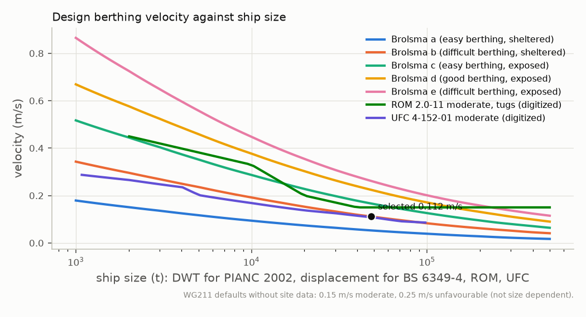
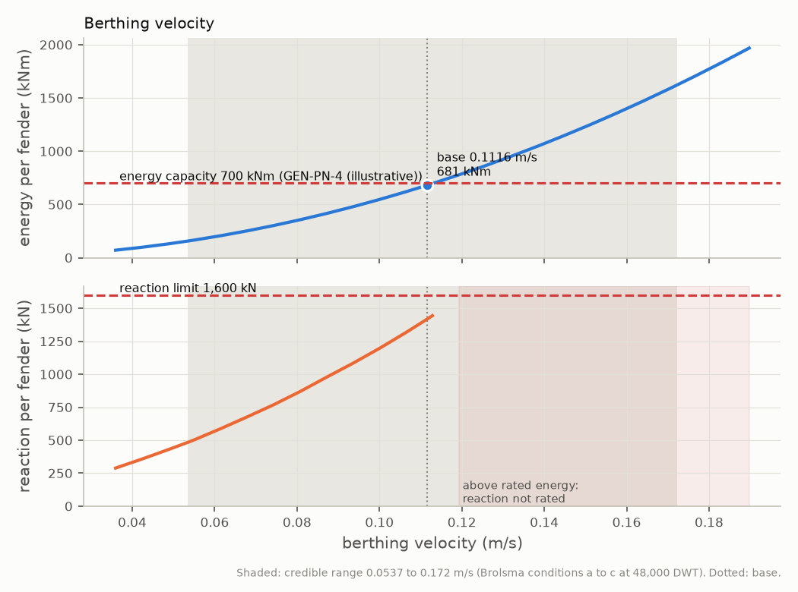
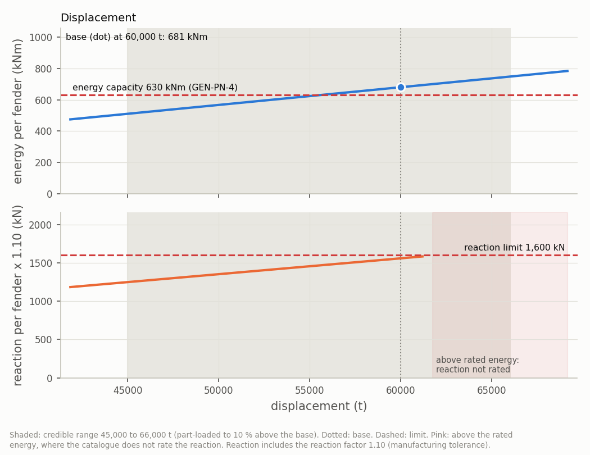
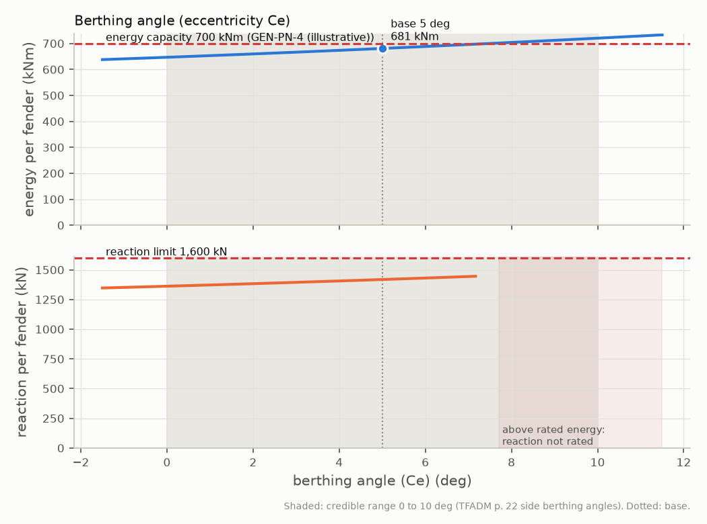
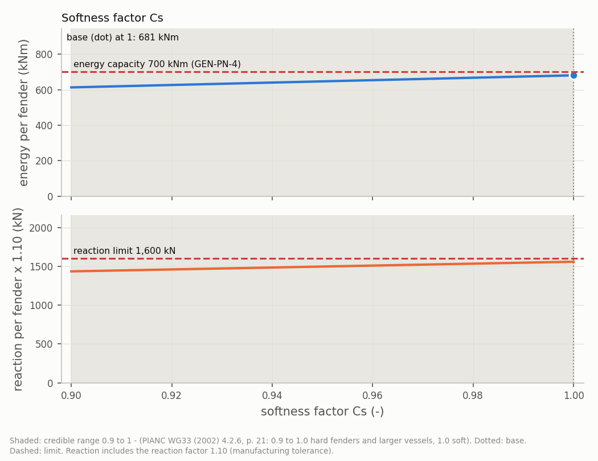
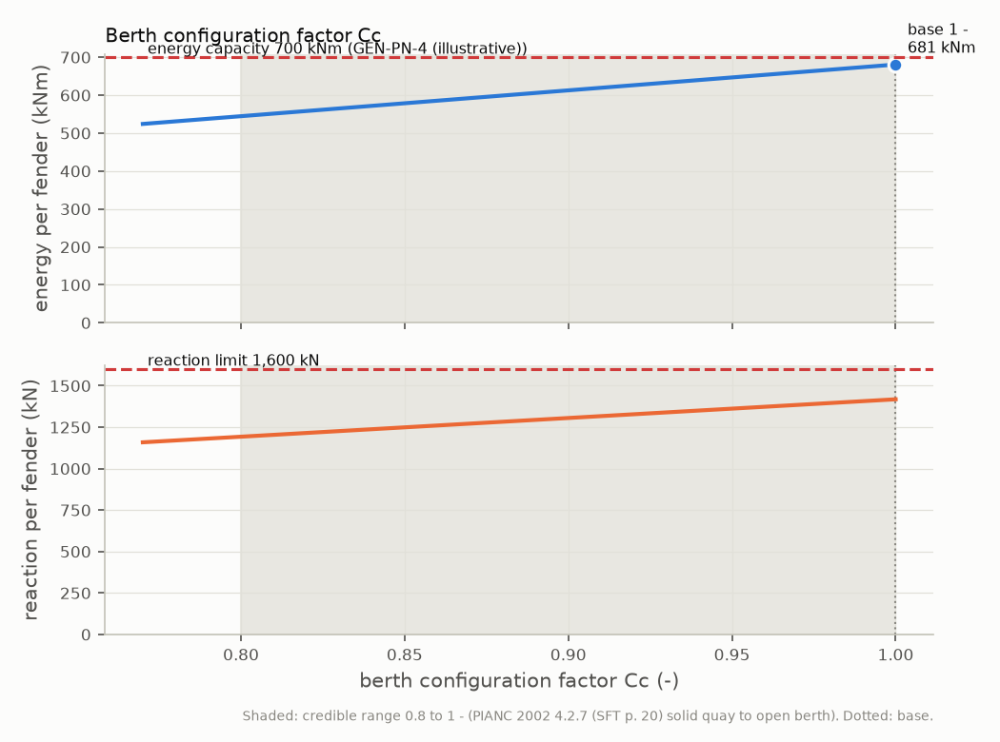
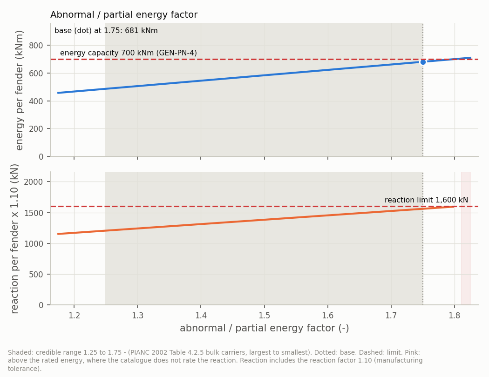

# Fender design: methods, coefficients, database and sensitivity (generic method report, revision 1)

Living method report for the berthing-energy design of ship fenders. It sits beside the
calculation module `digitalmodel.hydrodynamics.fender_design` (with
`digitalmodel.hydrodynamics.berthing_energy`), the fender database in `data/fender_design/`,
the universal workbook generator and the study script in
`examples/hydrodynamics/fender_design/`. Every number in this report is regenerated by
`fender_study.py` from `generic_case.yaml`; the workbook `fender-design-generic.xlsx` beside
this report is the same case with live formulas.

The worked case is a generic Supramax-class bulk carrier in round numbers at an open berth
with illustrative (fictional) fenders. It demonstrates the method. It is not a design, and
no result here clears a fender for any berth.

## 1. Summary

- Eight berthing-energy methods are implemented, each coefficient with its source and how
  that source was verified: PIANC WG33 (2002), PIANC WG211 (2024), BS 6349-4:2014, EAU 2012,
  ROM 2.0-11, UFC 4-152-01, the Ueda added mass used in Japanese practice, and IS 4651-3:1974
  (withdrawn, for comparison).
- For the same ship and berth the design energy ranges from the lowest to the highest method
  by about a factor of two (Table 3, Figure 1). The spread comes mostly from the velocity each
  method assigns, then from the design factor; the energy equation itself is common.
- For the generic case the PIANC 2002 design energy is 680.8 kNm (normal energy
  389.1 kNm). The illustrative base fender has a capacity of 700.0 kNm, a
  utilisation of 0.97.
- One-at-a-time sensitivity (Section 7) ranks the inputs. In this case the three largest
  are: berthing velocity; first contact from bow / LBP (Ce); displacement. The berthing velocity enters squared and is the
  largest single term in this case.
- Four errors recur in spreadsheets and are checked by the module and tests (Section 3.7):
  K² in place of R² cos² φ in the eccentricity numerator; the moulded depth entered as the
  draught; K computed from L_OA; and a velocity from one method combined with the factors of
  another.

## 2. Berthing energy

All methods share the kinetic-energy form

E_N = ½ · M · v_B² · C_m · C_e · C_s · C_c   (kNm with M in t and v_B in m/s)

and differ in how v_B and each coefficient are chosen and in the factor applied to reach
the design energy:

- deterministic methods (PIANC 2002, BS 6349-4, EAU, ROM, UFC): E_d = F · E_N, with F an
  abnormal (accidental) impact factor;
- PIANC WG211 (2024): a semi-probabilistic format, E_k,d = γ_E · E_k,c with a characteristic
  velocity, C_s and C_c removed, and the fender capacity divided by a material factor
  γ_m before comparison.

M is the displacement at the berthing draught. The draught is the berthing draught, never
the moulded depth.

## 3. Coefficients and their sources

Verification levels used throughout: **full-text** (read in the document), **secondary**
(read in a named document that reproduces it, usually a manufacturer's design manual),
**formula** (closed form of the cited paper, reproduced in the documents named) and
**digitized** (read off a published figure, about ±0.02 m/s). Secondary values should be
checked against the primary document before they are used as a design basis. Table 8 lists
every source.

### 3.1 Berthing velocity

- **PIANC 2002, Fig. 4.2.1 (Brolsma et al. 1977), tug-assisted:** five curves, a (easy,
  sheltered) to e (difficult, exposed). PIANC keys the curves by **DWT**; BS 6349-4:2014
  Figure 9 prints the same numbers against **displacement**. The module takes the measure
  from the method chosen and interpolates log-log; it does not extrapolate beyond 1,000 to
  500,000 t. Values below 0.10 m/s are flagged "use with caution" and below 0.08 m/s "not
  recommended", as in the two manuals that reproduce the table. Curves d and e may be
  high and are to be used with caution.
- **PIANC WG211 (2024):** characteristic velocity at 0.02 % exceedance per berthing. Without
  site data the background paper uses 0.15 m/s (moderate) and 0.25 m/s (unfavourable). The
  favourable and monitored values in the module (0.125 and 0.115 m/s) are derived here from
  the published Weibull fits and are not printed values. The WG211 velocity table by vessel
  size was not available.
- **ROM 2.0-11:** Table 4.6.4.36 (with tugs) and 4.6.4.37 (without), by displacement and
  climate class; digitized. The plateau above 40,000 t is 0.08, 0.15 and 0.20 m/s.
- **UFC 4-152-01:** Figs. 5-3 and 5-4 by displacement in long tons, sheltered, moderate and
  exposed; digitized and converted to SI.
- **EAU 2012:** characteristic values, favourable, normal and unfavourable; digitized at two
  sizes only (5,000 DWT and 50,000 DWT and above).
- **IS 4651-3:1974:** step table by displacement band and site condition.

Table 1 gives the Brolsma values the module uses at selected sizes; Figure 2 compares the
methods.

| Size (t) | a | b | c | d | e |
|---|---|---|---|---|---|
| 5,000 | 0.117 | 0.236 | 0.352 | 0.459 | 0.558 |
| 10,000 | 0.094 | 0.192 | 0.287 | 0.377 | 0.448 |
| 20,000 | 0.074 | 0.153 | 0.228 | 0.303 | 0.355 |
| 50,000 | 0.052 | 0.110 | 0.164 | 0.221 | 0.258 |
| 100,000 | 0.039 | 0.083 | 0.126 | 0.171 | 0.201 |
| 200,000 | 0.028 | 0.062 | 0.095 | 0.131 | 0.158 |

Table 1 – Brolsma design berthing velocity (m/s) by size (t) and curve a to e; DWT for PIANC
2002, displacement for BS 6349-4.

Figure 2 – Design berthing velocity against ship size by method.

### 3.2 Added mass C_m

| Method | Formula | Validity and pairing | Source |
|---|---|---|---|
| PIANC 2002 (also ROM, WG211 example, EAU) | 1.8 at KC/D ≤ 0.1; 1.875 − 0.75 KC/D; 1.5 at KC/D ≥ 0.5 | use with C_c = 1.0 | secondary (SFT p. 18; TFADM p. 24); ROM p. 265 full-text |
| Vasco Costa (1964) (BS 6349-4, IS 4651) | 1 + 2T/B | v ≥ 0.08 m/s, KC ≥ 0.1T; pair with C_c | formula |
| Ueda (1981) (Japanese practice) | 1 + πT/(2 C_b B) | pair with C_c | formula |
| UFC 4-152-01 surface vessels | C_M0 + (C_m1 − C_M0)(T/d)^3.5, C_M0 = 1.3 + 1.5T/B, C_m1 = F[12.4(T/B)^0.3 − 50T/L] | F = 1.5C_b (C_b < 0.6) or 0.9 | full-text |
| Longitudinal approach | 1.1 | | secondary |

Table 2 – Added-mass methods.

The UFC form rises steeply in shallow water (T/d near 1) and gives values well above the
others there; UFC itself notes that added mass may exceed PIANC below a depth/draught of 1.2.
Figure 3 shows the four forms for the generic ship.

Figure 3 – Added mass factor against keel clearance for the generic ship.

### 3.3 Eccentricity C_e

C_e = (K² + R² cos² φ) / (K² + R²), K = (0.19 C_b + 0.11) L_BP (PIANC 2002 4.2.4).
R is the distance from the first-contact point to the centre of mass, taken at mid-L_BP on
the centreline unless the LCG is known. φ is the angle between the velocity vector (normal
to the berth) and R; for a contact forward of midships with berthing angle α,
φ = 90° − α − asin(B/2R), the form printed in the ShibataFenderTeam manual (the module
computes φ from the geometry and the test suite checks it equals this form).

- For the generic case: C_b 0.847, K 48.76 m, R 47.76 m, φ 65.4°, C_e 0.595.
- UFC uses C_e = k²/(a² + k²) with a the contact distance along the ship axis (φ = 90°).
- IS 4651 uses (1 + (l/r)² sin² θ)/(1 + (l/r)²) with r = L/4.
- Typical values for orientation (manufacturers' manuals): quarter point about 0.5,
  third point about 0.7, midships 1.0.

### 3.4 Softness C_s and berth configuration C_c

- C_s = 1.0 for fender deflection above 0.15 m, 0.9 at or below (PIANC 2002; ROM also 0.9
  for ships of 300 m and longer). WG211 removes C_s.
- C_c = 1.0 for open (piled or floating) berths, berthing angle above 5° and with the PIANC
  keel-clearance C_m. For solid quays at angles of 5° or less the sources differ: 0.8
  (KC/D ≤ 0.5) or 0.9 (KC/D > 0.5) in the SFT reading of PIANC; 0.9 in the Trelleborg reading
  and ROM; 0.8 in UFC. The module implements the SFT table and records the alternative.
  WG211 removes C_c.

### 3.5 Design factor

- PIANC 2002 Table 4.2.5 (secondary): tankers, bulk and cargo 1.25 (largest) to 1.75
  (smallest); container 1.5 to 2.0; general cargo 1.75; Ro-Ro and ferries 2.0 or more; tugs
  2.0. PIANC gives no rule between largest and smallest; the module takes the caller's
  choice. One manual reads "largest" by class (Capesize and above for bulk carriers, Handymax
  and smaller take 1.75); the other reading is the largest ships using the berth. The
  choice changes the design energy by 40 % and is carried as a sensitivity.
- BS 6349-4: energy factor 2.0 for gas carriers at LNG facilities (secondary); otherwise
  the PIANC table is used by the module, as the BS table itself was not read.
- ROM 2.0-11 Table 4.6.4.43: product of four factors (displacement ≤ 85,000 t 1.50 else
  1.25; without tugs 1.25; v ≤ 0.10 m/s 1.20; more than 300 calls a year 1.15), scaled by
  (T_R/500)^(1/20), not below 1.10.
- UFC 4-152-01 5-1.5.3: accidental berthing energy at least 50 % above normal (1.5).
- WG211: γ_E = γ_Eref · γ_n · γ_p · γ_c, with γ_Eref by navigation condition, spread of
  displacements (CoV_M), consequence class A to D and single or multiple contact, and γ_n
  = a ln(n) + b for n berthings a year (background-paper tables). The fender capacity is
  divided by γ_m = 1.10 (worked example).

### 3.6 Fender performance

- Capacity = rated energy × (1 − energy tolerance) × angular × velocity × temperature
  factors at the slowest velocity and highest temperature; maximum reaction = rated reaction
  × (1 + reaction tolerance) × velocity × temperature factors at the fastest velocity and
  lowest temperature (Trelleborg manual p. 30; SFT p. 26).
- Tolerances: moulded rubber ±10 %, extruded ±20 %, foam ±10 to ±15 %, pneumatic 0 % on
  energy (guaranteed energy absorption, GEA, ISO 17357-1) and ±10 % on reaction.
- Velocity factor by compression time t = d/(0.74 v) and temperature factor by compound are
  tabulated in the module (Trelleborg manual p. 35).
- Hull pressure guidance (PIANC 2002 Table 4.4.1, secondary): bulk carriers below 200 kPa;
  other values in `HULL_PRESSURE_KPA`. The sources disagree for bulk carriers (one paper lists
  200 to 320 kPa for WG33); the module uses 200 kPa and records the conflict.
- Reaction at part energy is read from a normalised curve when one is supplied; without a
  curve the rated reaction is used as an upper bound.

### 3.7 Errors checked by the module and the tests

1. **Eccentricity numerator.** (K² + K² cos² φ)/(K² + R²) is not the PIANC form. For the
   generic case it gives 0.599 against 0.595. `eccentricity_k2_numerator` exists only
   to quantify the error.
2. **Moulded depth as draught.** Block coefficient, keel clearance and added mass all use the
   berthing draught. A depth entered as draught lowers C_b and either removes the keel
   clearance or makes it look generous.
3. **K from L_OA.** K uses L_BP.
4. **Mixed bases.** A WG211 velocity (0.02 % exceedance) combined with WG33 factors, or a
   DWT-keyed velocity read at the displacement, changes the energy without any change of
   assumption. Each method in the module carries its own basis.

## 4. Comparison of methods

| Method | v (m/s) | Cm | Ce | Cs | Cc | Other | Normal (kNm) | Factor | Design (kNm) | Per fender / capacity |
|---|---|---|---|---|---|---|---|---|---|---|
| PIANC WG33 (2002) | 0.112 | 1.750 | 0.595 | 1.00 | 1.00 | 1.00 | 389.1 | 1.75 | 680.8 | 0.97 |
| PIANC WG211 (2024) | 0.150 | 1.750 | 0.595 | 1.00 | 1.00 | 1.00 | 702.9 | 1.59 | 1,116.9 | 1.76 |
| BS 6349-4:2014 | 0.102 | 1.750 | 0.595 | 1.00 | 1.00 | 1.00 | 328.2 | 1.75 | 574.3 | 0.82 |
| EAU 2012 | 0.153 | 1.750 | 0.595 | 1.00 | 1.00 | 1.00 | 727.1 | 1.75 | 1,272.5 | 1.82 |
| ROM 2.0-11 (2012) | 0.150 | 1.750 | 0.595 | 1.00 | 1.00 | 0.95 | 667.8 | 1.50 | 1,001.7 | 1.43 |
| UFC 4-152-01 (2017 C1) | 0.099 | 3.876 | 0.540 | 1.00 | 1.00 | 0.95 | 582.9 | 1.50 | 874.3 | 1.25 |
| Ueda Cm (Japan), PIANC 2002 v and factor | 0.112 | 1.696 | 0.595 | 1.00 | 1.00 | 1.00 | 376.9 | 1.75 | 659.7 | 0.94 |
| IS 4651-3:1974 (withdrawn) | 0.200 | 1.750 | 0.504 | 0.90 | 1.00 | 1.00 | 952.2 | 1.00 | 952.2 | 1.36 |

Table 3 – Design berthing energy by method for the generic case (same ship and berth). The
last column is energy per fender over the base fender capacity (for WG211 the capacity is
divided by γ_m).

Figure 1 – Design energy by method.

| Method | Velocity basis | Cm basis | Factor basis |
|---|---|---|---|
| PIANC WG33 (2002) | pianc2002-velocity: curve b (difficult berthing, sheltered) at 48,000 DWT | pianc2002-cm: pianc2002; KC/D = 0.167 | pianc2002: PIANC 2002 Table 4.2.5, bulk, smallest ships |
| PIANC WG211 (2024) | pianc-wg211: moderate: R24B default without site data (pp. 976-979) | pianc2002-cm: keel clearance rule (as in the R24B example); KC/D = 0.167 | pianc-wg211: gamma_Eref 1.59 (class B, moderate, CoV_M high, single contact) x gamma_n 0.999 (100/yr); gamma_p = gamma_c = 1.0 |
| BS 6349-4:2014 | bs6349-4-velocity: curve b (difficult berthing, sheltered) at 60,000 t | vasco-costa-1964: vasco_costa; KC/D = 0.167 | pianc2002: PIANC 2002 Table 4.2.5, bulk, smallest ships; BS 6349-4 own factor table not read |
| EAU 2012 | eau-2012: moderate (normal), characteristic value, digitized | pianc2002-cm: pianc2002; KC/D = 0.167 | eau-2012: PIANC 2002 Table 4.2.5, bulk, smallest ships |
| ROM 2.0-11 (2012) | rom-2.0-11: Table 4.6.4.36, moderate, digitized | rom-2.0-11: 1.8 / 1.5 keel-clearance rule (p. 265); KC/D = 0.167 | rom-2.0-11: Table 4.6.4.43 product (with tugs, 100 calls/yr, T_R 500 yr) |
| UFC 4-152-01 (2017 C1) | ufc-4-152-01: Fig. 5-3/5-4, moderate (sheltered/moderate/exposed), digitized | ufc-4-152-01: 5-2.1.1 e surface vessels | ufc-4-152-01: 5-1.5.3: increase by at least 50 % |
| Ueda Cm (Japan), PIANC 2002 v and factor | pianc2002-velocity: curve b (difficult berthing, sheltered) at 48,000 DWT | ueda-1981: ueda; KC/D = 0.167 | pianc2002: PIANC 2002 Table 4.2.5, bulk, smallest ships |
| IS 4651-3:1974 (withdrawn) | is-4651-3-1974: Table 2 | is-4651-3-1974: 5.2.1.2: 1 + 2D/B | is-4651-3-1974: no abnormal factor in the method |

Table 4 – Basis of the velocity, added mass and factor for each method.

Observations for this case:

- PIANC 2002 with Brolsma curve b gives v = 0.112 m/s; ROM, EAU and WG211
  (moderate) give 0.15 m/s; the difference alone is a factor (0.15/0.112)² on energy.
- BS 6349-4 reads the same curve at the displacement (larger than DWT), so its velocity is
  lower: 0.102 m/s.
- UFC pairs a lower velocity with a much higher shallow-water added mass.
- Methods should not be averaged. One method is selected for a design, with the reasons;
  the others show how far the result depends on that choice.

## 5. Fender database

`data/fender_design/` holds the database schema (`database_schema.yaml`), the catalogue
index (`catalogue_index.csv`: catalogue, edition, URL, fender types, row count, date read)
and illustrative rows for tests and examples. The rated values themselves come from
manufacturers' catalogues and are held in a private vendor table with a citation per row
(catalogue, page or table, value method, date read); `scripts/fender_design/import_vendor_tables.py`
converts that table into the schema and into the selection-catalogue layout the workbook
reads. The database currently holds 4,652 rows from 14 catalogues (Figure 4):
cone, cell, element, arch, V, cylindrical and other solid rubber types, and pneumatic, foam,
foam-filled and hydropneumatic floating fenders. Float levels of floating fenders are not
published in the catalogues read.

Figure 4 – Rows in the fender database by fender type.

## 6. Universal workbook

`build_fender_workbook.py` writes an xlsx from a case file and a catalogue:

- **Inputs:** the case values with their basis (yellow cells).
- **Calc:** C_b, K, R, φ, C_e (and the error form), KC/D and C_m by three methods as live
  formulas.
- **Velocity:** the Brolsma table and log-log interpolation at the DWT and displacement, live.
- **Methods:** design energy by every method with live velocity, C_m and C_e where the
  method uses them; the basis of each term.
- **Fenders:** the catalogue with live capacity, utilisation, design reaction and checks
  against the limits on Inputs.
- **Sensitivity, Tornado, Sizes:** written by the generator, with charts.
- **Sources:** the source register.

The test suite recomputes the workbook's formulas and checks C_b, K, R, φ, C_e, every
method's design energy and the fender utilisation against the module.

## 7. Sensitivity

Each input is moved alone over a credible range with every other input at its base. Each
chart shows the energy per fender with the base fender's capacity, and below it the
reaction per fender with the reaction limit; the credible range is shaded and the base is
marked. Above the rated energy the catalogue does not rate the reaction, and the chart says so.

| Input | Base | Credible range | Basis | Design energy change at range ends | Utilisation at range ends | Value at utilisation 1 |
|---|---|---|---|---|---|---|
| berthing velocity | 0.1116 m/s | 0.0537 to 0.172 | Brolsma conditions a to c at 48,000 DWT | -77 % / +138 % | 0.23 / 2.31 | 0.1131 |
| displacement | 6e+04 t | 45000 to 66000 | part-loaded to 10 % above the base | -25 % / +10 % | 0.73 / 1.07 | 6.169e+04 |
| water depth (Cm through keel clearance) | 14 m | 12.6 to 18 | KC/D 0.05 to 0.5, the PIANC Cm range | +3 % / -14 % | 1.00 / 0.83 | 13.16 |
| first contact from bow / LBP (Ce) | 0.25 - | 0.2 to 0.35 | SFT p. 17 side berthing contact 20 to 35 % from the bow | -15 % / +36 % | 0.83 / 1.32 | 0.2586 |
| berthing angle (Ce) | 5 deg | 0 to 10 | TFADM p. 22 side berthing angles | -5 % / +6 % | 0.92 / 1.03 | 7.499 |
| softness factor Cs | 1 - | 0.9 to 1 | PIANC 2002 4.2.6 hard to soft fenders | -10 % / +0 % | 0.88 / 0.97 | - |
| berth configuration factor Cc | 1 - | 0.8 to 1 | PIANC 2002 4.2.7 (SFT p. 20) solid quay to open berth | -20 % / +0 % | 0.78 / 0.97 | - |
| abnormal / partial energy factor | 1.75 - | 1.25 to 1.75 | PIANC 2002 Table 4.2.5 bulk carriers, largest to smallest | -29 % / +0 % | 0.69 / 0.97 | 1.799 |

Table 5 – One-at-a-time sensitivity of the design energy (PIANC 2002, generic case).

Figure 5 – Ranking of inputs by the span of design energy over their credible ranges.

| Rank | Input | Span of design energy (percentage points) |
|---|---|---|
| 1 | berthing velocity | 214 |
| 2 | first contact from bow / LBP (Ce) | 51 |
| 3 | displacement | 35 |
| 4 | abnormal / partial energy factor | 29 |
| 5 | berth configuration factor Cc | 20 |
| 6 | water depth (Cm through keel clearance) | 17 |
| 7 | berthing angle (Ce) | 11 |
| 8 | softness factor Cs | 10 |

Table 6 – Ranking.

Figure 6 – Berthing velocity.

Figure 7 – Displacement.

Figure 8 – Water depth (C_m through keel clearance).

Figure 9 – First-contact point (C_e).

Figure 10 – Berthing angle (C_e).

Figure 11 – Softness factor C_s.

Figure 12 – Berth configuration factor C_c.

Figure 13 – Abnormal (or partial) energy factor.

## 8. Neighbouring fender sizes

| Fender | Rated energy (kNm) | Rated reaction (kN) | Hull pressure (kPa) | Energy margin (%) | dE (%) | dR (%) | dp (%) |
|---|---|---|---|---|---|---|---|
| GEN-PN-4 (base) | 700 | 1,450 | 210 | +3 | 0 | 0 | 0 |
| GEN-PN-2 | 250 | 800 | 130 | -63 | -64 | -45 | -38 |
| GEN-PN-3 | 400 | 1,100 | 135 | -41 | -43 | -24 | -36 |
| GEN-PN-5 | 900 | 1,600 | 150 | +32 | 29 | 10 | -29 |
| GEN-FM-6 | 1,000 | 1,400 | 180 | +47 | 43 | -3 | -14 |

Table 7 – Illustrative fenders against the base (percentage change from the base).

Figure 14 – Neighbouring sizes: capacity against energy per fender and reaction against the
limit.

## 9. Verification

The tests (`tests/hydrodynamics/fender_design/`) reproduce published worked examples:

- Roubos et al. (2024), Example 1 (LNG jetty): WG33 velocities by DWT (curves b and c,
  0.076 and 0.115 m/s), BS 6349-4 velocity by displacement (0.100 m/s) and Vasco Costa C_m
  (1.45), PIANC C_m (1.73), WG211 characteristic energy (2,590 and 1,151 kNm), design
  energies (4,659, 1,783, 1,901 and 1,926 kNm) and the WG211 fender capacity (1,784 kNm),
  each within 1 to 3 % (printed coefficients are rounded to two decimals);
- ShibataFenderTeam Design Manual (2026) p. 19: C_b, K, R, φ and C_e (0.761) for a laden
  tanker at third-point contact;
- Trelleborg Fender Application Design Manual (2024) pp. 39–40: compression time, velocity
  and temperature factors, maximum reaction (1,172 kN) and minimum energy (512 kNm);
- IS 4651-3 Table 3 eccentricity values; hand checks of every method, of the sweeps and of
  the workbook formulas.

## 10. Limitations

- PIANC WG33 (2002) and WG211 (2024) were not read directly; their values here are
  secondary (manufacturers' manuals and two 2024 papers by members of WG211). The WG211
  partial factors are the background paper's derivation; the final guideline tables may
  differ, and the WG211 velocity table by vessel size is not included.
- BS 6349-4, EAU and the Japanese standards were not read directly. ROM, UFC and EAU
  velocities are digitized from figures.
- Hull-pressure guidance and the solid-quay C_c differ between sources (Section 3.4, 3.6).
- The sweeps are one at a time; combined adverse values are not shown and are not the sum
  of the individual changes.
- Ship-to-ship (floating fender between ships) energy and dolphin layout methods are not
  implemented.
- Citation sidecars resolved against a wiki page per standard are not yet in place; the
  source register in the module carries the provenance.

## 11. Sources

| Id | Document | Edition | Clause | Verification | Read in |
|---|---|---|---|---|---|
| pianc2002 | PIANC MarCom WG33, Guidelines for the Design of Fender Systems | 2002 | section 4.2 (energy), Table 4.2.5 (abnormal factor), Table 4.4.1 (hull pressure) | secondary | Trelleborg Fender Application Design Manual MN-FEN-V4.0-EN (2024) pp. 23-28, 46; ShibataFenderTeam Design Manual (English, 2026) pp. 17-22, 33 |
| pianc2002-velocity | PIANC 2002 design berthing velocity (Brolsma et al. 1977 curves a to e) | 2002 | Fig. 4.2.1; table keyed by DWT | secondary | Trelleborg Fender Application Design Manual MN-FEN-V4.0-EN (2024) p. 23 |
| bs6349-4-velocity | BS 6349-4:2014 design berthing velocity (Brolsma curves) | 2014 | Figure 9; keyed by displacement | secondary | ShibataFenderTeam Design Manual (English, 2026) p. 21 |
| bs6349-4 | BS 6349-4:2014 Maritime works. Code of practice for design of fendering and mooring systems | 2014 | berthing energy (as summarised) | secondary | ShibataFenderTeam Design Manual (English, 2026) pp. 4, 18, 21-22; Trelleborg Fender Application Design Manual MN-FEN-V4.0-EN (2024) pp. 15, 23 |
| vasco-costa-1964 | Vasco Costa, F. The berthing ship | 1964 | Cm = 1 + 2D/B; valid for v >= 0.08 m/s and UKC >= 0.1 D | formula | Trelleborg Fender Application Design Manual MN-FEN-V4.0-EN (2024) p. 24; ShibataFenderTeam Design Manual (English, 2026) p. 18 |
| ueda-1981 | Ueda, S. et al. added mass of berthing ships | 1981 | Cm = 1 + pi D / (2 Cb B) | formula | Trelleborg Fender Application Design Manual MN-FEN-V4.0-EN (2024) p. 24; ShibataFenderTeam Design Manual (English, 2026) p. 18 |
| pianc2002-cm | PIANC 2002 added mass from keel clearance | 2002 | section 4.2.5 | secondary | ShibataFenderTeam Design Manual (English, 2026) p. 18; Trelleborg Fender Application Design Manual MN-FEN-V4.0-EN (2024) p. 24 |
| pianc2002-ce | PIANC 2002 eccentricity | 2002 | section 4.2.4 | secondary | Trelleborg Fender Application Design Manual MN-FEN-V4.0-EN (2024) p. 25; ShibataFenderTeam Design Manual (English, 2026) p. 19 |
| pianc2002-cc | PIANC 2002 berth configuration factor | 2002 | section 4.2.7 | secondary | ShibataFenderTeam Design Manual (English, 2026) p. 20; Trelleborg Fender Application Design Manual MN-FEN-V4.0-EN (2024) p. 27 |
| pianc2002-cs | PIANC 2002 softness factor | 2002 | section 4.2.6 | secondary | Trelleborg Fender Application Design Manual MN-FEN-V4.0-EN (2024) p. 27; ShibataFenderTeam Design Manual (English, 2026) p. 20 |
| tfadm-2024 | Trelleborg Fender Application Design Manual MN-FEN-V4.0-EN (2024) | 2024 | pp. 22-46 | full-text |  |
| sft-2026 | ShibataFenderTeam Design Manual (English, 2026) | 2026 | pp. 17-36 | full-text |  |
| iso17357-1 | ISO 17357-1:2014 Ships and marine technology. Floating pneumatic rubber fenders | 2014 | performance at 60 % deflection (GEA) | secondary | Trelleborg Pneumatic Fenders BC-PNE-V6-EN (2025) pp. 8-9; Yokohama floating fender web table |
| pianc-wg211 | PIANC MarCom WG211, Guidelines for the Design of Fender Systems | 2024 | semi-probabilistic format: E_k,d = gamma_E E_k,c; E_f,d = E_f,c / gamma_m; Cs and Cc removed | secondary | Roubos, Iversen, Oskamp (2024) Backgrounds partial energy factors for fender design, 35th PIANC World Congress, pp. 959-966 (Eq. 3-18, Tables 3, 8, 9, 12); Roubos, Mirihagalla, Gaal, Blankers, Groenewegen (2024) Comparison of fender dimensions, PIANC WG211 and PIANC WG33, 35th PIANC World Congress, pp. 973-982 (Tables 1-4) |
| ufc-4-152-01 | UFC 4-152-01 Design: Piers and Wharves | 2017, Change 1 2024 | 5-2.1 (Eq. 5-1, 5-2; Ce, Cg, Cd, Cc, Cm), 5-1.5.3 (+50 % accidental), Figs. 5-3 and 5-4 | full-text | WBDG copy |
| rom-2.0-11 | ROM 2.0-11 Recomendaciones para el proyecto y ejecucion en obras de atraque y amarre | June 2012 | 4.6.4.4.3 (energy, Cm, Ce, Cg, Cc, Cs), Table 4.6.4.36 (velocity with tugs), Table 4.6.4.43 (accidental factors), Table 4.6.4.42 (hull pressure) | full-text | Puertos del Estado PDF (archived copy, Spanish) |
| eau-2012 | EAU 2012 Recommendations of the Committee for Waterfront Structures (9th English ed.) | 2012 | R 38, R 40 (berthing velocity), R 60 (fenders for large vessels) | secondary | Roubos et al. (2017) Eq. 8-12 and Fig. 1; SFT p. 18, 22 |
| is-4651-3-1974 | IS 4651 (Part III):1974 Code of practice for planning and design of ports and harbours, Loading | 1974 (withdrawn; superseded 2020) | 5.2.1 (energy, Cm, Ce, Cs), Table 2 (velocity), 5.2.2 | full-text | BIS scan |

Table 8 – Source register (`fender_design.SOURCES`).
