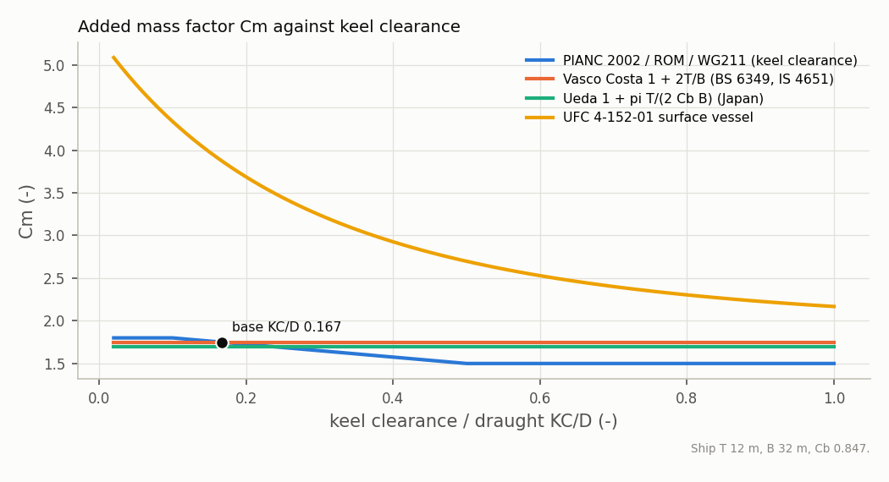
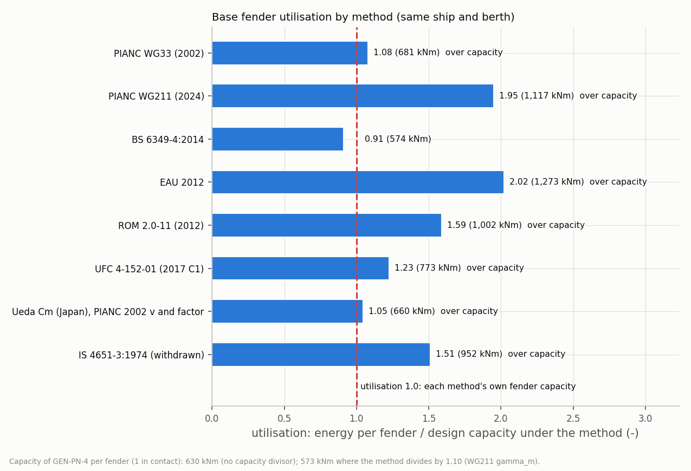
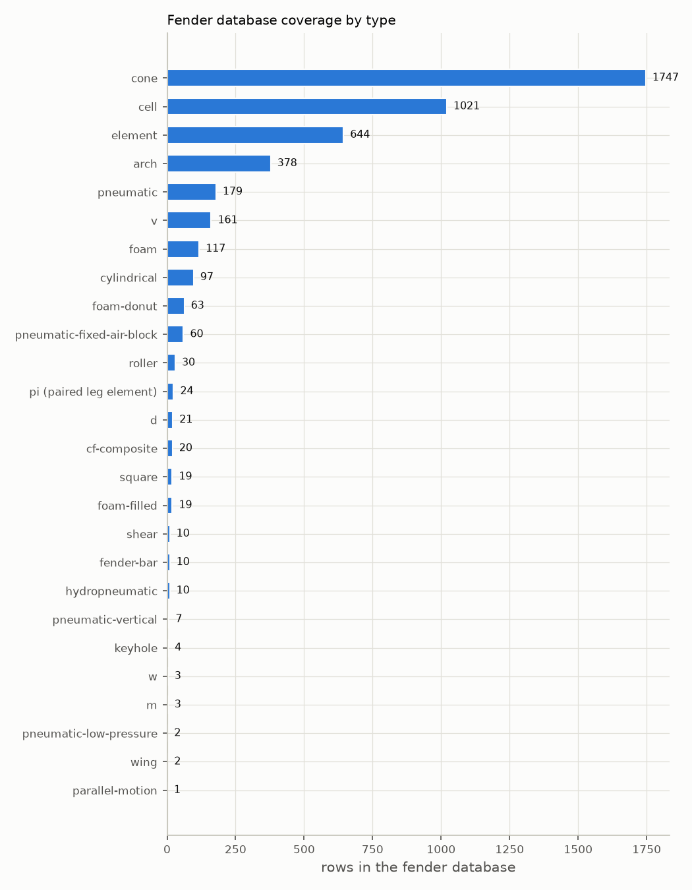
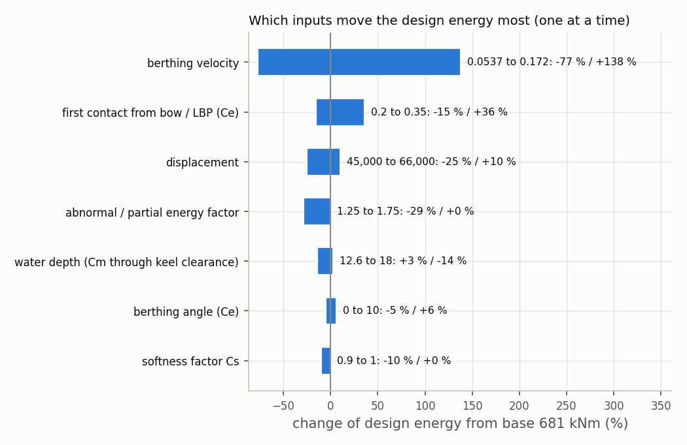
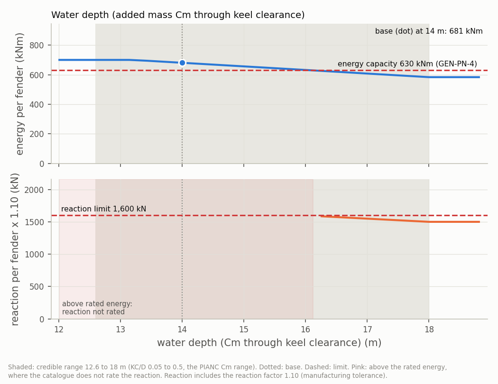
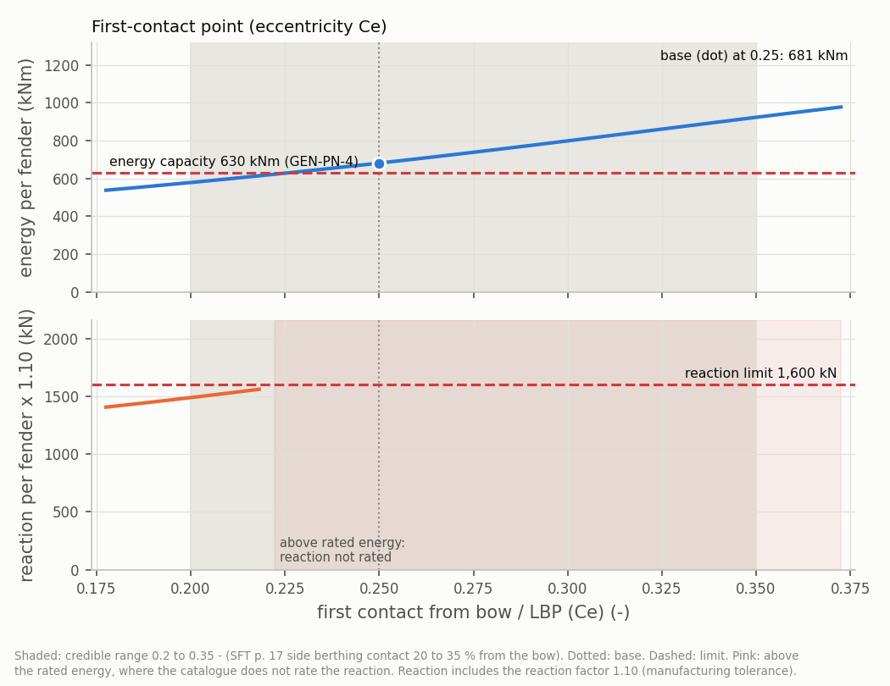
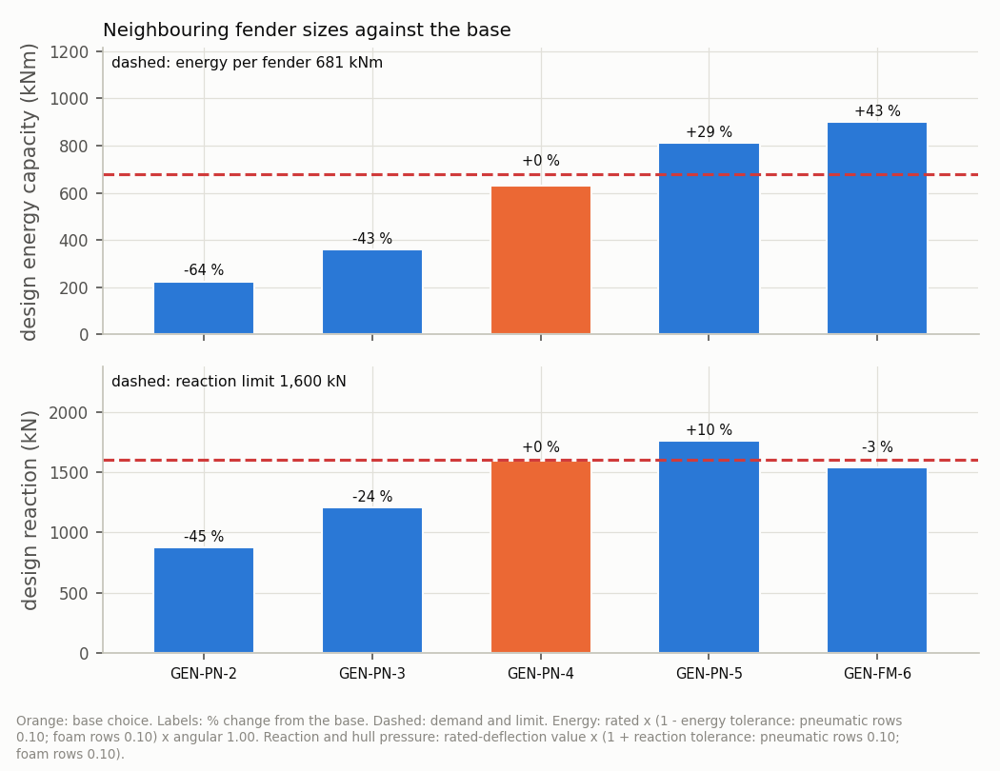

# Fender design: methods, coefficients, database and sensitivity (generic method report, revision 4)

Living method report for the berthing-energy design of ship fenders. It sits beside the
calculation module `digitalmodel.hydrodynamics.fender_design` (with
`digitalmodel.hydrodynamics.berthing_energy`), the fender database in `data/fender_design/`,
the universal workbook generator and the study script in
`examples/hydrodynamics/fender_design/`. Every number in this report is regenerated by
`fender_study.py` from `generic_case.yaml`; the workbook `fender-design-generic.xlsx` beside
this report is the same case with live formulas. Citation mode for this build: `record`
(Section 10).

The worked case is a generic Supramax-class bulk carrier in round numbers at an open berth
with illustrative (fictional) fenders. It demonstrates the method. It is not a design, and
no result here clears a fender for any berth.

## 1. Summary

- Eight berthing-energy methods are implemented, each coefficient with its source and how
  that source was verified: PIANC WG33 (2002), PIANC WG211 (2024), BS 6349-4:2014, EAU 2012,
  ROM 2.0-11, UFC 4-152-01, the Ueda added mass used in Japanese practice, and IS 4651-3:1974
  (withdrawn, for comparison).
- For the same ship and berth the design energy ranges from the lowest to the highest method
  by about a factor of two (Table 3; Figure 3 gives the fender utilisation by method). The
  spread comes mostly from the velocity each method assigns, then from the design factor; the
  energy equation itself is common.
- For the generic case the design energy by the selected method, PIANC WG33 (2002), is
  680.8 kNm (normal energy 389.1 kNm). The illustrative base fender has a
  capacity of 630.0 kNm, a utilisation of 1.081.
- Base fender GEN-PN-4 (Table 7): energy utilisation 1.081 against 1.0 at the 10 % pneumatic energy tolerance (**not met**; 0.973, met, at the 0 % of SFT p. 26 for guaranteed energy absorption (GEA); Section 3.6); design reaction 1,595 kN against the 1,600 kN limit (met, margin 0.3 %); design hull pressure 231 kPa against the 200 kPa limit (**not met**, 15.5 % over). The base fender therefore **fails** the energy and hull pressure checks, and is not a solution for this case as it stands. Of the neighbouring sizes in Table 7, only GEN-FM-6 meets every check at the tolerances of its type (GEN-FM-6: utilisation 0.756, design reaction 1,540 kN, margin 3.7 %, hull pressure 198 kPa, margin 1.0 %); the fenders are illustrative, so this is not a selection.
- Assumed values are collected in Table 10, each marked "ASSUMED - to be confirmed".
- One-at-a-time sensitivity (Section 7) ranks the inputs. In this case the three largest
  are: berthing velocity; first contact from bow / LBP (Ce); displacement. The berthing velocity enters squared and is the
  largest single term in this case.
- Each method result carries a citation sidecar for the standards behind its coefficients.
  This report was generated with the explicit citation opt-out (citation mode `record`, `--allow-unresolved-citations`): the default mode `strict` stops the calculation while the cited wiki pages are missing. Every unresolved citation is flagged on its result and listed below. (Section 10, Table 9.)
- Four errors recur in spreadsheets and are checked by the module and tests (Section 3.7):
  K² in place of R² cos² φ in the eccentricity numerator; the moulded depth entered as the
  draught; K computed from L_OA; and a velocity from one method combined with the factors of
  another.

## 2. Berthing energy

All methods share the kinetic-energy form

E_N = ½ · M · v_B² · C_m · C_e · C_s · C_c   (kNm with M in t and v_B in m/s)

and differ in how v_B and each coefficient are chosen and in the factor applied to reach
the design energy:

- deterministic methods (PIANC 2002, BS 6349-4, EAU, ROM, UFC): E_d = F · E_N, with F an
  abnormal (accidental) impact factor;
- PIANC WG211 (2024): a semi-probabilistic format, E_k,d = γ_E · E_k,c with a characteristic
  velocity, C_s and C_c removed, and the fender capacity divided by a material factor
  γ_m before comparison.

M is the displacement at the berthing draught. The draught is the berthing draught, never
the moulded depth.

## 3. Coefficients and their sources

Verification levels used throughout: **full-text** (read in the document), **secondary**
(read in a named document that reproduces it, usually a manufacturer's design manual),
**formula** (closed form of the cited paper, reproduced in the documents named) and
**digitized** (read off a published figure, about ±0.02 m/s). Secondary values should be
checked against the primary document before they are used as a design basis. Table 8 lists
every source with the date it was read. The PIANC WG33 (2002) values used here were checked
against the primary text, read from a held copy: section 4.2.4 (C_e and K = (0.19 C_b + 0.11) L), 4.2.5 (keel-clearance
C_m 1.8 / 1.5, linear between; Ueda and Vasco Costa with their validity limits; longitudinal
approach 1.1), 4.2.6 (C_s, p. 21), 4.2.7 (C_c, p. 22), Table 4.2.5 (abnormal factor), Fig. 4.2.1
(keyed by DWT; curves d and e to be used with caution) and Table 4.4.1 (bulk carriers below
200 kN/m²). The Brolsma values themselves are read from the manuals' table of Fig. 4.2.1 and
stay secondary.

### 3.1 Berthing velocity

- **PIANC 2002, Fig. 4.2.1 (Brolsma et al. 1977), tug-assisted:** five curves, a (easy,
  sheltered) to e (difficult, exposed). PIANC keys the curves by **DWT**; BS 6349-4:2014
  Figure 9 prints the same numbers against **displacement**. The module takes the measure
  from the method chosen and interpolates log-log; it does not extrapolate beyond 1,000 to
  500,000 t. Values below 0.10 m/s are flagged "use with caution" and below 0.08 m/s "not
  recommended", as in the two manuals that reproduce the table. Curves d and e may be
  high and are to be used with caution.
- **PIANC WG211 (2024):** characteristic velocity at 0.02 % exceedance per berthing. Without
  site data the background paper uses 0.15 m/s (moderate) and 0.25 m/s (unfavourable). The
  favourable and monitored values in the module (0.125 and 0.115 m/s) are derived here from
  the published Weibull fits and are not printed values. The WG211 velocity table by vessel
  size was not available.
- **ROM 2.0-11:** Table 4.6.4.36 (with tugs) and 4.6.4.37 (without), by displacement and
  climate class; digitized. The plateau above 40,000 t is 0.08, 0.15 and 0.20 m/s.
- **UFC 4-152-01:** Figs. 5-3 and 5-4 by displacement in long tons, sheltered, moderate and
  exposed; digitized from the gridlines and converted to SI. Two independent readings of
  each figure differ by up to 0.015 ft/s, which is the stated limit (±0.015 ft/s). Fig. 5-3
  ("Small Ships (up to 20,000 tons)") and Fig. 5-4 ("Large Ship", from 5,000 LT) overlap from
  5,000 to 20,000 LT. There the module takes, for each class, the larger of the two figures:
  Fig. 5-3 is higher for the moderate class (0.73 against 0.66 ft/s at 5,000 LT) and Fig. 5-4
  for the sheltered class from 8,000 LT. Below 5,000 LT it reads Fig. 5-3 and above 20,000 LT
  Fig. 5-4. The generic ship (59,052 LT) is outside the overlap.
- **EAU 2012:** characteristic values, favourable, normal and unfavourable; digitized at two
  sizes only (5,000 DWT and 50,000 DWT and above).
- **IS 4651-3:1974:** step table by displacement band and site condition.

Table 1 gives the Brolsma values the module uses at selected sizes; Figure 1 compares the
methods.

| Size (t) | a | b | c | d | e |
|---|---|---|---|---|---|
| 5,000 | 0.117 | 0.236 | 0.352 | 0.459 | 0.558 |
| 10,000 | 0.094 | 0.192 | 0.287 | 0.377 | 0.448 |
| 20,000 | 0.074 | 0.153 | 0.228 | 0.303 | 0.355 |
| 50,000 | 0.052 | 0.110 | 0.164 | 0.221 | 0.258 |
| 100,000 | 0.039 | 0.083 | 0.126 | 0.171 | 0.201 |
| 200,000 | 0.028 | 0.062 | 0.095 | 0.131 | 0.158 |

Table 1 – Brolsma design berthing velocity (m/s) by size (t) and curve a to e; DWT for PIANC
2002, displacement for BS 6349-4.

Figure 1 – Design berthing velocity against ship size by method.

### 3.2 Added mass C_m

| Method | Formula | Validity and pairing | Source |
|---|---|---|---|
| PIANC 2002 (also ROM, WG211 example, EAU) | 1.8 at KC/D ≤ 0.1; 1.875 − 0.75 KC/D; 1.5 at KC/D ≥ 0.5 | use with C_c = 1.0 (the manuals' pairing rule: TFADM p. 27, SFT p. 18) | full-text (PIANC WG33 (2002) 4.2.5); ROM p. 265 full-text |
| Vasco Costa (1964) (BS 6349-4, IS 4651) | 1 + 2T/B | v ≥ 0.08 m/s, KC ≥ 0.1T; pair with C_c | formula (also in PIANC WG33 (2002) 4.2.5) |
| Ueda (1981) (Japanese practice) | 1 + πT/(2 C_b B) | pair with C_c | formula (also in PIANC WG33 (2002) 4.2.5) |
| UFC 4-152-01 surface vessels | C_M0 + (C_m1 − C_M0)(T/d)^3.5, C_M0 = 1.3 + 1.5T/B, C_m1 = F[12.4(T/B)^0.3 − 50T/L] | F = 1.5C_b (C_b < 0.6) or 0.9; the C_b in F is read two ways (printed wording: the berthing coefficient C_e·C_g·C_d·C_c, Eq. 5-2, p. 106, restated p. 109; alternative: the block coefficient), option `ufc_f_basis`, this build `berthing_coefficient` | full-text |
| Longitudinal approach | 1.1 | | full-text (PIANC WG33 (2002) 4.2.5) |

Table 2 – Added-mass methods.

The UFC form rises steeply in shallow water (T/d near 1) and gives values well above the
others there; UFC itself notes that added mass may exceed PIANC below a depth/draught of 1.2.
The C_b inside the UFC factor F is a source ambiguity. The printed wording on p. 109 is
"C_b = berthing coefficient as defined previously", that is C_e·C_g·C_d·C_c of Equation 5-2
(p. 106); the block coefficient has its own symbol (C_BL, p. 107). The threshold 0.6 and the
form 1.5 C_b read as a hull-form limit, which supports the block coefficient instead. The
source text does not settle it, so both readings are an explicit option: the case option
`ufc_f_basis` takes `berthing_coefficient` (the default, the printed wording) or
`block_coefficient`, and the workbook carries the same choice as the live input UFCF (1 or 0).
This build uses `berthing_coefficient`. For the generic case the UFC design energy is
773.0 kNm under the berthing-coefficient reading and 874.3 kNm under the
block-coefficient reading. Under the berthing-coefficient reading the UFC C_m depends on the
contact point; the UFC curve in Figure 2 uses the C_b in F of the base case. TR-6074-OCN, which
UFC cites for the added mass, was not read, so the reading is not resolved against that source.
Figure 2 shows the four forms for the generic ship.

Figure 2 – Added mass factor against keel clearance for the generic ship.

### 3.3 Eccentricity C_e

C_e = (K² + R² cos² φ) / (K² + R²), K = (0.19 C_b + 0.11) L_BP (PIANC 2002 4.2.4).
R is the distance from the first-contact point to the centre of mass, taken at mid-L_BP on
the centreline unless the LCG is known. φ is the angle between the velocity vector (normal
to the berth) and R; for a contact forward of midships with berthing angle α,
φ = 90° − α − asin(B/2R), the form printed in the ShibataFenderTeam manual (the module
computes φ from the geometry and the test suite checks it equals this form).

- For the generic case: C_b 0.847, K 48.76 m, R 47.76 m, φ 65.4°, C_e 0.595. These are
  from the ship and berth in the form above, whichever method is selected.
- The selected method (`pianc2002`) gives these geometry fields: `cb` 0.847, `k_m` 48.763, `r_m` 47.760, `phi_deg` 65.427, `ce` 0.595.
- UFC uses C_e = k²/(a² + k²) with a the contact distance along the ship axis (φ = 90°).
- IS 4651 uses (1 + (l/r)² sin² θ)/(1 + (l/r)²) with r = L/4.
- Typical values for orientation (manufacturers' manuals): quarter point about 0.5,
  third point about 0.7, midships 1.0.

### 3.4 Softness C_s and berth configuration C_c

- C_s: PIANC WG33 (2002) 4.2.6 (p. 21) gives 1.0 for soft fenders and smaller vessels and 0.9
  to 1.0 for hard fenders and larger vessels, and concludes a general value of 1.0. The module
  takes 1.0 by default (`cs_basis` `pianc2002`, source `pianc2002-cs`). The 0.15 m deflection
  figure is BS 6349-4's definition of a hard fender, which the Trelleborg manual (p. 27) and
  the ShibataFenderTeam manual (p. 20) apply as C_s 0.9 at or below 0.15 m; the module offers
  that rule only when the caller selects it (`cs_basis` `tfadm-2024`, source `tfadm-2024`). ROM
  has its own rule (0.9 also for ships of 300 m and longer). WG211 removes C_s. This build uses
  `pianc2002`.
- C_c: PIANC WG33 (2002) 4.2.7 (p. 22) gives 1.0 for open berths and corners of quay walls,
  "generally 0.9" for solid quay walls under parallel approach, and no cushion effect above
  a 5° approach angle (1.0). Its text adds that the cushion effect "will hardly occur" with a
  large keel clearance, but it prints no threshold. It gives no value for a partly closed
  berth and no 0.8. The module takes these values by default (`cc_basis` `pianc2002`, source
  `pianc2002-cc`), with the keel-clearance condition stated: at a solid quay and an angle of 5°
  or less, C_c is 0.9 when KC/D is below 0.15 and 1.0 when KC/D is 0.15 or more. The 0.15
  threshold is the Trelleborg manual's reading (p. 27: 0.9 for a keel clearance below 15 % of
  the draught), so the 1.0 result names that manual as its source (Table 10). For a partly
  closed berth the module takes 1.0, the open-berth value, as an assumption (Table 10). The
  ShibataFenderTeam table (p. 20: solid quay 0.8 at KC/D ≤ 0.5 or 0.9 above, partly closed 0.9
  or 1.0) is an option the caller selects (`cc_basis` `sft-2026`, source `sft-2026`); it is never
  cited as PIANC. With the PIANC keel-clearance C_m, C_c is 1.0: this pairing is the manuals'
  rule (Trelleborg p. 27, "usually assumed"; ShibataFenderTeam p. 18), not a clause of 4.2.7.
  ROM and UFC keep their own C_c (ROM 0.9 for a solid quay; UFC 0.8). WG211 removes C_c. This
  build uses `pianc2002`; the generic berth is open, so its C_c is 1.0 under either basis.

### 3.5 Design factor

- PIANC 2002 Table 4.2.5 (full-text): tankers, bulk and cargo 1.25 (largest) to 1.75
  (smallest); container 1.5 to 2.0; general cargo 1.75; Ro-Ro and ferries 2.0 or more; tugs
  2.0. PIANC gives no rule between largest and smallest; the module takes the caller's
  choice. One manual reads "largest" by class (Capesize and above for bulk carriers, Handymax
  and smaller take 1.75); the other reading is the largest ships using the berth. The
  choice changes the design energy by 40 % and is carried as a sensitivity.
- BS 6349-4: energy factor 2.0 for gas carriers at LNG facilities (secondary); otherwise
  the PIANC table is used by the module, as the BS table itself was not read.
- EAU: the module applies the PIANC 2002 Table 4.2.5 factor and labels it so (source
  `pianc2002`). The ShibataFenderTeam manual (p. 22) says the factors were "also adopted by
  EAU-2004"; the EAU 2012 text was not read.
- ROM 2.0-11 Table 4.6.4.43: product of four factors (displacement ≤ 85,000 t 1.50 else
  1.25; without tugs 1.25; v ≤ 0.10 m/s 1.20; more than 300 calls a year 1.15), scaled by
  (T_R/500)^(1/20), not below 1.10.
- UFC 4-152-01 5-1.5.3: accidental berthing energy at least 50 % above normal (1.5).
- WG211: γ_E = γ_Eref · γ_n · γ_p · γ_c, with γ_Eref by navigation condition, spread of
  displacements (CoV_M), consequence class A to D and single or multiple contact, and γ_n
  = a ln(n) + b for n berthings a year (background-paper tables). The fender capacity is
  divided by γ_m = 1.10 (worked example). CoV_M defaults to `low`, the column with the largest
  factor; `moderate` or `high` gives a smaller factor and needs a basis in the spread of
  displacements using the berth (the generic case assumes `high`, Table 10). γ_n is not
  extrapolated below one berthing a year, where the logarithm turns negative (γ_E would fall
  below 1 under 0.22 a year for class B); the range of the fit was not read.

### 3.6 Fender performance

- Capacity = rated energy × (1 − energy tolerance) × angular × velocity × temperature
  factors at the slowest velocity and highest temperature; maximum reaction = rated reaction
  × (1 + reaction tolerance) × velocity × temperature factors at the fastest velocity and
  lowest temperature (Trelleborg manual p. 30; SFT p. 26).
- Tolerances (Trelleborg manual p. 76, performance tolerances on reaction and energy):
  moulded rubber ±10 %, extruded ±20 %, foam ±10 %, pneumatic ±10 %. Each fender type takes
  its own tolerance: the case's `energy_tolerance` and `reaction_tolerance` apply to the base
  fender's type, and `tolerances_by_type` gives every other type in the catalogue (a catalogue
  with another type and no entry for it is refused). The generic case gives foam 0.10 on
  energy and reaction, the printed value.
- Pneumatic energy tolerance: the sources conflict. The Trelleborg table (p. 76) gives ±10 %
  on energy; the ShibataFenderTeam manual (p. 26) gives 0 % on energy for guaranteed energy
  absorption (GEA, ISO 17357-1). The module takes the tolerance the case gives (default 0.10);
  the generic case takes 10 %, the reading that gives the lower capacity, since 0 % rests on
  the supplier's GEA rating (Table 10). Both verdicts follow. For the base fender GEN-PN-4 the energy utilisation is 1.081 at 10 % (**not met**) and 0.973 at 0 % (met); this build takes 10 %.
- Angular factor: a reduction only, in (0, 1]. Vendor factors above 1 for cone fenders at
  small angles (Trelleborg p. 36; R24B Table 4 C_ang 1.03 to 1.05) are not credited in the
  design path; `wg211_fender_capacity` takes C_ang as given only to reproduce the R24B example.
- Velocity factor by compression time t = d/(0.74 v) and temperature factor by compound are
  tabulated in the module (Trelleborg manual p. 35). Between rows the factor for minimum
  energy is read at the next higher tabulated time (the smaller factor) and the factor for
  maximum reaction at the next lower (the larger). The table stops at 20 s, where the blend
  and SBR factors are still above 1.00, so beyond 20 s the module needs to know the use:
  for minimum energy it takes 1.00, as the manual's worked example does at 48 s (pp. 39–40);
  for maximum reaction it holds the 20 s value, an upper bound because the factor does not
  rise with time. Without the use stated, a time beyond 20 s is an error.
- Hull pressure guidance (PIANC 2002 Table 4.4.1, full-text): bulk carriers below 200 kPa;
  other values in `HULL_PRESSURE_KPA`. The sources disagree for bulk carriers (one paper lists
  200 to 320 kPa for WG33); the module uses 200 kPa and records the conflict.
- Reaction at part energy is read from a normalised curve when one is supplied; without a
  curve the rated reaction is used as an upper bound. A curve must run from 0 % to at least
  100 % of rated energy; a shorter curve is refused, because a reaction outside its data is
  not supported by them. A curve may fall after buckling and rise again, so the reaction at
  part energy is the largest reached along the curve up to that energy, not the value at the
  final energy; for a reaction that does not fall the two are the same. Where a curve exceeds
  100 % before the rated point, the rated reaction of every row of its fender type is
  multiplied by that peak over 100 % (neighbouring sizes and the workbook Fenders sheet).
  Every reaction compared with a limit
  (selection, sweeps, charts) is multiplied by the reaction factor, here 1.10 (the +10 %
  manufacturing tolerance): the rated-deflection design reaction of the base fender is
  1,595 kN.
- Hull pressure is compared at rated deflection only (catalogue value × reaction factor). The
  pressure at part load is not calculated: no pressure-deflection relationship is sourced,
  and scaling the rated pressure by reaction would assume the rated contact area at every
  deflection.

### 3.7 Errors checked by the module and the tests

1. **Eccentricity numerator.** (K² + K² cos² φ)/(K² + R²) is not the PIANC form. For the
   generic case it gives 0.599 against 0.595. `eccentricity_k2_numerator` exists only
   to quantify the error.
2. **Moulded depth as draught.** Block coefficient, keel clearance and added mass all use the
   berthing draught. A depth entered as draught lowers C_b and either removes the keel
   clearance or makes it look generous.
3. **K from L_OA.** K uses L_BP.
4. **Mixed bases.** A WG211 velocity (0.02 % exceedance) combined with WG33 factors, or a
   DWT-keyed velocity read at the displacement, changes the energy without any change of
   assumption. Each method in the module carries its own basis.

Plausibility checks on the inputs: a block coefficient M/(ρ L_BP B T) above 1 is refused,
and one outside 0.45 to 0.9 is flagged on every result (an assumed range, Table 10). The
berthing angle is below 90° in magnitude, and its sign agrees with the end of first contact:
with the bow nearer the berth (angle above 0) the first contact is in the forward half, with
the stern nearer (below 0) in the aft half. The other sign would put the contact on the far
end and lower C_e (to −14 % for the generic ship at −19.6°). The workbook applies the same
rules to its inputs.

## 4. Comparison of methods

| Method | v (m/s) | Cm | Ce | Cs | Cc | Other | Normal (kNm) | Factor | Design (kNm) | Per fender / capacity | Flags |
|---|---|---|---|---|---|---|---|---|---|---|---|
| PIANC WG33 (2002) | 0.112 | 1.750 | 0.595 | 1.00 | 1.00 | 1.00 | 389.1 | 1.75 | 680.8 | 1.081 | - |
| PIANC WG211 (2024) | 0.150 | 1.750 | 0.595 | 1.00 | 1.00 | 1.00 | 702.9 | 1.59 | 1,116.9 | 1.950 | WG211 factors from the 2024 background papers; final guideline tables not read |
| BS 6349-4:2014 | 0.102 | 1.750 | 0.595 | 1.00 | 1.00 | 1.00 | 328.2 | 1.75 | 574.3 | 0.912 | - |
| EAU 2012 | 0.153 | 1.750 | 0.595 | 1.00 | 1.00 | 1.00 | 727.1 | 1.75 | 1,272.5 | 2.020 | EAU velocities digitized at two sizes only |
| ROM 2.0-11 (2012) | 0.150 | 1.750 | 0.595 | 1.00 | 1.00 | 0.95 | 667.8 | 1.50 | 1,001.7 | 1.590 | - |
| UFC 4-152-01 (2017 C1) | 0.099 | 3.427 | 0.540 | 1.00 | 1.00 | 0.95 | 515.3 | 1.50 | 773.0 | 1.227 | below 0.10 m/s: use with caution (TFADM p. 23) |
| Ueda Cm (Japan), PIANC 2002 v and factor | 0.112 | 1.696 | 0.595 | 1.00 | 1.00 | 1.00 | 376.9 | 1.75 | 659.7 | 1.047 | - |
| IS 4651-3:1974 (withdrawn) | 0.200 | 1.750 | 0.504 | 0.90 | 1.00 | 1.00 | 952.2 | 1.00 | 952.2 | 1.511 | withdrawn standard; comparison only |

Table 3 – Design berthing energy by method for the generic case (same ship and berth). The
"per fender / capacity" column is energy per fender over the base fender capacity under that
method (for WG211 the capacity is divided by γ_m). Flags in bold put a formula outside its
stated validity; such a result is outside the method's basis and is shown for comparison
only. The citation qualification common to all rows is in Table 9.

Figure 3 – Utilisation of the base fender by method: energy per fender over the fender
capacity under that method (for WG211 divided by γ_m), against the limit 1.0. Each method is
compared with its own capacity, and a bar beyond 1.0 is over capacity. The bar label gives
the design energy. A hatched bar is outside the stated validity of a formula it uses (note
below the chart).

| Method | Velocity basis | Cm basis | Factor basis |
|---|---|---|---|
| PIANC WG33 (2002) | pianc2002-velocity: curve b (difficult berthing, sheltered) at 48,000 DWT | pianc2002-cm: pianc2002; KC/D = 0.167 | pianc2002: PIANC 2002 Table 4.2.5, bulk, smallest ships |
| PIANC WG211 (2024) | pianc-wg211: moderate: R24B default without site data (pp. 976-979) | pianc2002-cm: keel clearance rule (as in the R24B example); KC/D = 0.167 | pianc-wg211: gamma_Eref 1.59 (class B, moderate, CoV_M high, single contact) x gamma_n 0.999 (100/yr); gamma_p = gamma_c = 1.0 |
| BS 6349-4:2014 | bs6349-4-velocity: curve b (difficult berthing, sheltered) at 60,000 t | vasco-costa-1964: vasco_costa; KC/D = 0.167 | pianc2002: PIANC 2002 Table 4.2.5, bulk, smallest ships; BS 6349-4 own factor table not read |
| EAU 2012 | eau-2012: moderate (normal), characteristic value, digitized | pianc2002-cm: pianc2002; KC/D = 0.167 | pianc2002: PIANC 2002 Table 4.2.5, bulk, smallest ships; applied to EAU (SFT p. 22: adopted by EAU-2004; the EAU 2012 text was not read) |
| ROM 2.0-11 (2012) | rom-2.0-11: Table 4.6.4.36, moderate, digitized | rom-2.0-11: 1.8 / 1.5 keel-clearance rule (p. 265); KC/D = 0.167 | rom-2.0-11: Table 4.6.4.43 product (with tugs, 100 calls/yr, T_R 500 yr) |
| UFC 4-152-01 (2017 C1) | ufc-4-152-01: Figs. 5-3/5-4, moderate (sheltered/moderate/exposed), digitized; Fig. 5-3 below 5,000 LT; larger of Figs. 5-3 and 5-4 from 5,000 to 20,000 LT; Fig. 5-4 above | ufc-4-152-01: 5-2.1.1 e surface vessels; F 0.770 from berthing coefficient Ce Cg Cd Cc = 0.513 (Eq. 5-2, p. 106; p. 109, printed wording; the block coefficient reading is the alternative) | ufc-4-152-01: 5-1.5.3: increase by at least 50 % |
| Ueda Cm (Japan), PIANC 2002 v and factor | pianc2002-velocity: curve b (difficult berthing, sheltered) at 48,000 DWT | ueda-1981: ueda; KC/D = 0.167 | pianc2002: PIANC 2002 Table 4.2.5, bulk, smallest ships |
| IS 4651-3:1974 (withdrawn) | is-4651-3-1974: Table 2 | is-4651-3-1974: 5.2.1.2: 1 + 2D/B | is-4651-3-1974: no abnormal factor in the method |

Table 4 – Basis of the velocity, added mass and factor for each method.

Observations for this case:

- PIANC 2002 with Brolsma curve b gives v = 0.112 m/s; ROM, EAU and WG211
  (moderate) give 0.15 m/s; the difference alone is a factor (0.15/0.112)² on energy.
- BS 6349-4 reads the same curve at the displacement (larger than DWT), so its velocity is
  lower: 0.102 m/s.
- UFC pairs a lower velocity with a much higher shallow-water added mass.
- Methods should not be averaged. One method is selected for a design, with the reasons;
  the others show how far the result depends on that choice.

## 5. Fender database

`data/fender_design/` holds the database schema (`database_schema.yaml`), the catalogue
index (`catalogue_index.csv`: catalogue, edition, URL, fender types, row count, date read)
and illustrative rows for tests and examples. The rated values themselves come from
manufacturers' catalogues and are held in a private vendor table with a citation per row
(catalogue, page or table, value method, date read); `scripts/fender_design/import_vendor_tables.py`
converts that table into the schema and into the selection-catalogue layout the workbook
reads. The database currently holds 4,652 rows from 14 catalogues (Figure 4):
cone, cell, element, arch, V, cylindrical and other solid rubber types, and pneumatic, foam,
foam-filled and hydropneumatic floating fenders. Float levels of floating fenders are not
published in the catalogues read.

Each row keeps its performance basis: RPD (rated performance at the PIANC initial velocity),
CV (slow constant velocity) or GEA (guaranteed energy absorption, floating fenders). The
selection catalogue written by the importer carries the basis, and both the importer and the
case loader refuse a catalogue in which one fender type holds rows on different bases: a CV
and an RPD row of the same size are two ratings of one fender, not two fenders. Where the
vendor tables hold both, one basis is chosen at export (`--perf-basis`).

Figure 4 – Rows in the fender database by fender type.

## 6. Universal workbook

`build_fender_workbook.py` writes an xlsx from a case file and a catalogue:

- **Inputs:** the case values with their basis (yellow cells), including berth structure,
  fender deflection, tugs, calls a year, continuous berth and an optional velocity override.
  Below them, in red, the choices fixed at generation (method, Brolsma condition, condition
  class, ship type, factor position or override, WG211 class, CoV_M and contact, the C_s and
  C_c bases, the tolerances of fender types other than the base fender's, fender and curve):
  these select table rows or constants, and changing one needs the workbook to be
  regenerated.
- **Calc:** C_b, K, R, φ, C_e (and the error form), KC/D, C_m by four methods, the UFC and
  IS 4651 eccentricity, C_s, C_c and C_g by method, as live formulas.
- **Velocity:** the Brolsma table and log-log interpolation at the DWT and displacement, and
  the digitized UFC, ROM (with and without tugs) and EAU tables, live.
- **Methods:** design energy by every method. Every coefficient that depends on an Inputs
  value is a formula: velocity by size (or the override), C_m, C_e, C_s, C_c, C_g, the ROM
  accidental factor (displacement, tugs, velocity, calls) and the WG211 frequency correction.
  The flags column is written at generation.
- **Fenders:** the catalogue with live capacity, utilisation, design reaction and checks
  against the limits on Inputs.
- **Sensitivity, Tornado, Sizes:** written by the generator, with charts, and marked in red
  "regenerate after any input change".
- **Sources:** the source register.

The test suite recomputes the workbook's formulas and checks C_b, K, R, φ, C_e, every
method's design energy and the fender utilisation against the module. It then changes ten
inputs (displacement, DWT, depth, contact point, angle, structure, fender deflection, calls a
year, tugs, continuous berth) so that each threshold is crossed, recomputes, and checks every
method's velocity, C_m, C_e, C_s, C_c, factor and design energy against the module run on
the changed case; and it checks that the velocity override cell drives every method (ROM
factor 1.80 at 0.08 m/s).

## 7. Sensitivity

Each input is moved alone over a credible range with every other input at its base. Each
chart shows the energy per fender with the base fender's capacity, and below it the
reaction per fender, multiplied by the reaction factor 1.10, with the reaction limit; the
credible range is shaded and the base is marked. Above the rated energy the catalogue does
not rate the reaction, and the chart says so. A velocity sweep re-evaluates the method at
each velocity, so velocity-dependent coefficients (the ROM accidental factor and C_c) follow
it. A C_c sweep re-evaluates the method with C_c given, so terms derived from C_c follow it
(the UFC 4-152-01 added mass, through the berthing coefficient C_e C_g C_d C_c in its factor
F, under the berthing-coefficient reading). Only coefficients the method uses are swept, within the values its own rule gives;
the inputs left out for this method are:

| Input | Why it is not swept for this method |
|---|---|
| cc | Cc is 1.0 with the PIANC keel-clearance Cm, which already includes the confined-water effect (pairing rule of the manuals: TFADM p. 27, SFT p. 18) |

| Input | Base | Credible range | Basis | Design energy change at range ends | Utilisation at range ends | Value at utilisation 1 | Reaction x 1.10 at range ends (kN) | Value at reaction limit |
|---|---|---|---|---|---|---|---|---|
| berthing velocity | 0.1116 m/s | 0.0537 to 0.172 m/s | Brolsma conditions a to c at 48,000 DWT | -77 % / +138 % | 0.250 / 2.567 | 0.1073 m/s | 575 / not rated | - |
| displacement | 60,000 t | 45,000 to 66,000 t | part-loaded to 10 % above the base | -25 % / +10 % | 0.811 / 1.189 | 55,520 t | 1,353 / not rated | - |
| water depth (Cm through keel clearance) | 14 m | 12.6 to 18 m | KC/D 0.05 to 0.5, the PIANC Cm range | +3 % / -14 % | 1.112 / 0.926 | 16.09 m | not rated / 1,501 | - |
| first contact from bow / LBP (Ce) | 0.25 | 0.2 to 0.35 | SFT p. 17 side berthing contact 20 to 35 % from the bow | -15 % / +36 % | 0.918 / 1.465 | 0.2262 | 1,490 / not rated | - |
| berthing angle (Ce) | 5 deg | 0 to 10 deg | TFADM p. 22 side berthing angles | -5 % / +6 % | 1.027 / 1.144 | - | not rated / not rated | - |
| softness factor Cs | 1 | 0.9 to 1 | PIANC WG33 (2002) 4.2.6, p. 21: 0.9 to 1.0 hard fenders and larger vessels, 1.0 soft | -10 % / +0 % | 0.973 / 1.081 | 0.9253 | 1,560 / not rated | - |
| abnormal / partial energy factor | 1.75 | 1.25 to 1.75 | PIANC 2002 Table 4.2.5 bulk carriers, largest to smallest | -29 % / +0 % | 0.772 / 1.081 | 1.619 | 1,304 / not rated | - |

Table 5 – One-at-a-time sensitivity of the design energy by the selected method,
PIANC WG33 (2002), for the generic case. A utilisation is given to three decimals, and to
more where three would round it onto 1.000. The value at utilisation 1 is solved on the method,
not interpolated between swept points (which drifts at a coefficient break such as the C_m
kink at KC/D 0.1): berthing velocity, displacement, first contact from bow / LBP (Ce), softness factor Cs, abnormal / partial energy factor: bisection on the method between the bracketing swept points; water depth (Cm through keel clearance): closed form: keel-clearance Cm 1.61933 needed (base Cm 1.75000 / base utilisation 1.08070).

Figure 5 – Ranking of inputs by the span of design energy over their credible ranges.

| Rank | Input | Span of design energy (percentage points) |
|---|---|---|
| 1 | berthing velocity | 214 |
| 2 | first contact from bow / LBP (Ce) | 51 |
| 3 | displacement | 35 |
| 4 | abnormal / partial energy factor | 29 |
| 5 | water depth (Cm through keel clearance) | 17 |
| 6 | berthing angle (Ce) | 11 |
| 7 | softness factor Cs | 10 |

Table 6 – Ranking.

Figure 6 – Berthing velocity.

Figure 7 – Displacement.

Figure 8 – Water depth (C_m through keel clearance).

Figure 9 – First-contact point (C_e).

Figure 10 – Berthing angle (C_e).

Figure 11 – Softness factor C_s.

Figure 12 – Abnormal (or partial) energy factor.

## 8. Neighbouring fender sizes

| Fender | Rated energy (kNm) | Design capacity (kNm) | Utilisation | Rated reaction (kN) | Design reaction (kN) | Design hull pressure (kPa) | Energy | Reaction <= 1,600 kN | Pressure <= 200 kPa |
|---|---|---|---|---|---|---|---|---|---|
| GEN-PN-4 (base) | 700 | 630 | 1.081 | 1,450 | 1,595 | 231 | **no** | yes | **no** |
| GEN-PN-2 | 250 | 225 | 3.026 | 800 | 880 | 143 | **no** | yes | yes |
| GEN-PN-3 | 400 | 360 | 1.891 | 1,100 | 1,210 | 148 | **no** | yes | yes |
| GEN-PN-5 | 900 | 810 | 0.841 | 1,600 | 1,760 | 165 | yes | **no** | yes |
| GEN-FM-6 | 1,000 | 900 | 0.756 | 1,400 | 1,540 | 198 | yes | yes | yes |

Table 7 – Illustrative fenders against the energy per fender and the limits, with the
design adjustments of each fender's type. Energy: rated x (1 - energy tolerance: pneumatic rows 0.10; foam rows 0.10) x angular 1.00. Reaction and hull pressure: rated-deflection value x (1 + reaction tolerance: pneumatic rows 0.10; foam rows 0.10). The reaction and pressure are the
values at rated deflection, an upper bound for part load when the curve does not exceed the
rated reaction before the rated point (Section 3.6).

Figure 13 – Neighbouring sizes: design energy capacity against energy per fender and design
reaction against the limit (adjustments as Table 7).

## 9. Verification

The tests (`tests/hydrodynamics/fender_design/`) reproduce published worked examples:

- Roubos et al. (2024), Example 1 (LNG jetty): WG33 velocities by DWT (curves b and c,
  0.076 and 0.115 m/s), BS 6349-4 velocity by displacement (0.100 m/s) and Vasco Costa C_m
  (1.45), PIANC C_m (1.73), WG211 characteristic energy (2,590 and 1,151 kNm), design
  energies (4,659, 1,783, 1,901 and 1,926 kNm) and the WG211 fender capacity (1,784 kNm),
  each within 1 to 3 % (printed coefficients are rounded to two decimals);
- ShibataFenderTeam Design Manual (2026) p. 19: C_b, K, R, φ and C_e (0.761) for a laden
  tanker at third-point contact;
- Trelleborg Fender Application Design Manual (2024) pp. 39–40: compression time, velocity
  and temperature factors, maximum reaction (1,172 kN) and minimum energy (512 kNm), the
  latter with the velocity factor computed by the module at the 48.6 s compression time
  (1.00), not entered by hand;
- Roubos et al. (2024), Example 1, WG211 factor from the tables: γ_Eref · γ_n for class B,
  CoV_M `low`, single contact, 100 calls a year gives 1.819 (moderate) and 1.569 (monitored)
  against the printed 1.80 and 1.55, and design energies within 1.5 % of 4,659 and 1,783 kNm;
- ROM 2.0-11 Table 4.6.4.43 under a velocity override: at 0.08 m/s the accidental factor is
  1.80, and the result equals ROM's own result where its table gives 0.08 m/s;
- UFC 4-152-01 added mass: an independent hand calculation from the UFC text (LBP 180 m,
  B 32 m, T 12 m, d 14 m, block coefficient 0.4, midships contact, 0.10 m/s) gives berthing
  coefficient 1.0, F 0.9, C_m 3.876 and design energy 823.7 kNm;
- citation sidecar: by default a missing page or an unconfigured wiki stops the
  calculation; the explicit opt-out records and flags it; a page whose code_id, publisher or
  revision differs (or that has no frontmatter) stops the calculation in every mode;
- IS 4651-3 Table 3 eccentricity values; hand checks of every method, of the sweeps and of
  the workbook formulas.

## 10. Limitations

- PIANC WG33 (2002) was read in the primary text for the values listed in Section 3; the
  Brolsma velocities are still the manuals' tabulation of its Fig. 4.2.1. PIANC WG211 (2024)
  was not read directly; its values are secondary (two 2024 papers by members of WG211). The
  WG211 partial factors are the background paper's derivation; the final guideline tables may
  differ, and the WG211 velocity table by vessel size is not included.
- BS 6349-4, EAU and the Japanese standards were not read directly. ROM, UFC and EAU
  velocities are digitized from figures.
- Hull-pressure guidance differs between sources (Section 3.6), and so does the pneumatic
  energy tolerance (10 % or 0 %; 10 %, the lower capacity, is the default, Section 3.6). The
  solid-quay C_c is the PIANC WG33 (2002) value by default, with the Trelleborg keel-clearance
  threshold (Section 3.4); the vendor table is an explicit option.
- The sweeps are one at a time; combined adverse values are not shown and are not the sum
  of the individual changes.
- Ship-to-ship (floating fender between ships) energy and dolphin layout methods are not
  implemented.
- The wiki standards pages the citation sidecars point to are not yet written, so the
  default citation mode (`strict`) refuses to calculate; this build used citation mode
  `record` (Section 1). A result whose citation is not resolved is flagged
  "citation not resolved against the wiki" (Table 9); its values rest on the source register
  only (Table 8).

## 11. Sources

| Id | Document | Edition | Clause | Verification | Read in | Date read |
|---|---|---|---|---|---|---|
| pianc2002 | PIANC MarCom WG33, Guidelines for the Design of Fender Systems | 2002 | section 4.2 (energy), Table 4.2.5 (abnormal factor), Table 4.4.1 (hull pressure) | full-text | PIANC WG33 (2002), primary text (held copy); also Trelleborg Fender Application Design Manual MN-FEN-V4.0-EN (2024) pp. 23-28, 46; ShibataFenderTeam Design Manual (English, 2026) pp. 17-22, 33 | 2026-11-16 |
| pianc2002-velocity | PIANC 2002 design berthing velocity (Brolsma et al. 1977 curves a to e) | 2002 | Fig. 4.2.1; table keyed by DWT | secondary | Trelleborg Fender Application Design Manual MN-FEN-V4.0-EN (2024) p. 23 | 2026-11-16 |
| bs6349-4-velocity | BS 6349-4:2014 design berthing velocity (Brolsma curves) | 2014 | Figure 9; keyed by displacement | secondary | ShibataFenderTeam Design Manual (English, 2026) p. 21 | 2026-11-15 |
| bs6349-4 | BS 6349-4:2014 Maritime works. Code of practice for design of fendering and mooring systems | 2014 | berthing energy (as summarised) | secondary | ShibataFenderTeam Design Manual (English, 2026) pp. 4, 18, 21-22; Trelleborg Fender Application Design Manual MN-FEN-V4.0-EN (2024) pp. 15, 23 | 2026-11-15 |
| vasco-costa-1964 | Vasco Costa, F. The berthing ship | 1964 | Cm = 1 + 2D/B; valid for v >= 0.08 m/s and UKC >= 0.1 D | formula | Trelleborg Fender Application Design Manual MN-FEN-V4.0-EN (2024) p. 24; ShibataFenderTeam Design Manual (English, 2026) p. 18; PIANC WG33 (2002), primary text (held copy) section 4.2.5 | 2026-11-16 |
| ueda-1981 | Ueda, S. et al. added mass of berthing ships | 1981 | Cm = 1 + pi D / (2 Cb B) | formula | Trelleborg Fender Application Design Manual MN-FEN-V4.0-EN (2024) p. 24; ShibataFenderTeam Design Manual (English, 2026) p. 18; PIANC WG33 (2002), primary text (held copy) section 4.2.5 | 2026-11-16 |
| pianc2002-cm | PIANC 2002 added mass from keel clearance | 2002 | section 4.2.5 | full-text | PIANC WG33 (2002), primary text (held copy); also ShibataFenderTeam Design Manual (English, 2026) p. 18; Trelleborg Fender Application Design Manual MN-FEN-V4.0-EN (2024) p. 24 | 2026-11-16 |
| pianc2002-ce | PIANC 2002 eccentricity | 2002 | section 4.2.4 | full-text | PIANC WG33 (2002), primary text (held copy); also Trelleborg Fender Application Design Manual MN-FEN-V4.0-EN (2024) p. 25; ShibataFenderTeam Design Manual (English, 2026) p. 19 | 2026-11-16 |
| pianc2002-cc | PIANC 2002 berth configuration factor | 2002 | section 4.2.7, p. 22 | full-text | PIANC WG33 (2002), primary text (held copy) p. 22 | 2026-11-16 |
| pianc2002-cs | PIANC 2002 softness factor | 2002 | section 4.2.6, p. 21 | full-text | PIANC WG33 (2002), primary text (held copy) p. 21 | 2026-11-16 |
| tfadm-2024 | Trelleborg Fender Application Design Manual MN-FEN-V4.0-EN (2024) | 2024 | pp. 22-46 | full-text |  | 2026-11-15 |
| sft-2026 | ShibataFenderTeam Design Manual (English, 2026) | 2026 | pp. 17-36 | full-text |  | 2026-11-15 |
| iso17357-1 | ISO 17357-1:2014 Ships and marine technology. Floating pneumatic rubber fenders | 2014 | performance at 60 % deflection (GEA) | secondary | Trelleborg Pneumatic Fenders BC-PNE-V6-EN (2025) pp. 8-9; Yokohama floating fender web table | 2026-11-15 |
| pianc-wg211 | PIANC MarCom WG211, Guidelines for the Design of Fender Systems | 2024 | semi-probabilistic format: E_k,d = gamma_E E_k,c; E_f,d = E_f,c / gamma_m; Cs and Cc removed | secondary | Roubos, Iversen, Oskamp (2024) Backgrounds partial energy factors for fender design, 35th PIANC World Congress, pp. 959-966 (Eq. 3-18, Tables 3, 8, 9, 12); Roubos, Mirihagalla, Gaal, Blankers, Groenewegen (2024) Comparison of fender dimensions, PIANC WG211 and PIANC WG33, 35th PIANC World Congress, pp. 973-982 (Tables 1-4) | 2026-11-15 |
| ufc-4-152-01 | UFC 4-152-01 Design: Piers and Wharves | 2017, Change 1 2024 | 5-2.1 (Eq. 5-1, 5-2; Ce, Cg, Cd, Cc, Cm), 5-1.5.3 (+50 % accidental), Figs. 5-3 and 5-4 | full-text | WBDG copy | 2026-11-16 |
| rom-2.0-11 | ROM 2.0-11 Recomendaciones para el proyecto y ejecucion en obras de atraque y amarre | June 2012 | 4.6.4.4.3 (energy, Cm, Ce, Cg, Cc, Cs), Table 4.6.4.36 (velocity with tugs), Table 4.6.4.43 (accidental factors), Table 4.6.4.42 (hull pressure) | full-text | Puertos del Estado PDF (archived copy, Spanish) | 2026-11-15 |
| eau-2012 | EAU 2012 Recommendations of the Committee for Waterfront Structures (9th English ed.) | 2012 | R 38, R 40 (berthing velocity), R 60 (fenders for large vessels) | secondary | Roubos et al. (2017) Eq. 8-12 and Fig. 1; SFT p. 18, 22 | 2026-11-15 |
| is-4651-3-1974 | IS 4651 (Part III):1974 Code of practice for planning and design of ports and harbours, Loading | 1974 (withdrawn; superseded 2020) | 5.2.1 (energy, Cm, Ce, Cs), Table 2 (velocity), 5.2.2 | full-text | BIS scan | 2026-11-15 |

Table 8 – Source register (`fender_design.SOURCES`), with the date each source was read for it.

| Citation (code_id) | Wiki page | Methods | Status |
|---|---|---|---|
| PIANC-WG33-2002 | wikis/marine-engineering/wiki/standards/pianc-wg33-2002.md | pianc2002, wg211, bs6349, eau, ueda | unresolved: page_missing |
| PIANC-WG211-2024 | wikis/marine-engineering/wiki/standards/pianc-wg211-2024.md | wg211 | unresolved: page_missing |
| BS-6349-4 | wikis/marine-engineering/wiki/standards/bs-6349-4.md | bs6349 | unresolved: page_missing |
| vasco-costa-1964 | wikis/marine-engineering/wiki/concepts/vasco-costa-1964-berthing-added-mass.md | bs6349 | unresolved: page_missing |
| EAU-2012 | wikis/marine-engineering/wiki/standards/eau-2012.md | eau | unresolved: page_missing |
| ROM-2.0-11 | wikis/marine-engineering/wiki/standards/rom-2-0-11.md | rom | unresolved: page_missing |
| UFC-4-152-01 | wikis/marine-engineering/wiki/standards/ufc-4-152-01.md | ufc | unresolved: page_missing |
| ueda-1981 | wikis/marine-engineering/wiki/concepts/ueda-1981-berthing-added-mass.md | ueda | unresolved: page_missing |
| IS-4651-3 | wikis/marine-engineering/wiki/standards/is-4651-3.md | is4651 | unresolved: page_missing |

Table 9 – Citation sidecar of the method results and its resolution status when this report
was built (`fender_design.CITATION_TARGETS`).

| Assumed value | Where it enters | Used in this case | Status | Basis |
|---|---|---|---|---|
| UFC 4-152-01 C_c 0.9 for a partly closed berth | UFC method, `semi_closed` structure | no | ASSUMED - to be confirmed | UFC prints 1.0 (open) and 0.8 (solid) and 'in between'; the midpoint is taken |
| C_c 1.0 for a partly closed berth (PIANC basis) | PIANC 2002, Ueda, BS 6349-4, EAU; `semi_closed`, angle 5° or less | no | ASSUMED - to be confirmed | PIANC WG33 (2002) 4.2.7 gives no partly closed value; the open-berth value (no reduction) is taken |
| WG211 γ_m = 1.10 | WG211 fender capacity divisor | yes | ASSUMED - to be confirmed | the R24B worked example (Table 4); the final guideline value was not read |
| WG211 favourable and monitored velocities 0.125 and 0.115 m/s | WG211 velocity | no | ASSUMED - to be confirmed | derived from the R24A Weibull fits at 0.02 % exceedance; not printed values |
| WG211 γ_n not extrapolated below 1 berthing a year | WG211 frequency correction | no | ASSUMED - to be confirmed | the range of validity of R24A Table 9 was not read |
| WG211 CoV_M `high` | WG211 γ_Eref column | yes | ASSUMED - to be confirmed | generic case: a berth used by ships of widely varying displacement; the module default is `low`, the largest factor |
| ROM 2.0-11 return period T_R = 500 yr | ROM accidental factor (T_R/500)^(1/20) | yes | ASSUMED - to be confirmed | the table's reference period; no site return period is given |
| Pneumatic energy tolerance 0.10 | base fender capacity (Table 7; workbook ETOL) | yes | ASSUMED - to be confirmed | the sources conflict: TFADM p. 76 ±10 %, SFT p. 26 0 % on GEA; 10 % is taken (the lower capacity of the two); 0 % needs the supplier's GEA rating to ISO 17357-1. Base utilisation 1.081 at 10 % / 0.973 at 0 % |
| C_c solid quay 0.15 KC/D limit (PIANC basis) | PIANC 2002, Ueda, BS 6349-4, EAU; `closed`, angle 5° or less, Vasco Costa or Ueda C_m: 0.9 below the limit, 1.0 at or above it | no | ASSUMED - to be confirmed | PIANC WG33 (2002) 4.2.7 prints 'generally 0.9' and says the cushion effect 'will hardly occur' with a large keel clearance, with no threshold; 0.15 is the Trelleborg p. 27 reading |
| Block coefficient plausibility range 0.45 to 0.9 | a flag on every method result outside it (above 1 the ship is refused) | check only | ASSUMED - to be confirmed | span of merchant hull forms; not a value from the cited standards |
| Reaction limit 1,600 kN | reaction checks | yes | ASSUMED - to be confirmed | illustrative structural limit of the generic case |

Table 10 – Assumed values, each to be confirmed before a design uses it.
